# 01 – Actors & Use Cases

Phạm vi: **MVP** (German A1 + Info Hub), theo PD-08 và [CR-001](../change-requests/CR-001-german-first.md). Các use case của V2+ chỉ liệt kê để giữ chỗ.

## 1. Actors

| Actor | Mô tả | Quyền chính |
|---|---|---|
| **Guest** | Khách chưa đăng nhập | Xem landing page, catalog, giới thiệu khóa học, **bài học mẫu** (bài đầu tiên của mỗi khóa), Info Hub |
| **Student** | Người học đã đăng ký | Toàn bộ chức năng học, luyện tập, thi thử, xem tiến độ, báo lỗi |
| **Admin** | Chủ dự án. Kiêm Content Manager ở MVP | Quản trị nội dung, import, duyệt, Info Hub, xử lý báo lỗi, quản lý người dùng, dashboard |
| *System (Scheduler)* | Tác vụ nền | Tự nộp bài thi khi hết giờ, gắn cờ bài Info Hub quá hạn rà soát, dọn token hết hạn |
| *External: Email service* | Gửi email | Xác minh email, đặt lại mật khẩu |
| *External: Azure Speech, Claude API* | Chỉ được gọi từ CMS | Tạo audio, tạo bản nháp nội dung |

> Vai trò **Content Manager** và **Teacher** được tách ở V2+. Ngay từ MVP, quyền vẫn được thiết kế theo *permission* (ví dụ `content.publish`) chứ không theo tên vai trò. Nhờ vậy, khi tách vai trò sau này không phải sửa code nghiệp vụ.

## 2. Use case diagram (tổng quan)

```mermaid
flowchart LR
  Guest((Guest))
  Student((Student))
  Admin((Admin))
  Sys((System))

  subgraph Identity
    UC01[UC-01 Đăng ký]
    UC02[UC-02 Xác minh email]
    UC03[UC-03 Đăng nhập / Đăng xuất]
    UC04[UC-04 Quên & đặt lại mật khẩu]
    UC05[UC-05 Hồ sơ & mục tiêu học]
    UC06[UC-06 Xóa tài khoản]
  end
  subgraph Learning
    UC07[UC-07 Xem catalog]
    UC08[UC-08 Tham gia khóa học]
    UC09[UC-09 Học bài]
    UC10[UC-10 Tra từ vựng]
    UC11[UC-11 Xem điểm ngữ pháp]
    UC12[UC-12 Làm bài tập]
    UC13[UC-13 Bài kiểm tra cuối cấp]
    UC14[UC-14 Xem kết quả & giải thích]
    UC15[UC-15 Xem tiến độ]
    UC16[UC-16 Đọc Info Hub]
    UC17[UC-17 Báo lỗi nội dung]
  end
  subgraph ContentOps
    UC20[UC-20 Quản lý cấu trúc chương trình]
    UC21[UC-21 Soạn bài học]
    UC22[UC-22 Quản lý từ vựng & ngữ pháp]
    UC23[UC-23 Quản lý ngân hàng câu hỏi]
    UC24[UC-24 Quản lý blueprint & đề thi]
    UC25[UC-25 Import dữ liệu]
    UC26[UC-26 Tạo bản nháp bằng AI]
    UC27[UC-27 Duyệt & xuất bản]
    UC28[UC-28 Quản lý nguồn & giấy phép]
    UC29[UC-29 Quản lý bài Info Hub]
    UC30[UC-30 Xử lý báo lỗi]
    UC31[UC-31 Dashboard]
    UC32[UC-32 Quản lý người dùng]
    UC33[UC-33 Tạo audio TTS]
  end

  Guest --> UC01 & UC03 & UC04 & UC07 & UC16
  Guest -.bài mẫu.-> UC09
  Student --> UC05 & UC06 & UC08 & UC09 & UC10 & UC11 & UC12 & UC13 & UC14 & UC15 & UC17
  Admin --> UC20 & UC21 & UC22 & UC23 & UC24 & UC25 & UC26 & UC27 & UC28 & UC29 & UC30 & UC31 & UC32 & UC33
  Sys --> UC13
  Sys --> UC29
```

## 3. Danh sách use case

| ID | Tên | Actor | Ưu tiên MVP |
|---|---|---|---|
| UC-01 | Đăng ký tài khoản (email + mật khẩu) | Guest | Must |
| UC-01b | Đăng nhập bằng Google | Guest | **Must** (Q-P2-01) |
| UC-02 | Xác minh email | Student | Must |
| UC-03 | Đăng nhập / Đăng xuất | Guest/Student | Must |
| UC-04 | Quên & đặt lại mật khẩu | Guest | Must |
| UC-05 | Cập nhật hồ sơ, chọn mục tiêu học | Student | Must |
| UC-06 | Xóa tài khoản và dữ liệu cá nhân | Student | Must (yêu cầu pháp lý) |
| UC-07 | Xem catalog: ngôn ngữ, chương trình, khóa học | Guest/Student | Must |
| UC-08 | Tham gia (enroll) khóa học | Student | Must |
| UC-09 | Học bài | Student (Guest: bài mẫu) | Must |
| UC-10 | Tra từ vựng | Student | Must |
| UC-11 | Xem điểm ngữ pháp | Student | Must |
| UC-12 | Làm bài tập (luyện tập) | Student | Must |
| UC-13 | Làm bài kiểm tra cuối cấp có tính giờ | Student, System | Must |
| UC-14 | Xem kết quả, đáp án, giải thích | Student | Must |
| UC-15 | Xem tiến độ học | Student | Must |
| UC-16 | Đọc bài Info Hub | Guest/Student | Must |
| UC-17 | Báo lỗi nội dung | Student | Must |
| UC-20 | Quản lý Language / Program / Level / Course / Unit / Lesson | Admin | Must |
| UC-21 | Soạn nội dung bài học (khối nội dung) | Admin | Must |
| UC-22 | Quản lý từ vựng, câu ví dụ, điểm ngữ pháp | Admin | Must |
| UC-23 | Quản lý ngân hàng câu hỏi | Admin | Must |
| UC-24 | Quản lý blueprint đề và đề thi thử | Admin | Must |
| UC-25 | Import CSV/JSON (và ETL qua CLI) | Admin | Must |
| UC-26 | Tạo bản nháp bằng AI và kiểm tra chéo | Admin | Should |
| UC-27 | Duyệt và xuất bản nội dung | Admin | Must |
| UC-28 | Quản lý nguồn dữ liệu và giấy phép | Admin | Must |
| UC-29 | Quản lý bài Info Hub và chu kỳ rà soát | Admin, System | Must |
| UC-30 | Xử lý báo lỗi | Admin | Must |
| UC-31 | Xem dashboard thống kê | Admin | Must |
| UC-32 | Quản lý người dùng (xem, khóa, mở khóa) | Admin | Should |
| UC-33 | Tạo audio TTS cho mục từ, câu, câu hỏi | Admin | Should |
| *Release 1.1 / V2* | A2 (1.1). B1, Flashcard và SRS, tiếng Đức cho Ausbildung, phản hồi Schreiben bằng AI, streak, nhắc học qua email (V2) | — | Won't (MVP) |

---

## 4. Đặc tả các use case trọng yếu

### UC-01 – Đăng ký tài khoản
| Mục | Nội dung |
|---|---|
| Actor | Guest |
| Tiền điều kiện | Chưa đăng nhập |
| Luồng chính | 1. Guest mở trang Đăng ký. 2. Nhập tên hiển thị, email, mật khẩu, xác nhận mật khẩu. 3. Tick ô "Tôi đồng ý Điều khoản và Chính sách quyền riêng tư (nếu dưới 16 tuổi: đã được cha mẹ hoặc người giám hộ đồng ý)". 4. Hệ thống kiểm tra dữ liệu (BR-AUTH-01..04). 5. Hệ thống tạo tài khoản ở trạng thái **Unverified** và gửi email xác minh. 6. Hệ thống đăng nhập luôn và chuyển tới trang **chọn mục tiêu** (UC-05) |
| Luồng thay thế | 4a. Email đã tồn tại: báo "Email đã được dùng", gợi ý Đăng nhập / Quên mật khẩu. Không tiết lộ thêm thông tin khác. 4b. Mật khẩu yếu: báo lỗi ngay tại trường nhập |
| Hậu điều kiện | Có tài khoản, có bản ghi đồng ý (thời điểm + phiên bản điều khoản) |
| Quy tắc | BR-AUTH-01..06, BR-PRIV-01 |

### UC-09 – Học bài
| Mục | Nội dung |
|---|---|
| Actor | Student (Guest chỉ được học bài mẫu) |
| Tiền điều kiện | Bài học ở trạng thái Published. Student đã enroll khóa học (hệ thống tự enroll khi mở bài đầu tiên) |
| Luồng chính | 1. Mở bài học. 2. Hệ thống hiển thị lần lượt các **khối nội dung** (văn bản, từ vựng, ngữ pháp, hội thoại, audio, bài tập cuối bài). 3. Student nghe audio, xem từ. 4. Student làm bài tập cuối bài (UC-12). 5. Hệ thống ghi tiến độ và đánh dấu hoàn thành theo BR-PROG-01. 6. Gợi ý bài tiếp theo |
| Luồng thay thế | 1a. Guest mở bài không phải bài mẫu: yêu cầu đăng ký. 2a. Audio lỗi: hiện thông báo, vẫn cho học tiếp, kèm nút "Báo lỗi" |
| Hậu điều kiện | `LessonProgress` được cập nhật (lần mở cuối, trạng thái) |

### UC-12 – Làm bài tập (luyện tập)
| Mục | Nội dung |
|---|---|
| Actor | Student |
| Luồng chính | 1. Hệ thống hiển thị từng câu. 2. Student trả lời. 3. Hệ thống chấm **ngay** và hiện đúng/sai kèm giải thích (chế độ luyện tập). 4. Hết bộ câu: hiện tổng kết (số câu đúng, %) |
| Khác với thi thử | Không tính giờ. Xem đáp án ngay. Làm lại không giới hạn. Không có điểm thang 100 |
| Quy tắc | BR-ASM-01..08 |

### UC-13 – Làm bài kiểm tra cuối cấp có tính giờ (A1)
| Mục | Nội dung |
|---|---|
| Actor | Student. System (tự nộp bài) |
| Tiền điều kiện | Đã đăng nhập, đã xác minh email (BR-AUTH-07). Đề ở trạng thái Published |
| Luồng chính | 1. Student chọn đề, xem hướng dẫn (số câu, thời gian, cấu trúc). 2. Bấm "Bắt đầu". Hệ thống tạo `ExamAttempt` với `StartedAt` và `DeadlineAt` tính ở server. 3. Student làm bài theo từng phần (A1: Hören 20 phút rồi Lesen 25 phút, BR-EXAM-02, BR-EXAM-03). Câu trả lời được **lưu tự động** sau mỗi lần chọn. 4. Student bấm "Nộp bài" và xác nhận. 5. Hệ thống chấm điểm (BR-EXAM-05), tính mức đánh giá (BR-EXAM-11) và chuyển tới UC-14 |
| Luồng thay thế | 3a. Mất mạng hoặc đóng trình duyệt: mở lại trước `DeadlineAt` thì tiếp tục đúng chỗ, đồng hồ **không dừng**. 3b. Hết giờ: System tự nộp bài với các câu đã lưu (BR-EXAM-04). 2a. Đang có một lượt thi chưa nộp của cùng đề: hệ thống đề nghị tiếp tục lượt đó, không tạo lượt mới |
| Hậu điều kiện | `ExamAttempt` ở trạng thái Submitted / AutoSubmitted, có điểm, có snapshot câu hỏi |

### UC-25 – Import dữ liệu
| Mục | Nội dung |
|---|---|
| Actor | Admin |
| Tiền điều kiện | Nguồn (Source) và giấy phép (License) đã được khai báo (UC-28) |
| Luồng chính | 1. Admin chọn loại dữ liệu (Vocabulary / Example / Question). 2. Chọn Source (bắt buộc). 3. Tải file CSV/JSON theo template. 4. Hệ thống **chạy thử (dry-run)**: kiểm tra cấu trúc, trường bắt buộc, trùng lặp, license cho phép thương mại (BR-CNT-03). 5. Hiển thị báo cáo: số dòng hợp lệ, số dòng lỗi (kèm lý do), số dòng trùng. 6. Admin xác nhận. Hệ thống tạo `ImportBatch` và các bản ghi ở trạng thái **Draft**, kèm provenance đầy đủ |
| Luồng thay thế | 4a. License của Source không cho phép thương mại: **chặn** import (do PD-05). 6a. Admin hủy batch: xóa mọi bản ghi của batch **chưa từng publish** |
| Ghi chú | Dữ liệu lớn (kaikki `de-extract` 2,9 GB, Tatoeba, Leipzig) đi qua **công cụ CLI**, có cùng logic và ghi vào cùng bảng staging (AD-03) |

### UC-26 – Tạo bản nháp bằng AI
| Mục | Nội dung |
|---|---|
| Actor | Admin |
| Luồng chính | 1. Admin chọn mẫu (Prompt Template, ví dụ "Sinh 10 câu hỏi A1 – Lesen – chọn mạo từ der/die/das – chủ đề Gia đình"). 2. Chọn tham số (chủ đề, cấp độ, danh sách từ được phép dùng). 3. Hệ thống gọi API LLM và nhận kết quả có cấu trúc (JSON). 4. Hệ thống chạy **kiểm tra tự động** (BR-ASM-05) và **gọi AI kiểm định** (BR-CNT-07). 5. Lưu thành các bản ghi `Origin = AIDraft`, trạng thái Draft, kèm cờ cảnh báo. 6. Admin duyệt ở UC-27 |
| Luồng thay thế | 3a. API lỗi hoặc vượt hạn mức chi phí tháng (BR-CNT-08): báo lỗi, không tạo gì |

### UC-27 – Duyệt & xuất bản
| Mục | Nội dung |
|---|---|
| Actor | Admin |
| Luồng chính | 1. Mở hàng đợi duyệt, lọc theo loại, nguồn, cờ cảnh báo. 2. Xem từng mục theo checklist (BR-CNT-06). 3. Sửa nếu cần. 4. Chọn **Publish** hoặc **Trả về Draft** (kèm ghi chú). 5. Hệ thống ghi `ReviewedBy`, `ReviewedAt` và tăng `Version` |
| Quy tắc | Không publish được nếu thiếu Source/License (BR-CNT-01), hoặc nếu là câu hỏi chưa qua kiểm tra tự động |
