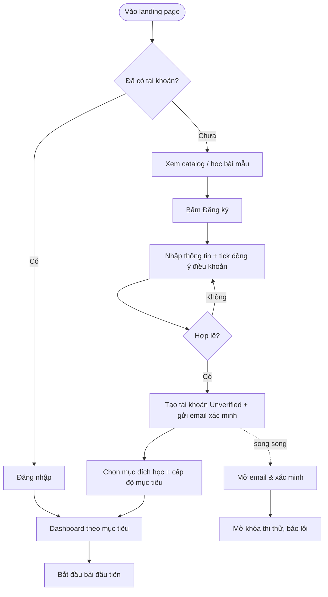
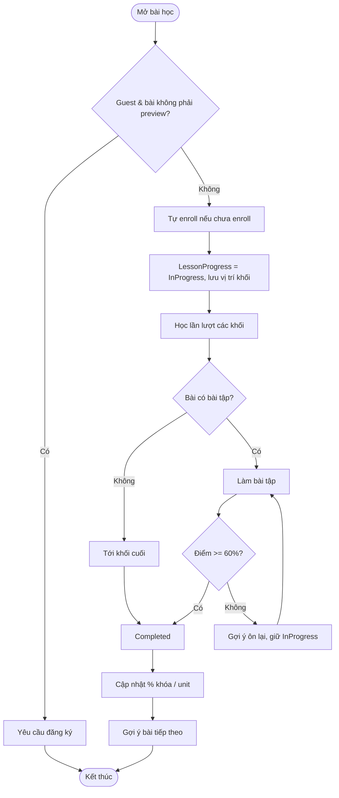
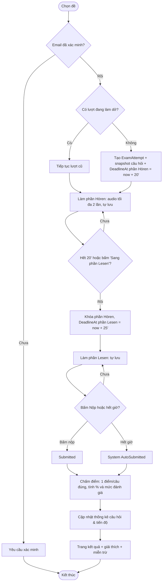
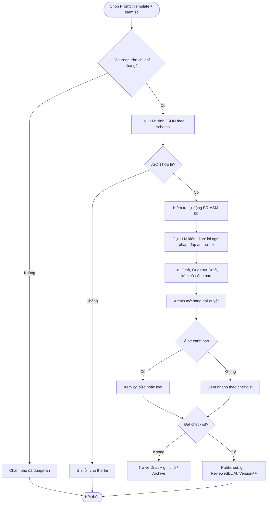
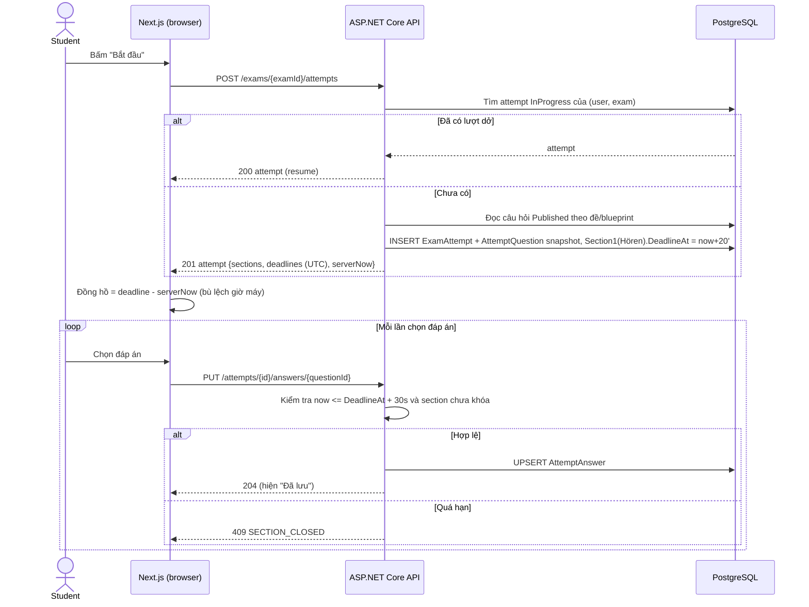
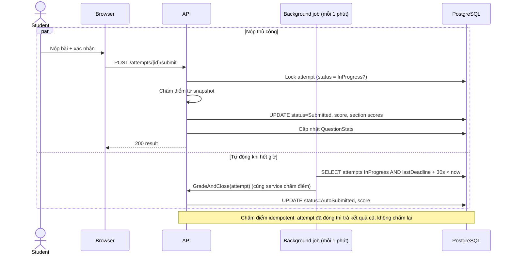
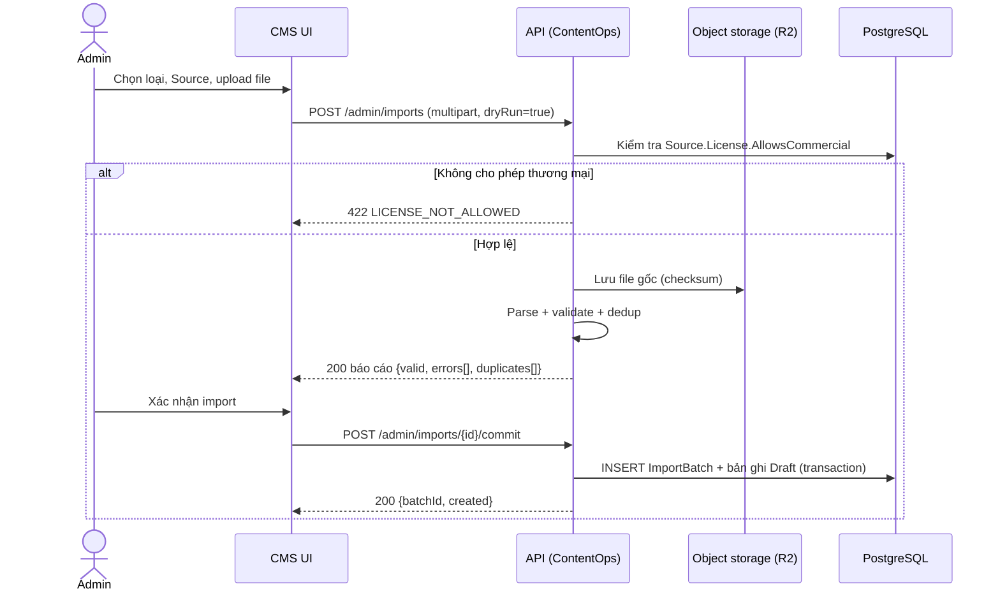
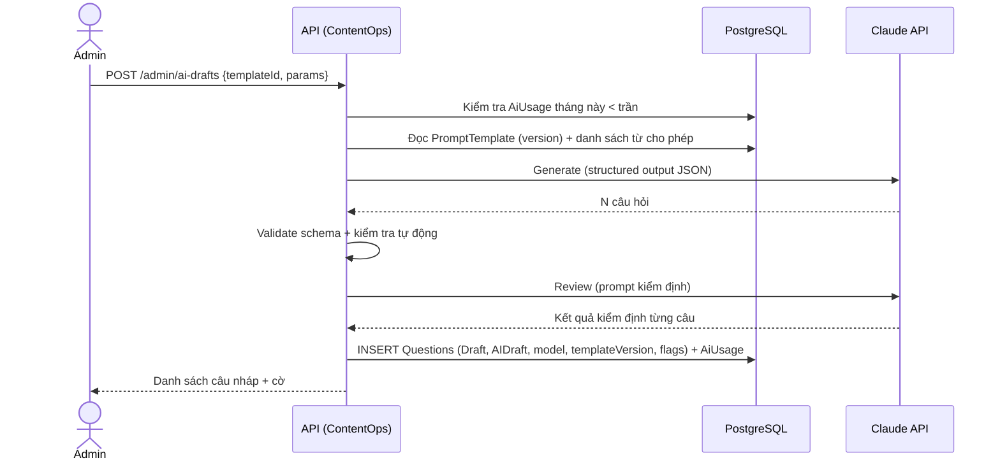
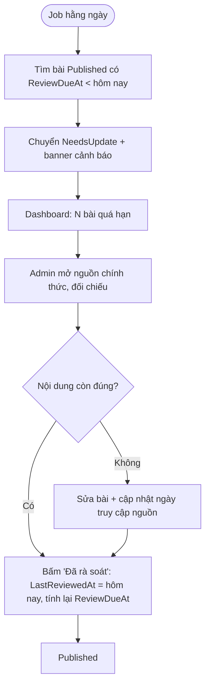
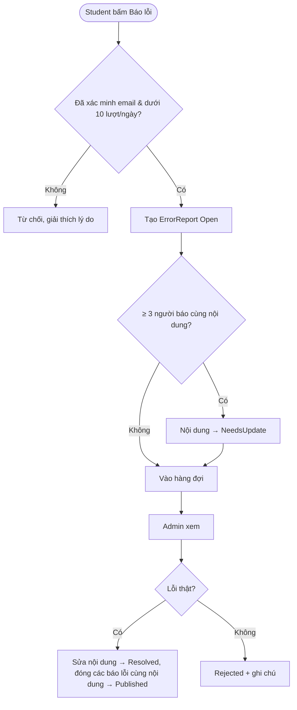

# 05 – Business Processes, Activity & Sequence Diagrams

Sơ đồ viết bằng Mermaid, hiển thị được trên GitHub và VS Code (cần extension Markdown Preview Mermaid).

## 1. Bản đồ quy trình nghiệp vụ

| Quy trình | Ai | Tần suất | Sơ đồ |
|---|---|---|---|
| P1. Người học mới bắt đầu | Guest → Student | Mỗi người dùng mới | §2 |
| P2. Học bài và cập nhật tiến độ | Student | Hằng ngày | §3 |
| P3. Bài kiểm tra cuối cấp | Student, System | Hằng tuần | §4, §7, §8 |
| P4. Nhập dữ liệu từ nguồn mở | Admin | Theo đợt | §5, §9 |
| P5. Tạo nội dung bằng AI và duyệt | Admin | Hằng tuần | §6, §10 |
| P6. Rà soát Info Hub | Admin, System | 3–6 tháng/bài | §11 |
| P7. Xử lý báo lỗi | Student → Admin | Liên tục | §12 |

---

## 2. Activity – Người học mới (P1)



## 3. Activity – Học bài và cập nhật tiến độ (P2)



## 4. Activity – Bài kiểm tra cuối A1 (P3)



## 5. Activity – Nhập dữ liệu (P4)

```mermaid
flowchart TD
  A([Tìm nguồn]) --> B[Xác minh nhà cung cấp & đọc giấy phép gốc]
  B --> C{License cho phép thương mại?}
  C -- Không / không rõ --> C1[Ghi NEEDS LEGAL VERIFICATION, dừng] --> Z([Kết thúc])
  C -- Có --> D[Tạo Source + License trong CMS]
  D --> E{Dữ liệu lớn?}
  E -- Có --> F[Tải file thô → CLI ETL: parse, chuẩn hóa]
  E -- Không --> G[Map sang template CSV/JSON → Upload trong CMS]
  F --> H[Dry-run: validate, dedup, kiểm license]
  G --> H
  H --> I{Admin chấp nhận báo cáo?}
  I -- Không --> J[Sửa mapping / file] --> H
  I -- Có --> K[Tạo ImportBatch, bản ghi Draft + provenance]
  K --> L[Xử lý trùng: bỏ qua / gộp / tạo mới]
  L --> M[Duyệt & Publish theo lô (P5)] --> Z
```

## 6. Activity – AI tạo bản nháp và duyệt (P5)



---

## 7. Sequence – Bắt đầu thi và lưu câu trả lời



## 8. Sequence – Nộp bài (thủ công và tự động)



## 9. Sequence – Import CSV trong CMS



## 10. Sequence – AI tạo câu hỏi


> Đồng bộ hay bất đồng bộ: tạo 20 câu có thể mất 20–60 giây. Ở Phase 3 cần chọn giữa (a) gọi đồng bộ có timeout dài, hoặc (b) job nền kèm polling. **Đề xuất (b)**, vì ổn định hơn với reverse proxy.

## 11. Activity – Rà soát Info Hub (P6)



## 12. Activity – Báo lỗi (P7)


