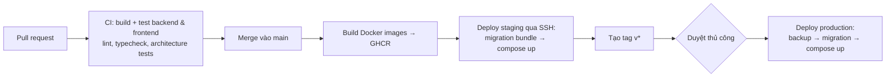

# 01 – System Architecture

Phạm vi: MVP German A1 + Info Hub (PD-08). Thiết kế cho **1 người phát triển, 1 VPS, ≤ ~10 USD/tháng** (Q5). Mỗi quyết định ghi theo khung: Vấn đề → Đề xuất → Lý do → Phương án thay thế → Đánh đổi.

## 1. Overall Architecture

```mermaid
flowchart LR
  U[Người học / Admin<br/>trình duyệt mobile & desktop] -->|HTTPS| CF[Cloudflare DNS + CDN<br/>(free)]
  CF --> CADDY
  subgraph VPS[VPS Ubuntu LTS – Docker Compose]
    CADDY[Caddy reverse proxy<br/>TLS tự động]
    WEB[Next.js app<br/>SSR trang public + UI học + /admin]
    API[ASP.NET Core API<br/>Modular Monolith + Background jobs]
    PG[(PostgreSQL)]
    BK[Backup job<br/>pg_dump → R2]
    CADDY -->|/ | WEB
    CADDY -->|/api/*| API
    WEB -->|SSR fetch nội bộ| API
    API --> PG
    BK --> PG
  end
  API -->|S3 API| R2[(Cloudflare R2<br/>media + backup)]
  CF -->|media.<domain>| R2
  API -->|SMTP/API| MAIL[Email provider]
  API -->|chỉ từ CMS| TTS[Azure Speech TTS]
  API -->|chỉ từ CMS| LLM[Claude API]
  API --> SENTRY[Sentry]
  WEB --> SENTRY
```

### AR-01 – Cùng origin: `/` cho Next.js, `/api` cho ASP.NET Core
- **Vấn đề:** frontend và backend tách nhau thì phải xử lý CORS, cookie qua nhiều domain và CSRF phức tạp.
- **Đề xuất:** một domain duy nhất. Caddy định tuyến `/api/*` sang API, mọi đường dẫn khác sang Next.js.
- **Lý do:** cookie xác thực HttpOnly hoạt động tự nhiên, không cần CORS, cấu hình đơn giản nhất.
- **Phương án thay thế:** `api.<domain>` riêng (cần CORS, cookie `Domain=.<domain>`), hoặc Next.js làm BFF proxy mọi request (thêm một chặng mạng).
- **Đánh đổi:** API và web dính chung một domain, điều này chấp nhận được với monolith.

### AR-02 – Next.js chỉ render phía server (SSR/ISR) cho trang công khai
- **Vấn đề:** cần SEO cho landing, catalog, Info Hub (NFR-14), nhưng không muốn xử lý xác thực ở hai nơi.
- **Đề xuất:**
  - **Trang công khai** (landing, catalog, chi tiết khóa, Info Hub, Attribution): Server Components gọi API **không kèm cookie** (dữ liệu công khai). Dùng ISR, revalidate 5–10 phút.
  - **Trang cần đăng nhập** (học, bài tập, kiểm tra, tiến độ, hồ sơ, admin): Client Components, gọi API bằng TanStack Query. Cookie được trình duyệt tự gửi.
- **Lý do:** server Next.js không bao giờ phải giữ hay chuyển tiếp phiên của người dùng, nên logic xác thực chỉ nằm ở ASP.NET Core.
- **Đánh đổi:** trang học không có SSR. Chấp nhận được vì trang này không cần SEO, chỉ hiển thị skeleton trong lúc tải.

### AR-03 – Modular Monolith (Confirmed AD-01)
Một tiến trình API, chia thành các module theo bounded context:

| Module | Trách nhiệm | Schema DB |
|---|---|---|
| **Identity** | Tài khoản, Google login, đồng ý điều khoản, hồ sơ, mục đích học, xóa tài khoản | `identity` |
| **Catalog** | Language, Program, Level, Course, Unit, Lesson, LessonBlock | `catalog` |
| **Lexicon** | Từ vựng (giống, số nhiều, chia động từ), câu ví dụ, chủ đề, điểm ngữ pháp | `lexicon` |
| **Assessment** | Câu hỏi, bộ bài tập, blueprint, đề, lượt làm bài, chấm điểm | `assessment` |
| **Progress** | Enrollment, tiến độ bài học, sự kiện trả lời, thống kê | `progress` |
| **InfoHub** | Bài viết, nguồn chính thức, chu kỳ rà soát | `infohub` |
| **ContentOps** | Source, License, Media, Import, AI drafts, TTS, báo lỗi, lịch sử phiên bản, dashboard | `content` |

**Quy tắc ranh giới:**
1. Module chỉ truy cập **bảng của chính nó** qua EF Core.
2. Module cần dữ liệu của module khác thì gọi qua **interface công khai** của module đó (ví dụ `ILexiconReader.GetEntries(ids)`), đặt trong thư mục `Contracts/`.
3. Cho phép **khóa ngoại** giữa các schema (ví dụ `catalog.lesson_vocabulary → lexicon.vocabulary_entries`) để giữ toàn vẹn dữ liệu. Đây là đánh đổi có chủ đích của monolith dùng chung một DB.
4. Ranh giới được kiểm tra bằng architecture test (NetArchTest) trong CI.

**Phương án thay thế:** mỗi module một project hoặc một DbContext riêng. Bị loại vì quá nhiều nghi thức cho một người. Sẽ tách khi thật sự cần.

## 2. Backend Architecture

### 2.1 Tổ chức bên trong module: Vertical Slice
Mỗi tính năng là một "slice" gồm request, validator, handler, endpoint, nằm chung một thư mục. Domain entity và EF configuration đặt chung trong module.

```
Request (HTTP) → Endpoint (Minimal API) → Validator (FluentValidation) → Handler → AppDbContext / services
                                                                              ↓
                                                                       Result<T> → HTTP response
```

| Thành phần | Lựa chọn | Lý do / phương án thay thế |
|---|---|---|
| HTTP | **Minimal APIs** theo nhóm endpoint của mỗi module (`MapGroup`) | Gọn, nhanh, hợp với vertical slice. Thay thế: Controllers (quen thuộc nhưng nhiều boilerplate hơn) |
| Điều phối | **Gọi handler trực tiếp qua DI** (`StartAttemptHandler.Handle()`), **không** dùng MediatR | Bớt một thư viện và một lớp gián tiếp. MediatR từ 2025 chuyển sang giấy phép thương mại (🟡 cần kiểm tra lại điều khoản). Thay thế: Wolverine, MediatR |
| Validation | **FluentValidation** (Apache 2.0) | Phổ biến, test được |
| ORM | **EF Core** + Npgsql, **một `AppDbContext`**, cấu hình chia theo module (`IEntityTypeConfiguration`) | Một bộ migration duy nhất, transaction dễ |
| Kết quả nghiệp vụ | `Result<T>` / `Error(code, message)`, map sang ProblemDetails | Không dùng exception cho lỗi nghiệp vụ dự đoán được |
| Thời gian | Inject `TimeProvider` (.NET), không gọi `DateTime.UtcNow` trực tiếp | Test được logic hết giờ của bài kiểm tra |
| ID | **UUID v7** (`Guid.CreateVersion7()`) | Tăng theo thời gian, nên index B-tree tốt. Không lộ số lượng bản ghi như ID tự tăng |

### 2.2 Background jobs
| Job | Chu kỳ | Mục đích |
|---|---|---|
| `AutoSubmitExpiredAttempts` | 1 phút | Tự nộp các lượt quá `DeadlineAt + 30 giây` (BR-EXAM-04) |
| `MarkOverdueArticles` | Hằng ngày | Bài Info Hub quá hạn rà soát thì chuyển NeedsUpdate (BR-INFO-04) |
| `PurgeDeletedAccounts` | Hằng ngày | Xóa hoặc ẩn danh dữ liệu cá nhân trong ≤ 30 ngày (BR-PRIV-02) |
| `ProcessContentJobs` | 10 giây (polling) | Chạy job AI nháp và job TTS từ bảng `content.jobs` |
| `RecalculateQuestionFlags` | Hằng giờ | Gắn cờ câu hỏi bất thường (BR-ASM-08) |

- **Đề xuất:** dùng `BackgroundService` + `PeriodicTimer` của .NET, kết hợp bảng job trong PostgreSQL (lấy job bằng `FOR UPDATE SKIP LOCKED`).
- **Lý do:** không thêm thư viện, chạy được trên 1 instance. Khóa bằng `pg_try_advisory_lock` để an toàn nếu sau này chạy 2 instance.
- **Phương án thay thế:** Hangfire (có dashboard, nhưng thêm schema và phụ thuộc), Quartz.NET.

### 2.3 Hiệu năng & cache
- Dữ liệu catalog và Info Hub công khai: dùng **Output Cache** của ASP.NET Core (in-memory) 5 phút, kết hợp ISR của Next.js. Xóa cache khi publish.
- Dashboard admin: cache 5 phút (US-58).
- Không dùng Redis ở MVP, vì chỉ có 1 instance (YAGNI).

## 3. Frontend Architecture

| Chủ đề | Quyết định |
|---|---|
| Framework | **Next.js (App Router)** + TypeScript strict, build `output: "standalone"` để đóng gói Docker |
| UI | **Tailwind CSS + shadcn/ui** (component copy vào repo, dựa trên Radix nên có sẵn accessibility) |
| Data fetching | **TanStack Query** cho client. `fetch` trong Server Components cho trang công khai |
| API client | **Sinh kiểu từ OpenAPI** của backend (`openapi-typescript` + `openapi-fetch`), nhờ đó frontend và backend không lệch hợp đồng |
| Form | React Hook Form + Zod |
| State cục bộ | `useState` / Context. **Zustand** chỉ dùng cho trạng thái phiên làm bài kiểm tra (đáp án chờ gửi, đồng hồ) |
| Hàng đợi offline khi làm bài | Đáp án chưa gửi được lưu vào `localStorage` theo `attemptId`, tự gửi lại khi có mạng (US-31) |
| Markdown | Nội dung bài học và Info Hub lưu dạng **Markdown**, render bằng `react-markdown` + `rehype-sanitize` (chống XSS) |
| Audio | Thẻ `<audio>` gốc của trình duyệt bọc trong component `AudioPlayer` (tốc độ 0,75x / 1x, đếm số lần phát ở chế độ thi) |
| Admin | Nằm **trong cùng app Next.js**, dưới `/admin`, có route guard. Không tách app riêng |
| Chuỗi giao diện | Tiếng Việt, gom trong `src/lib/strings.ts` (Q6: không làm i18n) |

## 4. Authentication & Authorization

### 4.1 Authentication
- **ASP.NET Core Identity** với khóa chính Guid. Đăng nhập bằng **cookie** (`HttpOnly`, `Secure`, `SameSite=Lax`, thời hạn trượt 14 ngày, "Ghi nhớ" thì 30 ngày).
- **Google login:** `AddGoogle()` của Identity (OAuth 2.0). Luồng chạy qua `/api/v1/auth/external/google` (redirect). Liên kết tài khoản theo BR-AUTH-09.
- Email xác minh và đặt lại mật khẩu dùng token của Identity (`DataProtectorTokenProvider`). Thời hạn: 24 giờ cho xác minh, 1 giờ cho đặt lại (FR-ID-02, 04).
- Khóa tạm sau 5 lần đăng nhập sai (`LockoutOptions`, BR-AUTH-06).
- **Lý do không dùng JWT:** web cùng origin nên cookie an toàn hơn (không lưu token trong JS) và đơn giản hơn. Nếu sau này có app mobile thì bật thêm bearer token song song.

### 4.2 CSRF
- `SameSite=Lax` cộng với **antiforgery token** của ASP.NET Core: cookie `XSRF-TOKEN`, frontend gửi lại qua header `X-XSRF-TOKEN` cho mọi request POST, PUT, PATCH, DELETE.
- API chỉ nhận `application/json` (trừ upload multipart ở admin, cũng phải kèm token).

### 4.3 Authorization theo permission
| Permission | Student | Admin |
|---|---|---|
| `learning.access` (học, bài tập, tiến độ) | ✅ | ✅ |
| `assessment.take` (bài kiểm tra; cần email đã xác minh, BR-AUTH-07) | ✅ | ✅ |
| `reports.create` (cần email đã xác minh) | ✅ | ✅ |
| `content.manage` (CRUD, import, AI, TTS) | | ✅ |
| `content.publish` | | ✅ |
| `infohub.manage` | | ✅ |
| `reports.manage` | | ✅ |
| `users.manage` | | ✅ |

- Vai trò được map sang permission **trong code** (bảng tĩnh). Endpoint khai báo `.RequireAuthorization("content.publish")`.
- Sau này tách vai trò Content Manager chỉ cần sửa bảng map (đúng như Phase 2 đã định).
- Tài khoản Admin đầu tiên được tạo bằng **lệnh CLI** (`aduo-cli create-admin`). Không có trang đăng ký Admin.

## 5. File Storage (Cloudflare R2)
| Bucket | Nội dung | Truy cập |
|---|---|---|
| `aduo-media` | Audio, hình đã publish | **Công khai qua `media.<domain>`** (Cloudflare CDN). Key không đoán được: `audio/{yyyy}/{uuid}.mp3` |
| `aduo-private` | File import gốc, bản backup DB | Riêng tư, chỉ API và job backup truy cập |

- **Upload (chỉ Admin):** API nhận multipart, sau đó kiểm tra:
  - Kích thước: audio ≤ 5 MB, hình ≤ 2 MB, import ≤ 50 MB.
  - **Magic bytes**, không tin vào đuôi file.
  - Danh sách MIME cho phép: `audio/mpeg`, `audio/ogg`, `image/webp`, `image/png`, `image/jpeg`, `text/csv`, `application/json`.
  - Đổi tên thành UUID rồi ghi lên R2.
  - Ảnh được chuyển sang WebP phía server (ImageSharp, 🟡 cần kiểm tra lại giấy phép, có thể thay bằng SkiaSharp).
- **Audio TTS:** tạo bằng Azure ở dạng MP3 khoảng 48 kbps mono (NFR-03), rồi lưu lên R2. Người học **không bao giờ** gọi thẳng Azure.
- Thư viện: `AWSSDK.S3` (R2 tương thích S3).
- **Lý do chọn R2:** không tính phí egress. Audio là lưu lượng chính. 🟡 Free tier và giá cần xác minh lại ở Phase 5.

## 6. Error Handling
- Mọi lỗi trả về theo **RFC 9457 ProblemDetails**, có thêm `code` (mã lỗi ổn định cho frontend) và `traceId`. Chi tiết ở [03-api-design §1.4](03-api-design.md).
- Lỗi nghiệp vụ dự đoán được thì trả `Result.Failure(Error)`, map sang 400/404/409/422.
- Lỗi không lường trước được bắt bởi `UseExceptionHandler`, trả 500 với thông báo chung, log đầy đủ kèm `traceId`, gửi lên Sentry.
- Frontend:
  - Error boundary theo route.
  - Toast cho lỗi hành động.
  - Hiển thị câu tiếng Việt thân thiện theo `code`, ví dụ `SECTION_CLOSED` thành "Phần này đã hết giờ".

## 7. Logging & Monitoring
| Thành phần | Công cụ | Ghi chú |
|---|---|---|
| Log | **Serilog**, xuất JSON ra console (Docker) và file xoay vòng 14 ngày | Kèm `traceId`, `userId` (Guid, không có email). **Không log**: mật khẩu, token, cookie, nội dung báo lỗi |
| Lỗi | **Sentry** (free tier 🟡) cho cả API và Next.js | Lọc bỏ PII |
| Uptime | UptimeRobot hoặc tương đương (free 🟡), kiểm tra `/api/health` mỗi 5 phút | Báo qua email |
| Health | `/api/health` (liveness), `/api/health/ready` (kiểm tra DB) | Dùng cho Docker healthcheck |
| Chỉ số | Ghi thời gian từng request vào log. Dashboard admin tự tổng hợp số liệu nghiệp vụ | Prometheus/Grafana để sau (YAGNI) |

## 8. Security (tổng hợp, chi tiết kiểm thử ở Phase 5)
| Rủi ro | Biện pháp |
|---|---|
| SQL Injection | Chỉ dùng EF Core với tham số. Cấm nối chuỗi SQL. Raw SQL chỉ qua `FromSql` có tham số |
| XSS | React tự escape. Markdown đi qua `rehype-sanitize`. Có header **CSP**. Không dùng `dangerouslySetInnerHTML` |
| CSRF | §4.2 |
| Brute force / spam | **Rate limiting** (middleware có sẵn của ASP.NET Core): đăng nhập 10/phút/IP, đăng ký 5/giờ/IP, quên mật khẩu 3/giờ/email, báo lỗi theo BR-RPT-01, API chung 300/phút/người dùng |
| Mật khẩu | Hash của Identity (PBKDF2), chính sách BR-AUTH-02 |
| Header | HSTS, `X-Content-Type-Options: nosniff`, `Referrer-Policy: strict-origin-when-cross-origin`, `frame-ancestors 'none'` |
| Secrets | Biến môi trường trong file `.env` trên VPS (quyền 600), **không commit**. GitHub Actions dùng Secrets. Có sẵn `.env.example` |
| Upload | §5 |
| DB | Postgres **không mở cổng ra Internet** (chỉ chạy trong mạng Docker). User ứng dụng không có quyền superuser |
| Backup | Mã hóa trước khi đẩy lên R2 (`age` hoặc `gpg`). Khóa giữ ngoài VPS |
| Gian lận khi làm bài | Đáp án đúng **không bao giờ** được gửi xuống client trước khi nộp bài. Giờ do server tính |

## 9. Deployment Architecture

### 9.1 Môi trường
| Môi trường | Ở đâu | DB | Ghi chú |
|---|---|---|---|
| Development | Máy bạn: `docker compose -f compose.dev.yml` (Postgres) + `dotnet watch` + `next dev` | Postgres local | Seed dữ liệu mẫu bằng CLI |
| Staging | **Cùng VPS**, compose project riêng, `staging.<domain>`, có Basic Auth | DB riêng (`aduo_staging`) | Deploy tự động từ nhánh `main` |
| Production | VPS, `<domain>` | `aduo_prod` | Deploy khi tạo tag `v*` và được duyệt thủ công |

Staging dùng chung VPS để giữ chi phí ≤ 10 USD (Q5). Đánh đổi: staging quá tải có thể ảnh hưởng prod, chấp nhận được ở quy mô beta.

### 9.2 CI/CD (GitHub Actions)

- **Migration:** dùng `dotnet ef migrations bundle` tạo file chạy được, chạy **trước** khi khởi động API mới. **Không** auto-migrate lúc ứng dụng khởi động.
- **Rollback:** chạy lại image tag trước. Migration phải theo hướng "expand → contract" (thêm cột trước, xóa cột ở bản sau) để image cũ vẫn chạy được với schema mới.

### 9.3 Chi phí ước tính (🟡 xác minh giá ở Phase 5)
| Hạng mục | Ước tính |
|---|---|
| VPS 2 vCPU / 4 GB, ưu tiên khu vực Singapore để gần Việt Nam | ~5–10 USD/tháng |
| Domain (.com hoặc .vn) | ~10–25 USD/năm |
| Cloudflare DNS/CDN, R2 (trong free tier), Sentry free, UptimeRobot free, GHCR | 0 |
| Email giao dịch (free tier của nhà cung cấp, 🟡) | 0 |
| Azure TTS (F0: 0,5 triệu ký tự/tháng, đã xác minh ở Phase 1) | 0 nếu nằm trong free tier |
| Claude API (chỉ trong CMS, có trần 10 USD/tháng, BR-CNT-08) | ~1–10 USD/tháng khi đang nhập nội dung |
