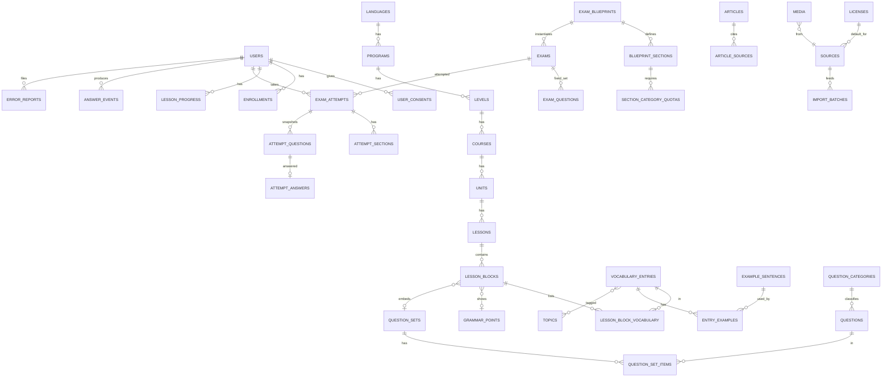

# 02 – Database Design (PostgreSQL)

## 1. Quy ước chung

| Chủ đề | Quy ước | Lý do |
|---|---|---|
| Tên | `snake_case`, bảng ở dạng số nhiều (`vocabulary_entries`). C# vẫn dùng PascalCase, map bằng `EFCore.NamingConventions` | Chuẩn PostgreSQL, viết SQL tay không cần ngoặc kép |
| Schema | Một schema cho mỗi module: `identity`, `catalog`, `lexicon`, `assessment`, `progress`, `infohub`, `content` | Ranh giới module nhìn thấy được ngay trong DB (AD-01) |
| Khóa chính | `id uuid` (UUID v7, sinh ở ứng dụng). Bảng tra cứu nhỏ dùng `smallint` hoặc `text` code. Bảng nối dùng khóa ghép | |
| Thời gian | `timestamptz`, luôn lưu UTC | |
| Enum | Lưu `text` kèm `CHECK (... IN (...))`. EF map enum sang chuỗi | Đọc được khi xem dữ liệu, thêm giá trị mới dễ hơn enum native của Postgres |
| JSON | `jsonb` chỉ dùng khi cấu trúc thay đổi theo loại (thân câu hỏi, khối bài học, snapshot). Luôn có **C# record + validator** tương ứng | Linh hoạt nhưng không "vô chủ" |
| Xóa | Nội dung: **không xóa cứng** sau khi đã publish, chỉ chuyển `Archived`. Người dùng: ẩn danh (BR-PRIV-02) | Truy vết, giữ snapshot |
| Khóa lạc quan | Cột `version int` (đếm phiên bản nội dung, BR-CNT-09) kiêm concurrency token. Thêm `xmin` cho các bảng không có `version` | Tránh 2 tab admin ghi đè lên nhau |
| Extension | `pg_trgm`, `unaccent` | Tìm kiếm mờ, tìm tiếng Việt không dấu |

### 1.1 Khối "ContentMeta" (provenance và vòng đời) – dùng chung
Mọi bảng **nội dung** (`vocabulary_entries`, `example_sentences`, `grammar_points`, `lessons`, `questions`, `articles`, `media`…) đều có bộ cột sau, map bằng **EF owned type / complex type** `ContentMeta`:

| Cột | Kiểu | Ghi chú |
|---|---|---|
| `status` | text | `Draft` \| `InReview` \| `Published` \| `NeedsUpdate` \| `Archived` (BR-CNT-05) |
| `source_id` | uuid FK → `content.sources` | **NOT NULL** (BR-CNT-01) |
| `license_id` | smallint FK → `content.licenses` | **NOT NULL** |
| `original_ref` | text null | Định danh ở nguồn gốc (tên trang Wiktionary + số nghĩa, ID câu Tatoeba) |
| `origin` | text | `Imported` \| `HumanAuthored` \| `AIDraft` \| `AIDraftHumanEdited` |
| `ai_model`, `prompt_template_id` | text null, uuid null | Khi `origin` là AI |
| `import_batch_id` | uuid null FK | |
| `reviewed_by`, `reviewed_at` | uuid null, timestamptz null | |
| `version` | int | Tăng mỗi lần sửa nội dung đã publish |
| `created_at`, `updated_at`, `published_at` | timestamptz | |

**Vì sao nhúng cột vào từng bảng mà không làm một bảng `provenance` chung (polymorphic)?**
- Nhúng cột thì có FK thật tới `sources` và `licenses`.
- Lọc theo `status` không cần JOIN.
- EF Core hỗ trợ tốt (owned type).

Bảng chung dạng `(entity_type, entity_id)` thì không có toàn vẹn tham chiếu. Đánh đổi: các cột bị lặp ở nhiều bảng, nhưng chỉ khai báo **một lần** trong C#.

## 2. ERD tổng quan



## 3. Chi tiết bảng

Ký hiệu: **PK** khóa chính · **FK** khóa ngoại · **UQ** unique · **IX** index · **CK** check · 🧾 = có khối ContentMeta.

### 3.1 `identity`
| Bảng | Cột chính | Ràng buộc / Index |
|---|---|---|
| `users` (bảng Identity, mở rộng) | `id` uuid PK, `email`, `normalized_email`, `email_confirmed`, `password_hash` (null nếu chỉ đăng nhập Google), `display_name` (2–50), `avatar_media_id` null, `learning_purpose` (`Ausbildung`\|`Nursing`\|`Recognition`\|`Study`\|`Other`) null, `target_level` (`A1`\|`A2`\|`B1`) null, `created_at`, `deleted_at` null, `anonymized_at` null, lockout fields của Identity | UQ `normalized_email`. CK `learning_purpose`, `target_level`. IX `deleted_at` (partial: not null), phục vụ job purge |
| `user_logins`, `user_tokens`, `user_roles`, `roles` | Bảng chuẩn của Identity | Google login nằm ở `user_logins` |
| `data_protection_keys` | `id`, `friendly_name`, `xml` | Khóa mã hóa cookie của ASP.NET Data Protection. Lưu bền vững để deploy không đăng xuất người dùng |
| `user_consents` | `id`, `user_id` FK, `terms_version`, `privacy_version`, `consented_at`, `minor_guardian_confirmed` bool | IX `user_id`. Lưu mỗi lần đồng ý một phiên bản mới (BR-AUTH-04) |

### 3.2 `catalog`
| Bảng | Cột chính | Ràng buộc / Index |
|---|---|---|
| `languages` | `code` text PK (`de`), `name_vi` | Seed: `de`. Giữ bảng để dữ liệu rõ nghĩa (AD-05) |
| `programs` | `id`, `language_code` FK, `slug`, `title`, `program_type` (`CEFR`\|`Vocational`), `metadata` jsonb, `status`, `sort_order` | UQ `(language_code, slug)` |
| `levels` | `id`, `program_id` FK, `code` (`A1`…), `title`, `sort_order`, `status` | UQ `(program_id, code)` |
| `courses` 🧾 | `id`, `level_id` FK, `slug`, `title`, `description_md`, `cover_media_id` null, `estimated_minutes`, `access_tier` (`Free`\|`Premium`, mặc định `Free`), `sort_order` | UQ `slug`. IX `(level_id, sort_order)` |
| `units` | `id`, `course_id` FK, `title`, `sort_order`, `status` | IX `(course_id, sort_order)` |
| `lessons` 🧾 | `id`, `unit_id` FK, `slug`, `title`, `summary`, `is_preview`, `estimated_minutes`, `sort_order`, `pass_threshold_pct` null (mặc định lấy cấu hình 60%) | UQ `(unit_id, slug)`. IX `(unit_id, sort_order)` |
| `lesson_blocks` | `id`, `lesson_id` FK, `sort_order`, `block_type` (`Markdown`\|`VocabularyList`\|`Grammar`\|`Dialogue`\|`Audio`\|`Image`\|`Exercise`), `payload` jsonb, `grammar_point_id` FK null, `question_set_id` FK null | UQ `(lesson_id, sort_order)` DEFERRABLE (cho kéo-thả). CK: `block_type='Grammar'` ⇒ `grammar_point_id NOT NULL`, `block_type='Exercise'` ⇒ `question_set_id NOT NULL` |
| `lesson_block_vocabulary` | `block_id` FK, `entry_id` FK → `lexicon.vocabulary_entries`, `sort_order` | PK `(block_id, entry_id)` |

`payload` theo `block_type`:
- `Markdown`: `{ markdown }`.
- `Dialogue`: `{ lines:[{ speaker, de, vi, audioMediaId }] }`.
- `Audio`: `{ mediaId, transcriptDe, transcriptVi }`.
- `Image`: `{ mediaId, altVi }`.

Mỗi kiểu có một record C# và validator riêng.

**Vì sao khối từ vựng, ngữ pháp, bài tập dùng FK hoặc bảng nối, còn các khối khác dùng jsonb?** Từ vựng, ngữ pháp và câu hỏi là nội dung **dùng chung** (BR-CAT-04), cần toàn vẹn tham chiếu: không xóa được một mục từ đang được bài học dùng. Văn bản và hội thoại chỉ thuộc riêng một bài nên jsonb là đủ.

### 3.3 `lexicon`
| Bảng | Cột chính | Ràng buộc / Index |
|---|---|---|
| `vocabulary_entries` 🧾 | `id`, `language_code`, `lemma` (`Mädchen`), `lemma_search` (lowercase, đã chuyển `ä→ae`, `ß→ss`), `homograph_no` smallint mặc định 1, `part_of_speech` (`Noun`\|`Verb`\|`Adjective`\|`Adverb`\|`Pronoun`\|`Preposition`\|`Conjunction`\|`Numeral`\|`Phrase`\|`Other`), `gender` (`m`\|`f`\|`n`) null, `plural` null, `noun_number` (`Normal`\|`NoPlural`\|`PluralOnly`) null, `ipa` null, `is_separable` bool, `is_irregular` bool, `forms` jsonb null, `cefr_level` (`A1`…), `meaning_vi`, `meaning_vi_search` (lowercase, bỏ dấu), `notes_vi` null, `gloss_en` null (nghĩa tiếng Anh gốc từ Wiktionary, chỉ dùng nội bộ để dịch, không hiển thị), `audio_media_id` null | **UQ `(language_code, lemma, part_of_speech, homograph_no)`** (BR-CNT-10). IX GIN trigram trên `lemma_search` và `meaning_vi_search`. IX `(cefr_level, status)`. **CK**: `part_of_speech='Noun' AND status='Published'` ⇒ `gender IS NOT NULL AND noun_number IS NOT NULL` (BR-LEX-01) |
| `topics` | `id`, `slug`, `title_vi` | UQ `slug` |
| `entry_topics` | `entry_id`, `topic_id` | PK ghép |
| `example_sentences` 🧾 | `id`, `language_code`, `text_de`, `text_vi`, `cefr_level` null, `audio_media_id` null | IX trigram `text_de` (tìm ví dụ chứa từ) |
| `entry_examples` | `entry_id`, `sentence_id`, `sort_order` | PK ghép |
| `grammar_points` 🧾 | `id`, `language_code`, `slug`, `title_vi`, `structure` (ví dụ `Subjekt + Verb (Pos. 2) + …`), `explanation_md`, `common_mistakes_md`, `cefr_level` | UQ `(language_code, slug)` |
| `grammar_examples` | `grammar_point_id`, `sentence_id`, `sort_order` | PK ghép |
| ~~`saved_entries`~~ | *(đã chuyển sang schema `engagement`, xem §9 – CR-003)* | |

`forms` (jsonb) chứa hình thái của động từ, phục vụ BR-LEX-02:
```json
{ "praesens": { "ich": "rufe an", "du": "rufst an", "er_sie_es": "ruft an",
                "wir": "rufen an", "ihr": "ruft an", "sie_Sie": "rufen an" },
  "perfekt": { "auxiliary": "haben", "partizip2": "angerufen" },
  "praeteritum": null }
```
CK ở ứng dụng (khi publish): động từ ở cấp A1 bắt buộc có đủ 6 ngôi `praesens`. Từ A2 trở lên bắt buộc có thêm `perfekt`.

**Vì sao `forms` là jsonb mà không phải bảng `verb_forms` (entry, tense, person, form)?** Bảng chia động từ luôn được đọc và ghi **trọn bộ** cùng mục từ, gần như không bao giờ truy vấn riêng một ngôi. Dùng jsonb thì đơn giản hơn nhiều mà không mất gì. Nếu sau này cần bài tập "tìm mọi động từ có Partizip II bất quy tắc", có thể thêm cột tính toán hoặc index biểu thức.

### 3.4 `assessment`
| Bảng | Cột chính | Ràng buộc / Index |
|---|---|---|
| `question_categories` | `id`, `program_id` FK, `skill` (`Listening`\|`Reading`\|`Writing`\|`Speaking`\|`Vocabulary`\|`Grammar`), `code` (`ARTICLE_CHOICE`, `VERB_CONJUGATION`, `WORD_ORDER`, `READ_SHORT_TEXT`, `LISTEN_DIALOGUE`…), `title_vi` | UQ `(program_id, code)` |
| `questions` 🧾 | `id`, `language_code`, `category_id` FK, `skill`, `type` (`SingleChoice`\|`FillBlank`\|`Matching`\|`Ordering`), `cefr_level`, `stem_md`, `stem_audio_media_id` null, `stem_image_media_id` null, `body` jsonb, `explanation_md`, `settings` jsonb (caseSensitive, allowUmlautSubstitution, keepOptionOrder), `auto_check_passed` bool, `auto_check_issues` jsonb, `ai_review` jsonb null, `stats_attempts` int, `stats_correct` int, `flagged_for_review` bool | IX `(category_id, status)`, `(cefr_level, skill, status)`, partial IX `flagged_for_review = true` |
| `question_topics` | `question_id`, `topic_id` | PK ghép |
| `question_sets` 🧾 | `id`, `title`, `purpose` (`LessonExercise`\|`Practice`) | |
| `question_set_items` | `set_id`, `question_id`, `sort_order` | PK `(set_id, question_id)` |
| `exam_blueprints` | `id`, `program_id`, `code` (`A1_FINAL`), `title`, `version`, `pass_bands` jsonb (`[{min:60,label:"ReadyForNext"},{min:40,label:"NeedsReview"},{min:0,label:"Relearn"}]`), `is_active` | UQ `(code, version)` |
| `blueprint_sections` | `id`, `blueprint_id` FK, `section_no`, `skill`, `title_vi`, `duration_seconds`, `question_count`, `points_per_question` numeric(5,2), `max_audio_plays` smallint null, `allow_return` bool (mặc định false) | UQ `(blueprint_id, section_no)` |
| `section_category_quotas` | `section_id`, `category_id`, `count` | PK ghép. CK: tổng `count` = `question_count` (kiểm ở ứng dụng) |
| `exams` 🧾 | `id`, `blueprint_id` FK, `slug`, `title`, `kind` (`Fixed`\|`Generated`), `cefr_level` | UQ `slug` |
| `exam_questions` | `exam_id`, `section_no`, `sort_order`, `question_id` FK | PK `(exam_id, section_no, sort_order)`. UQ `(exam_id, question_id)` |
| `exam_attempts` | `id`, `exam_id` FK, `user_id` FK, `status` (`InProgress`\|`Submitted`\|`AutoSubmitted`), `started_at`, `submitted_at` null, `current_section_no`, `score` numeric(6,2) null, `max_score`, `score_pct` numeric(5,2) null, `band` null, `blueprint_snapshot` jsonb | **UQ partial `(user_id, exam_id) WHERE status='InProgress'`**: database bảo đảm BR-EXAM-06. IX `(user_id, started_at DESC)`. Partial IX `status='InProgress'` cho job tự nộp |
| `attempt_sections` | `attempt_id` FK, `section_no`, `started_at`, `deadline_at`, `closed_at` null, `score` null | PK `(attempt_id, section_no)` |
| `attempt_questions` | `id`, `attempt_id` FK, `section_no`, `sort_order`, `question_id` (FK, giữ để thống kê), `question_version`, `snapshot` jsonb (stem, body **kể cả đáp án đúng**, explanation, media ids), `points` | UQ `(attempt_id, section_no, sort_order)` |
| `attempt_answers` | `attempt_question_id` PK/FK, `response` jsonb, `audio_plays` smallint mặc định 0, `answered_at`, `is_correct` null, `awarded_points` null | Ghi kiểu upsert (US-31) |

Thân câu hỏi `body` (jsonb), mỗi `type` có một record C#:

| type | body |
|---|---|
| SingleChoice | `{ "options":[{ "id":"a","text":"der","mediaId":null,"isCorrect":false }, …] }` |
| FillBlank | `{ "template":"Ich ___ aus Vietnam.", "blanks":[{ "id":1,"accepted":["komme"] }] }` |
| Matching | `{ "left":[{ "id":"l1","text":"Hallo" }], "right":[{ "id":"r1","text":"Xin chào" }], "pairs":[["l1","r1"]] }` |
| Ordering | `{ "tokens":["ich","heiße","Lan"], "accepted":[["ich","heiße","Lan"]] }` |

**Vì sao `body` là jsonb mà không phải bảng `question_options`?** Bốn loại câu hỏi có cấu trúc khác hẳn nhau. Câu hỏi luôn được đọc trọn và được **snapshot nguyên khối** vào lượt làm bài (BR-EXAM-07). Đánh đổi: các `mediaId` nằm trong JSON nên không có FK, vì vậy validator kiểm tra sự tồn tại của media khi lưu, và job hằng ngày quét các media mồ côi.

**Bảo mật:** API cho người học dùng **DTO riêng** đã loại bỏ `isCorrect`, `accepted`, `pairs` (§8 file 01).

### 3.5 `progress`
| Bảng | Cột chính | Ràng buộc / Index |
|---|---|---|
| `enrollments` | `user_id`, `course_id`, `enrolled_at`, `last_activity_at` | PK `(user_id, course_id)` |
| `lesson_progress` | `user_id`, `lesson_id`, `status` (`InProgress`|`Completed`), `last_block_id` null, `reached_end` bool, `best_exercise_pct` null,\|`Completed`), `last_block_id` null, `best_exercise_pct` null, `started_at`, `completed_at` null | PK `(user_id, lesson_id)`. IX `(user_id, status)` |
| `practice_sessions` | `id`, `user_id`, `question_set_id`, `started_at`, `completed_at` null, `correct`, `total`, `score_pct` | IX `(user_id, started_at DESC)` |
| `answer_events` | `id` bigint identity PK, `user_id`, `question_id`, `skill`, `category_id`, `source` (`Practice`\|`Exam`), `source_id`, `fraction` numeric(4,3) (0–1), `occurred_at` | IX `(user_id, occurred_at DESC)`. IX `(question_id)` |

**`answer_events`** là nhật ký **chỉ ghi thêm** (append-only). Đây là nguồn duy nhất để tính:
- (a) tỷ lệ đúng theo kỹ năng trong 90 ngày (BR-PROG-04);
- (b) thống kê từng câu hỏi (BR-ASM-08: job hằng giờ cập nhật `questions.stats_*`);
- (c) gợi ý ôn tập (BR-EXAM-11).

Khi xóa tài khoản, `user_id` được thay bằng một UUID ẩn danh cố định (BR-PRIV-02).

Quy mô ước tính: 1.000 người × 2.000 lượt trả lời = 2 triệu dòng. Postgres trên 1 VPS xử lý tốt. Khi lớn hơn có thể partition theo tháng.

### 3.6 `infohub`
| Bảng | Cột chính | Ràng buộc / Index |
|---|---|---|
| `articles` 🧾 | `id`, `category` (`Ausbildung`\|`Recognition`\|`LearningPath`), `slug`, `title`, `summary`, `body_md`, `classification` (`Official`\|`Reference`), `last_reviewed_at`, `review_due_at` | UQ `slug`. IX `(category, status)`. Partial IX `review_due_at` cho job rà soát |
| `article_sources` | `id`, `article_id` FK, `title`, `publisher`, `url`, `accessed_at`, `is_official` | CK: mỗi bài Published có ≥ 1 nguồn `is_official` (kiểm ở ứng dụng, BR-INFO-01) |

### 3.7 `content`
| Bảng | Cột chính | Ràng buộc / Index |
|---|---|---|
| `licenses` | `id` smallint PK, `code` (`CC-BY-SA-4.0`, `CC-BY-2.0-FR`, `CC0-1.0`, `LGPL-2.1`, `Proprietary`…), `name`, `url`, `allows_commercial`, `requires_attribution`, `share_alike`, `allows_modification` | UQ `code`. Seed sẵn |
| `sources` | `id`, `name`, `provider`, `url`, `default_license_id` FK, `license_verified_at`, `notes`, `is_active` | UQ `name`. Seed: "Wiktionary (kaikki.org)", "Tatoeba", "ADUO (tự biên soạn)", "Azure TTS" |
| `media` 🧾 | `id`, `kind` (`Audio`\|`Image`\|`ImportFile`), `bucket`, `storage_key`, `content_type`, `size_bytes`, `duration_ms` null, `checksum_sha256`, `original_url` null, `attribution` null | UQ `storage_key`. IX `checksum_sha256` (tránh upload trùng) |
| `import_batches` | `id`, `content_type`, `source_id` FK, `file_media_id` FK, `status` (`DryRun`\|`Committed`\|`Cancelled`), `report` jsonb (hợp lệ / lỗi / trùng), `created_by`, `created_at`, `committed_at` null | |
| `prompt_templates` | `id`, `code`, `version`, `purpose`, `system_prompt`, `user_prompt_template`, `output_schema` jsonb, `is_active` | UQ `(code, version)` |
| `jobs` | `id`, `kind` (`AiDraft`\|`AiReview`\|`Tts`), `status` (`Queued`\|`Running`\|`Succeeded`\|`Failed`), `payload` jsonb, `result` jsonb null, `error` null, `attempts`, `created_by`, `created_at`, `started_at`, `finished_at` | IX `(status, created_at)` |
| `external_usage` | `id`, `provider` (`Anthropic`\|`AzureSpeech`), `units` (token / ký tự), `cost_usd` numeric(10,4), `job_id` null, `occurred_at` | IX `(provider, occurred_at)`. Dùng tính trần chi phí tháng (BR-CNT-08) |
| `content_revisions` | `id`, `entity_type`, `entity_id`, `version`, `snapshot` jsonb, `changed_by`, `changed_at`, `change_note` | IX `(entity_type, entity_id, version DESC)`. Bảng polymorphic **có chủ đích**, vì chỉ là lịch sử và không cần FK |
| `review_checklists` | `id`, `entity_type`, `entity_id`, `version`, `items` jsonb (các mục đã tick), `reviewed_by`, `reviewed_at` | Bằng chứng đã duyệt theo checklist (BR-CNT-06) |
| `error_reports` | `id`, `user_id`, `target_type` (`VocabularyEntry`\|`ExampleSentence`\|`Question`\|`LessonBlock`\|`Article`), `target_id`, `category` (`WrongAnswer`\|`Typo`\|`AudioIssue`\|`Other`), `message` (≤ 500), `status` (`Open`\|`Resolved`\|`Rejected`), `resolution_note`, `created_at`, `resolved_at`, `resolved_by` | **UQ partial `(user_id, target_type, target_id) WHERE status='Open'`** (BR-RPT-01). IX `(target_type, target_id, status)` để đếm điều kiện 3 người báo (BR-RPT-02) |
| `app_settings` | `key` PK, `value` jsonb, `updated_at` | Các giá trị *(cấu hình)* trong business rules: ngưỡng 60%, trần chi phí 10 USD… |

## 4. Chuẩn hóa (Normalization)
- Thiết kế ở mức **3NF** cho dữ liệu nghiệp vụ.
- **Phi chuẩn hóa có chủ đích**, kèm lý do:
  1. `lemma_search` và `meaning_vi_search`: cột dẫn xuất phục vụ tìm kiếm, cập nhật ở ứng dụng mỗi khi lưu.
  2. `questions.stats_*`: bộ đếm tổng hợp từ `answer_events`, giúp đọc nhanh. Được tính lại bởi job.
  3. `exam_attempts.score`, `score_pct`, `band`: lưu kết quả cuối để lịch sử không phải tính lại.
  4. `attempt_questions.snapshot`: **bắt buộc** về nghiệp vụ (BR-EXAM-07), không phải tối ưu.
  5. `skill` có ở cả `questions` lẫn `answer_events`: để truy vấn thống kê 90 ngày không phải JOIN.

## 5. Truy vấn trọng yếu và index phục vụ
| Truy vấn | Index |
|---|---|
| Tìm từ "maedchen" / "co gai" | GIN `gin_trgm_ops` trên `lemma_search`, `meaning_vi_search` + lọc `status='Published'` |
| Danh sách bài của một khóa, kèm tiến độ của người học | `units(course_id, sort_order)`, `lessons(unit_id, sort_order)`, `lesson_progress(user_id, lesson_id)` PK |
| Lượt làm bài đang dở của người học | Partial UQ `exam_attempts(user_id, exam_id) WHERE InProgress` |
| Job tự nộp bài | Partial IX `exam_attempts(status) WHERE InProgress` JOIN `attempt_sections.deadline_at` |
| Tỷ lệ đúng 90 ngày | `answer_events(user_id, occurred_at DESC)` |
| Hàng đợi duyệt | IX `(status)` trên từng bảng nội dung (partial: `status IN ('Draft','InReview','NeedsUpdate')`) |

## 6. Migration Strategy
1. **EF Core Code-First**, một `AppDbContext`, migration lưu ở `Aduo.Core/Infrastructure/Persistence/Migrations`.
2. Mỗi migration phải được **review file SQL sinh ra** (`dotnet ef migrations script`) trước khi merge.
3. Thay đổi phá vỡ theo hướng **expand → migrate data → contract**, chia ra ít nhất 2 lần release.
4. Deploy: dùng `migrations bundle` chạy trước khi khởi động API. Production luôn **backup trước** (file 01 §9.2).
5. **Dữ liệu tra cứu** (licenses, sources mặc định, language `de`, program, các level A1–B1, question categories, blueprint `A1_FINAL`) được seed bằng **lệnh CLI idempotent** `aduo-cli seed`, không dùng `HasData`. Lý do: dễ sửa, không làm phình migration.
6. Extension `pg_trgm` và `unaccent` được tạo trong migration đầu tiên.

## 7. Dữ liệu seed: blueprint `A1_FINAL` (BR-EXAM-02)
| section_no | skill | duration | questions | points/q | max_audio_plays | allow_return |
|---|---|---|---|---|---|---|
| 1 | Listening (Hören) | 1200 s (20 phút) | 15 | 1 | 2 | false |
| 2 | Reading (Lesen) | 1500 s (25 phút) | 15 | 1 | null | false |

`pass_bands`: ≥ 60 → `ReadyForNext`, ≥ 40 → `NeedsReview`, còn lại → `Relearn` (BR-EXAM-11).

## 8. [ĐÃ CHỐT – CR-002] Schema `engagement` và cột bổ sung

> Schema thứ 8 (AD-06). **Cần migration mới** khi làm module Engagement: `Init` chỉ tạo 7 schema. Thêm hằng `Schemas.Engagement` và đưa vào `Schemas.All` (test `Migrations_Apply_AndCreateAllModuleSchemas` sẽ tự kiểm tra). Chi tiết cột và lý do: [08-engagement.md §6](../phase-4/modules/08-engagement.md).

### 8.1 Bảng mới
| Bảng | Cột chính | Ràng buộc / Index |
|---|---|---|
| `engagement.srs_cards` | `user_id`, `entry_id` (FK → `lexicon.vocabulary_entries`), `state`, `ease_factor` numeric(4,2), `interval_days`, `repetitions`, `due_at`, `last_reviewed_at`, `lapses`, `total_reviews`, `is_suspended`, `created_at` | PK `(user_id, entry_id)`. IX `(user_id, due_at)` WHERE NOT `is_suspended`. CK `ease_factor >= 1.3` |
| `engagement.srs_review_log` | `id` bigint, `user_id`, `entry_id`, `grade`, `response_ms`, `reviewed_at`, `client_event_id` uuid | **UQ `(user_id, client_event_id)`** (idempotent). Append-only |
| `engagement.daily_activity` | `user_id`, `day` date (giờ VN), `xp_earned`, `cards_reviewed`, `exercises_done`, `lessons_completed`, `scenes_played`, `goals_completed` | PK `(user_id, day)` |
| `engagement.user_stats` | `user_id` PK, `total_xp`, `level`, `current_streak`, `longest_streak`, `last_active_day` | Bản tổng hợp đọc nhanh, tính lại được từ `daily_activity` |
| `engagement.daily_quests` | `user_id`, `day`, `kind`, `target`, `progress`, `completed_at` | PK `(user_id, day, kind)` |
| `engagement.daily_phrases` 🧾 (Release 1.1) | `id`, `text_de`, `text_vi`, `kind`, `audio_media_id`, `cefr_level` | Qua ContentOps lifecycle |

### 8.2 Cột bổ sung ở bảng cũ
| Bảng | Cột | Mục đích |
|---|---|---|
| `lexicon.grammar_points` | `is_public` bool mặc định false | Ngữ pháp công khai cho khách (SSR, SEO) |
| `lexicon.vocabulary_entries` | `is_public_practice` bool mặc định false | Bộ từ chơi thử cho khách (khoảng 50 từ A1) |
| `assessment.questions` | `is_public_practice` bool mặc định false | Bộ luyện tập công khai, **tách khỏi** ngân hàng đề kiểm tra (AD-07) |
| `catalog.units` | `week_hint` smallint null, `milestone_label` text null | Trang Lộ trình trực quan (1.1) |
| `progress.answer_events` | giá trị `source` mới: `Game`, `Srs` | Phân biệt nguồn sự kiện |

**Ràng buộc quan trọng:** câu hỏi đã nằm trong một đề kiểm tra (`exam_questions`) **không được** đặt `is_public_practice = true` (kiểm tra ở ứng dụng khi lưu, vì lộ đáp án bài có giờ).

## 9. [ĐÃ CHỐT – CR-003, phương án 2] Cá nhân hóa và thẻ từ giàu thông tin

### 9.1 Cột mới ở `lexicon.vocabulary_entries`
| Cột | Kiểu | Ghi chú |
|---|---|---|
| `synonyms` | jsonb null | `[{lemma, noteVi?}]` |
| `collocations` | jsonb null | `[{textDe, textVi}]` |
| `word_family` | jsonb null | `[{entryId?, lemma, pos, meaningVi}]` |
| `usage_notes_vi` | text null | Markdown ngắn |

### 9.2 Bảng mới và thay đổi ở schema `engagement`
Chi tiết cột và lý do: [08-engagement §12.5](../phase-4/modules/08-engagement.md).
| Bảng | Thay đổi |
|---|---|
| `engagement.user_preferences` | **Mới.** Một dòng mỗi người: `daily_xp_goal`, `new_cards_per_day`, `daily_minutes`, `grading_strictness`, `default_study_mode`, `meaning_language`. CK theo giới hạn BR-ENG-11 |
| `engagement.saved_entries` | **Mới** (chuyển từ Lexicon). PK `(user_id, entry_id)` |
| `engagement.user_words` | **Mới.** Từ do người học tự nhập, riêng tư theo `user_id` |
| `engagement.srs_cards` | **Sửa:** PK thành `id` uuid; thêm `user_word_id` null; CK đúng một trong `entry_id` / `user_word_id`; UQ partial cho từng cặp |
| `engagement.daily_activity` | **Sửa:** thêm `active_seconds` int |

**Vì sao chuyển `saved_entries` sang Engagement?** Đây là dữ liệu **của từng người học**, không phải tri thức dùng chung. Lexicon chỉ nên chứa nội dung đã duyệt, không biết người học nào lưu gì (AR-03).
