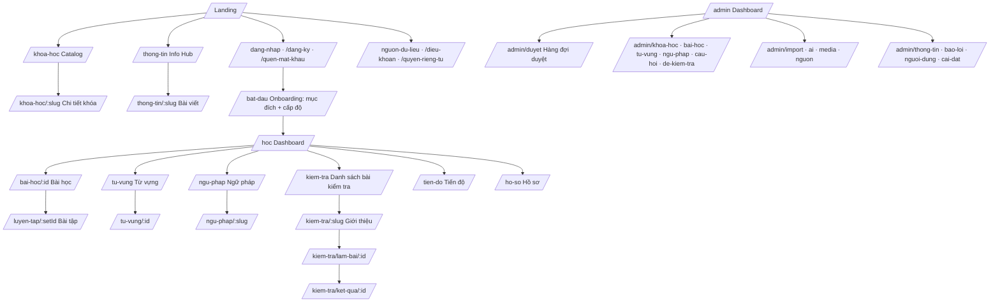

# 05 – UX: Sitemap, User Flows, Wireframes

Nguyên tắc UX cho người dùng chính (P1 – Lan, 18 tuổi, Android tầm trung, 4G):
1. **Một việc chính trên mỗi màn hình.** Nút hành động chính to, đặt ở vùng ngón cái dễ chạm (nửa dưới màn hình).
2. **Luôn biết mình đang ở đâu trong lộ trình.** Hiển thị A1 → A2 → B1, unit, bài.
3. **Bài ngắn 10–15 phút**, lưu tiến độ tự động, quay lại đúng chỗ.
4. **Tiếng Việt thân thiện**, xưng "bạn". Thuật ngữ tiếng Đức luôn kèm giải thích ngắn.
5. **Nhẹ:** skeleton khi tải, audio chỉ tải khi bấm phát, không có ảnh trang trí nặng.

## 1. Sitemap



**Điều hướng của người học (mobile):** thanh tab dưới cùng gồm 4 mục **Học · Từ vựng · Kiểm tra · Tôi**. Tiến độ và Hồ sơ nằm trong "Tôi". Trên desktop, thanh tab chuyển thành thanh bên trái.

## 2. User Flows trọng yếu
Các luồng chi tiết đã có ở [Phase 2 – 05-processes-diagrams](../phase-2/05-processes-diagrams.md). Phase 3 bổ sung cách các luồng đó đi qua từng màn hình:

| Luồng | Màn hình đi qua | Mục tiêu UX |
|---|---|---|
| F1 – Lần đầu đến | Landing → (Học thử bài mẫu) → Đăng ký / Google → Onboarding 2 bước → Dashboard → Bài 1 | Từ lúc vào trang tới lúc học bài đầu tiên **≤ 2 phút**, tối đa 3 lần nhập dữ liệu |
| F2 – Học hằng ngày | Mở app → Dashboard: bấm thẻ "Tiếp tục học" → Bài học (cuộn qua các khối) → Bài tập cuối bài → "Hoàn thành!" → Bài tiếp theo | Chỉ **1 chạm** để quay lại học tiếp |
| F3 – Tra từ khi đang học | Trong khối từ vựng, chạm vào một từ → mở **bottom sheet** chi tiết (giống, số nhiều, chia động từ, audio) → đóng lại | Không rời khỏi bài học |
| F4 – Bài kiểm tra cuối A1 | Kiểm tra → Giới thiệu đề (cấu trúc, miễn trừ) → Bắt đầu → Hören → xác nhận chuyển phần → Lesen → Nộp → Kết quả + gợi ý ôn | Không mất đáp án. Luôn thấy đồng hồ và trạng thái "Đã lưu" |
| F5 – Báo lỗi | Biểu tượng ⚑ trên câu hỏi hoặc mục từ → bottom sheet chọn loại lỗi và nhập mô tả → "Cảm ơn bạn!" | ≤ 3 chạm |
| F6 – Admin nhập nội dung | Import → Dry-run → Xem báo cáo → Commit → Hàng đợi duyệt → Checklist → Publish | Duyệt **hàng loạt** được với các mục không có cờ cảnh báo |

## 3. Wireframes (mobile 360px, mức low-fidelity)

### 3.1 Landing
```
┌──────────────────────────────┐
│ ADUO               [Đăng nhập]│
├──────────────────────────────┤
│  Học tiếng Đức từ con số 0   │
│  đến B1 – cho Ausbildung     │
│  Bằng tiếng Việt · Miễn phí  │
│  [ Bắt đầu học miễn phí  ]   │  ← CTA chính
│  [ Học thử bài đầu tiên  ]   │
├──────────────────────────────┤
│  Lộ trình:  A1 ──▶ A2 ──▶ B1 │
│  ✓ Bài 10–15 phút trên điện  │
│    thoại  ✓ Có audio          │
│  ✓ Kiểm tra cuối cấp          │
├──────────────────────────────┤
│  Thông tin Ausbildung        │
│  ▸ Điều kiện tiếng Đức...    │
│  ▸ Công nhận văn bằng là gì? │
├──────────────────────────────┤
│ Nguồn dữ liệu · Điều khoản · │
│ Quyền riêng tư               │
└──────────────────────────────┘
```

### 3.2 Onboarding (2 bước, có nút bỏ qua)
```
┌──────────────────────────────┐
│ Bước 1/2            [Bỏ qua] │
│ Bạn học tiếng Đức để…        │
│ ┌──────────┐ ┌──────────┐    │
│ │🛠 Đi      │ │🩺 Ausbil- │    │
│ │Ausbildung│ │dung điều │    │
│ └──────────┘ │dưỡng      │    │
│ ┌──────────┐ └──────────┘    │
│ │📄 Công   │ ┌──────────┐    │
│ │nhận nghề │ │🎓 Du học  │    │
│ └──────────┘ └──────────┘    │
│ ┌──────────┐                 │
│ │ Khác     │                 │
│ └──────────┘                 │
│            [ Tiếp tục ]      │
└──────────────────────────────┘
Bước 2/2: Mục tiêu A1 / A2 / B1
(chọn Ausbildung thì gợi ý B1, có link "Vì sao là B1?" mở Info Hub)
```

### 3.3 Dashboard (Học)
```
┌──────────────────────────────┐
│ Chào Lan 👋                   │
│ Mục tiêu: B1 · Đang học A1   │
│ A1 ████████░░░░░░ 42%        │
├──────────────────────────────┤
│ ▶ TIẾP TỤC HỌC               │
│ Unit 3 · Bài 3.2             │
│ Mạo từ sở hữu mein/dein      │
│ 12 phút          [ Học tiếp ]│
├──────────────────────────────┤
│ Unit 3: Gia đình    3/5 bài  │
│  ✓ 3.1  ● 3.2  ○ 3.3 …       │
├──────────────────────────────┤
│ 📝 Kiểm tra cuối A1          │
│ Mở khi bạn học xong ≥ 80%    │  ← chỉ gợi ý, không khóa
├──────────────────────────────┤
│ 📌 Dành cho bạn (Ausbildung) │
│ ▸ Cần tiếng Đức mức nào?     │
├──────────────────────────────┤
│  Học   Từ vựng  Kiểm tra  Tôi│
└──────────────────────────────┘
```

### 3.4 Bài học (các khối nối tiếp nhau)
```
┌──────────────────────────────┐
│ ← Bài 3.2           ⚑   3/7  │  ← khối 3 trên 7
│ ▓▓▓▓▓▓░░░░░░░░               │
├──────────────────────────────┤
│ TỪ VỰNG                      │
│ ┌──────────────────────────┐ │
│ │ [die] Mutter      🔊      │ │  die = màu đỏ + chữ
│ │ die Mütter · mẹ           │ │
│ ├──────────────────────────┤ │
│ │ [der] Vater       🔊      │ │
│ │ die Väter · bố            │ │
│ └──────────────────────────┘ │
│ (chạm vào từ để mở chi tiết) │
├──────────────────────────────┤
│ NGỮ PHÁP: mein / meine       │
│ mein Vater · meine Mutter    │
│ ...                          │
├──────────────────────────────┤
│ Nguồn: Wiktionary · CC BY-SA │
│       [ Làm bài tập (8) ]    │
└──────────────────────────────┘
```

### 3.5 Câu hỏi luyện tập
```
┌──────────────────────────────┐
│ ✕   Câu 3/8        ⚑         │
│ Chọn mạo từ đúng:            │
│        ___ Tisch             │
│ ┌──────────────────────────┐ │
│ │ der                      │ │
│ ├──────────────────────────┤ │
│ │ die                      │ │
│ ├──────────────────────────┤ │
│ │ das                      │ │
│ └──────────────────────────┘ │
├──────────────────────────────┤
│ ✅ Chính xác! der Tisch –     │  ← phản hồi ngay
│ cái bàn. Danh từ giống đực.  │
│              [ Tiếp tục ]    │
└──────────────────────────────┘
```

### 3.6 Làm bài kiểm tra
```
┌──────────────────────────────┐
│ Hören · Phần 1/2   ⏱ 14:32   │  ← đồng hồ theo giờ server
│ ✓ Đã lưu                     │     (khi mất mạng: "⏳ Đang chờ mạng")
├──────────────────────────────┤
│ Câu 6/15                     │
│ [ ▶ Nghe ]  còn 1/2 lượt      │
│ Wann kommt der Bus?          │
│ ○ a) um 8 Uhr                │
│ ● b) um 9 Uhr                │
│ ○ c) um 10 Uhr               │
│ ☐ Đánh dấu xem lại           │
├──────────────────────────────┤
│ 1 2 3 4 5 [6] 7 8 … 15       │  ← lưới câu: đã làm / đánh dấu
│ [‹ Trước]          [Sau ›]   │
│ [ Sang phần Lesen → ]        │  ← có hộp thoại xác nhận
└──────────────────────────────┘
```

### 3.7 Kết quả
```
┌──────────────────────────────┐
│ Kiểm tra cuối A1 – Đề 1      │
│        21 / 30 · 70%         │
│   🎉 Sẵn sàng sang A2         │
│ Hören 10/15 · Lesen 11/15    │
├──────────────────────────────┤
│ Dạng bài cần ôn:             │
│ ▸ Chọn mạo từ        3/5     │
│ ▸ Đọc hiểu biển báo  2/4     │
│ Gợi ý: Bài 2.3, Bài 4.1      │
├──────────────────────────────┤
│ [ Xem lại câu sai (9) ]      │
├──────────────────────────────┤
│ ℹ Đây là bài kiểm tra do nền │
│ tảng biên soạn theo khung A1,│
│ không phải đề Goethe/telc…   │
└──────────────────────────────┘
```

### 3.8 Chi tiết từ vựng (bottom sheet)
```
┌──────────────────────────────┐
│ ───                          │
│ anrufen  🔊      [động từ tách]│
│ /ˈanˌʁuːfn̩/  · gọi điện       │
│ ┌────────┬──────────────────┐│
│ │ ich    │ rufe … an        ││
│ │ du     │ rufst … an       ││
│ │ er/sie │ ruft … an        ││
│ │ wir    │ rufen … an       ││
│ │ ihr    │ ruft … an        ││
│ │ sie/Sie│ rufen … an       ││
│ └────────┴──────────────────┘│
│ Ví dụ: Ich rufe dich morgen  │
│ an. 🔊 – Mai mình gọi bạn.   │
│ Nguồn: Wiktionary · CC BY-SA │
└──────────────────────────────┘
```

### 3.9 Admin – Hàng đợi duyệt (desktop)
```
┌────────────┬───────────────────────────────────────────────────────┐
│ Dashboard  │ Hàng đợi duyệt   [Loại ▾][Nguồn ▾][Origin ▾][☐ Có cờ]  │
│ Duyệt (128)│ ┌───┬──────────────┬─────────┬────────┬──────┬──────┐ │
│ Khóa học   │ │☐ │ Nội dung      │ Loại    │ Origin │ Cờ   │      │ │
│ Từ vựng    │ ├───┼──────────────┼─────────┼────────┼──────┼──────┤ │
│ Câu hỏi    │ │☐ │ ___ Tisch     │ Question│ AIDraft│ ✓ OK │ Xem  │ │
│ Đề KT      │ │☐ │ Mutter (f)    │ Vocab   │Imported│ ⚠ 1  │ Xem  │ │
│ Import     │ └───┴──────────────┴─────────┴────────┴──────┴──────┘ │
│ AI · Media │ [Publish các mục đã chọn (chỉ mục không có cờ)]         │
│ Info Hub   │                                                        │
│ Báo lỗi (3)│ Panel phải: xem trước + checklist BR-CNT-06 + Publish  │
└────────────┴───────────────────────────────────────────────────────┘
```
Publish hàng loạt **chỉ áp dụng cho mục không có cờ cảnh báo**. Checklist được tick một lần cho cả lô và lưu vào `review_checklists` cho từng mục (BR-CNT-05, 06).

## 4. Trạng thái màn hình (bắt buộc với mọi trang có dữ liệu)
| Trạng thái | Cách hiển thị | Ví dụ câu chữ |
|---|---|---|
| Loading | Skeleton theo đúng bố cục, không dùng spinner toàn trang | — |
| Empty | Minh họa nhỏ + 1 câu + 1 hành động | "Bạn chưa làm bài kiểm tra nào. **Bắt đầu Đề 1**" |
| Error | Thông báo theo `code` + nút "Thử lại" | "Mất kết nối. Bài làm của bạn vẫn được giữ trên máy." |
| Success | Toast 3 giây, hoặc màn hình chúc mừng khi hoàn thành bài hay unit | "Hoàn thành bài 3.2! 🎉" |
| Offline (khi làm bài) | Banner vàng cố định | "⏳ Đang chờ mạng – đáp án sẽ tự gửi" |
| Không đủ quyền | Giải thích + hành động | "Xác minh email để làm bài kiểm tra. **Gửi lại email**" |

## 5. Accessibility cơ bản (NFR-11)
- Tương phản ≥ 4.5:1 cho chữ. Vùng chạm ≥ 44×44px.
- Giống danh từ thể hiện bằng **màu và chữ** (BR-LEX-03). Đúng/sai thể hiện bằng **icon và chữ**, không chỉ dùng màu.
- Mọi nút audio có `aria-label` ("Nghe phát âm Mutter"). Ảnh có `alt` bằng tiếng Việt.
- Điều khiển được bằng bàn phím: phím 1–4 chọn đáp án, Enter để tiếp tục (desktop).
- Đồng hồ bài kiểm tra dùng `aria-live="polite"` mỗi phút, và đọc thông báo khi còn 5 phút.
- Tôn trọng cài đặt `prefers-reduced-motion`.

## 6. [ĐÃ CHỐT – CR-002, phương án 2] Điều chỉnh UX sau khảo sát đối thủ

> Đã chốt ngày 2026-11-22. Phân tích: [docs/research/01-competitor-analysis.md](../research/01-competitor-analysis.md).

- **Dashboard → "Bàn học":** màn hình chính một cửa, có streak, 3 nhiệm vụ, nút "Tiếp tục học", thẻ "Ôn hôm nay", lưới lối vào. Wireframe: [08-engagement §5](../phase-4/modules/08-engagement.md).
- **Thanh điều hướng dưới (mobile) 5 mục** thay vì 4: Học · Từ vựng · Ôn tập · Thông tin · Tôi. "Kiểm tra" vào từ "Học". Trên mobile nên là thanh nổi dạng viên thuốc, một tay chạm được, như Brottin.
- **Khách vào học ngay:** landing có khung "Chơi thử ngay" (mini-game Nối từ) và nút "Học thử bài đầu tiên". Ngữ pháp công khai. Tiến độ khách lưu trên máy kèm lời mời đăng nhập để giữ trên mọi thiết bị.
- **Trang ngữ pháp:** hai tab "Xem kiến thức" / "Luyện tập", thanh bên có tìm kiếm + lọc cấp độ trên desktop.
- **Hình ảnh:** nền gradient + hình minh họa vector tự thiết kế (địa danh Đức dạng đơn giản). **Không** dùng ảnh nền phong cách hãng phim hay mascot không có giấy phép.
- **Giọng văn:** giữ thân thiện, có một chút "tình cảm" (ví dụ lời chào theo giờ trong ngày, thông điệp nhẹ nhàng khi streak dừng), nhưng không trẻ con hóa.
