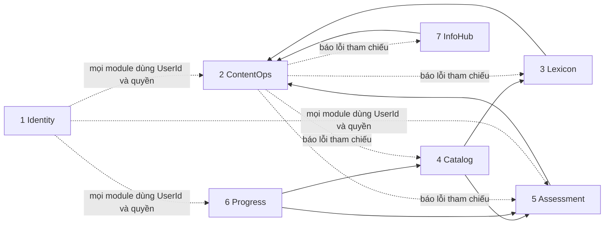

# Phase 4 – Module Breakdown (tổng hợp trước khi code)

Tổng hợp từ Phase 2 (yêu cầu, business rules) và Phase 3 (kiến trúc, database, API, UI). Phạm vi: **MVP German A1 + Info Hub**.

## 1. Tổng quan

Hệ thống gồm **1 nền tảng dùng chung (Foundation)** và **7 module nghiệp vụ**:

| # | Module | Một câu mô tả | Schema DB | Số bảng | Người dùng chính |
|---|---|---|---|---|---|
| 0 | **Foundation** (không phải module nghiệp vụ) | Khung dự án, hạ tầng dùng chung, CI/CD | — | — | Bạn (dev) |
| 1 | **Identity** | Tài khoản, đăng nhập, hồ sơ, mục đích học | `identity` | 3 (+ bảng chuẩn của Identity) | Mọi người |
| 2 | **ContentOps** | Nguồn, giấy phép, media, import, duyệt, AI, TTS, báo lỗi, dashboard | `content` | 11 | Admin (báo lỗi: Student) |
| 3 | **Lexicon** | Từ vựng tiếng Đức, câu ví dụ, chủ đề, điểm ngữ pháp | `lexicon` | 7 | Student, Admin |
| 4 | **Catalog** | Chương trình, cấp độ, khóa, unit, bài học, khối nội dung | `catalog` | 8 | Guest, Student, Admin |
| 5 | **Assessment** | Câu hỏi, bài tập, blueprint, bài kiểm tra cuối cấp, chấm điểm | `assessment` | 14 | Student, Admin |
| 6 | **Progress** | Enrollment, tiến độ bài học, nhật ký trả lời, thống kê | `progress` | 4 | Student |
| 7 | **InfoHub** | Bài viết Ausbildung, Recognition, Lộ trình, kèm nguồn chính thức | `infohub` | 2 | Guest, Student, Admin |

Mũi tên A → B nghĩa là A **cần** B (dùng dữ liệu hoặc interface của B). ContentOps là "chân đế" vì mọi nội dung đều phải có Source và License (BR-CNT-01).

---

## 2. Chi tiết từng module

### 0. Foundation – nền tảng dùng chung
| Mục | Nội dung |
|---|---|
| Mục đích | Có bộ khung chạy được từ đầu đến cuối trước khi viết tính năng đầu tiên |
| Thành phần | Solution .NET (`Aduo.Api`, `Aduo.Core`, `Aduo.Cli`, 3 project test). Next.js + Tailwind + shadcn/ui. `AppDbContext` + migration đầu tiên (`pg_trgm`, `unaccent`). `Result<T>` / `Error`, ProblemDetails, phân trang, `TimeProvider`. Serilog, health check. Rate limiting, security headers. Docker Compose dev (Postgres). GitHub Actions CI (build, test, lint). Sinh kiểu TypeScript từ OpenAPI. Khung `BackgroundService` chạy job |
| Đầu ra | `GET /api/health` trả OK. Trang Next.js gọi được API. CI xanh |
| Ước tính | 5–7 ngày công |

### 1. Identity
| Mục | Nội dung |
|---|---|
| Mục đích | Cho người dùng tạo tài khoản, đăng nhập an toàn, khai báo mục đích học; cho Admin có quyền quản trị |
| Chức năng | Đăng ký email + mật khẩu (kèm ô đồng ý điều khoản, xác nhận phụ huynh nếu dưới 16 tuổi). Xác minh email. Đăng nhập, đăng xuất, "Ghi nhớ". **Đăng nhập Google**. Quên và đặt lại mật khẩu. Hồ sơ: tên, ảnh, **mục đích học** (Ausbildung / Điều dưỡng / Công nhận nghề / Du học / Khác), **cấp độ mục tiêu** (A1 / A2 / B1). Đổi mật khẩu. Xóa tài khoản (ẩn danh trong ≤ 30 ngày). Admin: khóa và mở khóa tài khoản. CLI: `create-admin` |
| Bảng | `users` (mở rộng từ Identity), `user_consents`, các bảng chuẩn của Identity (`user_logins`, `user_tokens`, `roles`, `user_roles`) |
| API | `/auth/*` (register, login, logout, google, confirm-email, forgot/reset-password, csrf), `/me` (GET/PATCH), `/me/change-password`, `/me/delete`, `/admin/users/*` |
| Business rules | BR-AUTH-01..09, BR-PRIV-01..04 |
| Màn hình | Đăng ký, Đăng nhập, Quên mật khẩu, Đặt lại mật khẩu, Xác minh email, **Onboarding 2 bước**, Hồ sơ, Admin: Người dùng |
| Job | `PurgeDeletedAccounts` (hằng ngày) |
| Tích hợp ngoài | Google OAuth, nhà cung cấp email (SMTP) |
| Kiểm thử trọng tâm | Khóa tạm sau 5 lần sai, link hết hạn, chống dò email, CSRF, phân quyền |
| Ước tính | 6–8 ngày công |

### 2. ContentOps – vận hành nội dung
Module lớn nhất phía Admin, nên được chia làm hai đợt.

**2a. Lõi (làm sớm, vì mọi module nội dung cần):**
| Mục | Nội dung |
|---|---|
| Chức năng | Quản lý **License** (seed sẵn: CC BY-SA, CC BY, CC0, LGPL, Proprietary) và **Source** (Wiktionary, Tatoeba, ADUO tự biên soạn, Azure TTS). **Media**: upload audio và hình lên R2, kiểm tra loại file và dung lượng. **Vòng đời nội dung dùng chung**: Draft → InReview → Published / NeedsUpdate / Archived, kèm **checklist duyệt** và **lịch sử phiên bản**. **Hàng đợi duyệt** chung cho mọi loại nội dung. **Import CSV/JSON** (dry-run → báo cáo → commit → hủy batch). Chặn license không cho phép thương mại. Cài đặt hệ thống (`app_settings`). Trang **Attribution** công khai |
| Bảng | `licenses`, `sources`, `media`, `import_batches`, `content_revisions`, `review_checklists`, `app_settings` |
| Business rules | BR-CNT-01..06, 09..12 |

**2b. Mở rộng (làm sau, khi đã có nội dung):**
| Mục | Nội dung |
|---|---|
| Chức năng | **AI viết nháp** (mẫu prompt có phiên bản, job bất đồng bộ) và **AI kiểm định**. **TTS hàng loạt** (Azure, giọng de-DE). **Theo dõi chi phí** và trần chi phí tháng. **Báo lỗi** (người học gửi, Admin xử lý, tự chuyển NeedsUpdate khi đủ 3 người báo). **Dashboard Admin** |
| Bảng | `prompt_templates`, `jobs`, `external_usage`, `error_reports` |
| Business rules | BR-CNT-07, 08, BR-RPT-01..03 |
| API | `/admin/sources`, `/admin/licenses`, `/admin/media`, `/admin/imports/*`, `/admin/review-queue`, `/admin/{resource}/{id}/publish…`, `/admin/ai-drafts`, `/admin/tts-jobs`, `/admin/jobs/{id}`, `/admin/usage`, `/admin/error-reports/*`, `/admin/dashboard`, `/admin/settings`, `/attributions`, `/me/error-reports` |
| Màn hình | Admin: Nguồn, Media, Import, Hàng đợi duyệt, AI, Báo lỗi, Dashboard, Cài đặt. Người học: bottom sheet "Báo lỗi", trang Nguồn dữ liệu |
| Job | `ProcessContentJobs` (AI, TTS) |
| Tích hợp ngoài | Cloudflare R2, Claude API, Azure Speech |
| Ước tính | 2a: 5–7 ngày · 2b: 7–10 ngày |

### 3. Lexicon – từ vựng và ngữ pháp
| Mục | Nội dung |
|---|---|
| Mục đích | Kho từ vựng và ngữ pháp **dùng chung** cho mọi bài học và câu hỏi |
| Chức năng | Mục từ tiếng Đức: lemma, **giống der/die/das**, **số nhiều** (hoặc NoPlural / PluralOnly), IPA, loại từ, **bảng chia Präsens 6 ngôi** (Perfekt từ A2), cờ động từ tách / bất quy tắc, nghĩa tiếng Việt, cấp CEFR, chủ đề, audio, câu ví dụ. **Tìm kiếm** chấp nhận ae/oe/ue/ss và tiếng Việt không dấu. Điểm ngữ pháp: cấu trúc, giải thích, lỗi thường gặp, ví dụ. Admin: CRUD, import. **CLI `import wiktionary`** (lọc dump kaikki theo danh sách lemma A1), **CLI `import tatoeba`** (chỉ lấy câu CC0 / CC BY) |
| Bảng | `vocabulary_entries`, `topics`, `entry_topics`, `example_sentences`, `entry_examples`, `grammar_points`, `grammar_examples` |
| API | `/vocabulary-entries`, `/vocabulary-entries/{id}`, `/grammar-points`, `/grammar-points/{slug}`, `/topics`, `/admin/vocabulary-entries`, `/admin/example-sentences`, `/admin/grammar-points`, `/admin/topics` |
| Business rules | BR-LEX-01..04, BR-CNT-04, 10 |
| Màn hình | Tra từ vựng, Chi tiết từ (bottom sheet + trang riêng), Danh sách và chi tiết ngữ pháp. Admin: Từ vựng, Câu ví dụ, Ngữ pháp |
| Component đặc thù | `GenderBadge`, `ConjugationTable`, `VocabularyCard` |
| Ước tính | 7–10 ngày công (bao gồm CLI import) |

### 4. Catalog – cấu trúc khóa học và bài học
| Mục | Nội dung |
|---|---|
| Mục đích | Tổ chức lộ trình: Tiếng Đức → CEFR → A1 → Khóa → Unit → Bài |
| Chức năng | Cây chương trình (chỉ hiển thị khi mọi nút cha đã Published). Trang khóa học. **Bài học gồm các khối**: Markdown, Danh sách từ vựng (tham chiếu Lexicon), Ngữ pháp, Hội thoại (kèm audio), Audio, Hình, Bài tập (tham chiếu Assessment). Bài **học thử** cho Guest. Bài trước / Bài tiếp. Admin: CRUD, **kéo-thả khối**, **xem trước như người học** |
| Bảng | `languages`, `programs`, `levels`, `courses`, `units`, `lessons`, `lesson_blocks`, `lesson_block_vocabulary` |
| API | `/programs`, `/courses`, `/courses/{slug}`, `/lessons/{id}`, `/me/courses/{id}/enroll`, `/admin/courses`, `/admin/units`, `/admin/lessons`, `/admin/lessons/{id}/blocks`, `/admin/lessons/{id}/preview` |
| Business rules | BR-CAT-01..07 |
| Màn hình | Landing (phần khóa học), Catalog, Chi tiết khóa, **Bài học**. Admin: Khóa học, Bài học (Block editor) |
| Ước tính | 6–8 ngày công |

### 5. Assessment – câu hỏi, luyện tập, bài kiểm tra
Module phức tạp nhất phía người học, nên cũng chia làm hai đợt.

**5a. Câu hỏi + luyện tập:**
| Mục | Nội dung |
|---|---|
| Chức năng | 4 loại câu hỏi: **SingleChoice** (der/die/das, đọc hiểu, nghe hiểu), **FillBlank** (chia động từ; có tùy chọn ae/oe/ue/ss và phân biệt hoa thường), **Matching**, **Ordering** (trật tự câu). Dạng bài (category) theo kỹ năng. **Kiểm tra tự động** trước khi publish. Bộ bài tập gắn vào bài học. **Chế độ luyện tập**: chấm ngay, có giải thích, làm lại câu sai |
| Bảng | `question_categories`, `questions`, `question_topics`, `question_sets`, `question_set_items` |
| Business rules | BR-ASM-01..08 |

**5b. Bài kiểm tra cuối cấp:**
| Mục | Nội dung |
|---|---|
| Chức năng | **Blueprint** cấu hình bằng dữ liệu (seed `A1_FINAL`: Hören 15 câu / 20 phút / nghe tối đa 2 lần, rồi Lesen 15 câu / 25 phút). Đề **Fixed** và **Generated**. Làm bài: **giờ do server tính**, tự lưu từng câu, **mất mạng vẫn giữ đáp án**, khóa phần khi chuyển phần, đếm lượt nghe ở server, **tự nộp khi hết giờ**. **Snapshot câu hỏi**. Kết quả: điểm /30 và %, điểm từng kỹ năng, theo dạng bài, **mức đánh giá** (≥ 60% Sẵn sàng A2 / 40–59% Cần ôn thêm / < 40% Học lại), gợi ý bài cần ôn, câu miễn trừ. Lịch sử làm bài |
| Bảng | `exam_blueprints`, `blueprint_sections`, `section_category_quotas`, `exams`, `exam_questions`, `exam_attempts`, `attempt_sections`, `attempt_questions`, `attempt_answers` |
| Business rules | BR-EXAM-01..12 |
| API | `/me/practice-sessions/*`, `/exams`, `/exams/{slug}`, `/exams/{id}/attempts`, `/me/attempts/{id}` (answers, audio-plays, sections/close, submit, result), `/admin/questions/*`, `/admin/question-sets`, `/admin/blueprints`, `/admin/exams/*` |
| Màn hình | Bài tập, Danh sách bài kiểm tra, Giới thiệu đề, **Làm bài**, **Kết quả**, Lịch sử. Admin: Câu hỏi, Bộ bài tập, Đề kiểm tra |
| Job | `AutoSubmitExpiredAttempts` (mỗi phút), `RecalculateQuestionFlags` (hằng giờ) |
| Ước tính | 5a: 7–9 ngày · 5b: 7–10 ngày |

### 6. Progress – tiến độ học
| Mục | Nội dung |
|---|---|
| Chức năng | Enrollment (tự động khi mở bài đầu tiên). Trạng thái bài: InProgress / **Completed** (tới khối cuối và bài tập đạt ≥ 60%). % theo khóa và unit. **Nhật ký trả lời** (append-only) dùng để tính tỷ lệ đúng theo kỹ năng trong 90 ngày, thống kê từng câu hỏi, và gợi ý ôn tập. **Dashboard người học** ("Tiếp tục học", tiến độ, bài kiểm tra gợi ý, bài Info Hub theo mục đích) |
| Bảng | `enrollments`, `lesson_progress`, `practice_sessions`, `answer_events` |
| API | `/me/lessons/{id}/progress`, `/me/dashboard`, `/me/progress` |
| Business rules | BR-PROG-01..04 |
| Màn hình | **Dashboard (Học)**, Tiến độ |
| Ước tính | 3–5 ngày công |

### 7. InfoHub – thông tin chính thống
| Mục | Nội dung |
|---|---|
| Chức năng | Bài viết theo 3 chuyên mục: **Ausbildung**, **Công nhận văn bằng**, **Lộ trình học và chứng chỉ**. Mỗi bài có ≥ 1 nguồn chính thức kèm ngày truy cập. Phân loại "Chính thức" / "Tham khảo". **Chu kỳ rà soát** (3 tháng cho visa và thủ tục, 6 tháng cho chuyên mục khác). Quá hạn thì hiện banner cảnh báo. Câu miễn trừ. SEO (SSR, sitemap). Admin: soạn bằng Markdown, nút "Đã rà soát" |
| Bảng | `articles`, `article_sources` |
| API | `/articles`, `/articles/{slug}`, `/admin/articles/*`, `/admin/articles/{id}/mark-reviewed` |
| Business rules | BR-INFO-01..06 |
| Màn hình | Info Hub, Bài viết. Admin: Info Hub |
| Job | `MarkOverdueArticles` (hằng ngày) |
| Ước tính | 3–4 ngày công |

---

## 3. Thứ tự triển khai đề xuất

⚠️ **Thay đổi so với Phase 2** (mục 15.8: cần thống nhất lại). Phase 2 xếp thứ tự là Identity → Catalog → Lexicon → Assessment → Exam → Progress → CMS → Info Hub. Tôi đề xuất **đưa lõi ContentOps và Lexicon lên trước Catalog**, vì:
- Bài học **tham chiếu** từ vựng.
- Mọi nội dung đều **bắt buộc** có Source và License.

Làm Catalog trước thì sẽ phải tạm bỏ qua các ràng buộc này rồi quay lại sửa.

| Bước | Module | Kết quả có thể dùng thử ngay |
|---|---|---|
| 1 | Foundation | Khung chạy được, CI xanh |
| 2 | Identity | Đăng ký, đăng nhập, Google, onboarding |
| 3 | ContentOps 2a (lõi) | Admin quản lý nguồn, giấy phép, media, import, duyệt |
| 4 | Lexicon | Import khoảng 650 từ A1 từ Wiktionary, tra từ |
| 5 | Catalog | Soạn và học bài |
| 6 | Assessment 5a | Bài tập cuối bài |
| 7 | Progress | Tiến độ, dashboard "Tiếp tục học" |
| 8 | Assessment 5b | Bài kiểm tra cuối A1 |
| 9 | InfoHub | Bài viết Ausbildung, Recognition |
| 10 | ContentOps 2b | AI nháp, TTS, báo lỗi, dashboard admin |

**Nhập nội dung chạy song song từ bước 4:** sau mỗi module, bạn nhập luôn nội dung thật của module đó.

**Tổng ước tính phần code: khoảng 56–78 ngày công.** Đây là ước tính, chưa gồm thời gian nhập nội dung (khoảng 215–230 giờ, xem Phase 1 file 05) và Phase 5 (test, deploy).

## 4. Mỗi module đi đủ vòng (mục 12.1)
Với mỗi bước ở trên:
1. Rà lại yêu cầu và rule.
2. Migration.
3. Domain và unit test các rule.
4. API và integration test.
5. Giao diện.
6. Test thủ công trên mobile.
7. Cập nhật tài liệu và decision log.

Module chỉ được coi là **xong** khi CI xanh và mọi Acceptance Criteria liên quan ở [Phase 2 – 04](../phase-2/04-user-stories.md) đều đạt.

## 5. Tài liệu chi tiết từng module
Mỗi tài liệu gồm: mục tiêu và phạm vi, **kiến thức lập trình bạn sẽ học**, mô hình miền và bất biến, luồng xử lý chi tiết, dữ liệu, API, giao diện, bảo mật, **test case kèm kết quả mong đợi**, các bước triển khai, Definition of Done.

| Module | Tài liệu |
|---|---|
| 0 – Foundation | [modules/00-foundation.md](modules/00-foundation.md) |
| 1 – Identity | [modules/01-identity.md](modules/01-identity.md) |
| 2 – ContentOps | [modules/02-contentops.md](modules/02-contentops.md) |
| 3 – Lexicon | [modules/03-lexicon.md](modules/03-lexicon.md) |
| 4 – Catalog | [modules/04-catalog.md](modules/04-catalog.md) |
| 5 – Assessment | [modules/05-assessment.md](modules/05-assessment.md) |
| 6 – Progress | [modules/06-progress.md](modules/06-progress.md) |
| 7 – InfoHub | [modules/07-infohub.md](modules/07-infohub.md) |

**Bổ sung vào Phase 3 – 02 trong quá trình phân tích chi tiết:**
- `identity.data_protection_keys`.
- `lexicon.vocabulary_entries.gloss_en`.
- `lexicon.saved_entries` (Should).
- `progress.lesson_progress.reached_end`.
