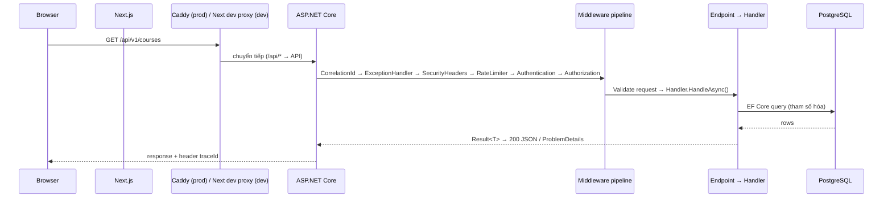

# Module 0 – Foundation (nền tảng dùng chung)

> Mục đích của tài liệu: giúp bạn **hiểu vì sao** từng mảnh tồn tại, không chỉ biết "cài cái gì". Đọc xong, bạn phải tự giải thích được một request đi từ trình duyệt tới database rồi quay về như thế nào.

## 1. Mục tiêu & phạm vi

**Mục tiêu:** dựng bộ khung chạy được từ đầu đến cuối (end-to-end) **trước khi** viết tính năng nghiệp vụ đầu tiên. Từ đó về sau, mọi module chỉ việc "cắm" vào khung này.

| Trong phạm vi | Ngoài phạm vi |
|---|---|
| Solution .NET (3 project + 3 project test), app Next.js | Bất kỳ tính năng nghiệp vụ nào |
| `AppDbContext`, migration đầu tiên, Postgres chạy bằng Docker | Deploy lên VPS (để Phase 5) |
| Các khối dùng chung: `Result<T>`, `Error`, ProblemDetails, phân trang, normalizer văn bản | |
| Logging, health check, rate limiting, security headers | |
| Khung background job | |
| CI (GitHub Actions): build, test, lint | |
| Sinh kiểu TypeScript từ OpenAPI | |

**Kết quả cần đạt:**
- Mở `http://localhost:3000` thấy một trang Next.js hiển thị "API: OK". Dòng chữ này lấy từ `GET /api/health`.
- CI trên GitHub chạy xanh.

## 2. Kiến thức bạn sẽ học ở module này

| Khái niệm | Giải thích ngắn | Áp dụng ở đâu |
|---|---|---|
| **Monorepo** | Một repo chứa cả backend, frontend, tài liệu và cấu hình deploy | Thư mục `ADUO/` |
| **Modular Monolith** | Một ứng dụng duy nhất nhưng chia module có ranh giới rõ ràng. Deploy đơn giản như monolith, mà vẫn tổ chức gọn như microservice | `Aduo.Core/Modules/*` |
| **Dependency Injection (DI)** | Đối tượng không tự `new` các phụ thuộc của nó, mà được "tiêm" vào qua constructor. Nhờ vậy dễ thay thế và dễ test | `builder.Services.Add…` trong `Program.cs` |
| **Middleware pipeline** | Mỗi request đi qua một chuỗi bước theo thứ tự: log, kiểm tra lỗi, xác thực, phân quyền, rate limit, rồi mới tới endpoint | `app.Use…` trong `Program.cs` |
| **ORM & Migration** | EF Core ánh xạ class C# sang bảng. Migration là các file mô tả thay đổi schema theo từng phiên bản, có thể áp dụng lần lượt | `AppDbContext`, `Migrations/` |
| **Result pattern** | Hàm nghiệp vụ trả về "thành công kèm giá trị" hoặc "thất bại kèm lỗi", thay vì ném exception cho những lỗi đã lường trước | `Result<T>` |
| **ProblemDetails (RFC 9457)** | Định dạng JSON chuẩn cho lỗi HTTP, giúp frontend xử lý lỗi theo một cách thống nhất | Mọi lỗi API |
| **Structured logging** | Log dạng có cấu trúc (JSON) với các trường riêng như `traceId` hay `userId`, thay vì một dòng chữ tự do, nên tìm kiếm và lọc được | Serilog |
| **Contract-first giữa FE và BE** | Backend xuất ra mô tả OpenAPI, frontend sinh kiểu TypeScript từ đó. Khi API đổi, TypeScript báo lỗi lúc build thay vì lỗi lúc chạy | `openapi-typescript` |
| **CI** | Mỗi lần push, máy chủ tự build và chạy test, để code hỏng không lọt vào nhánh `main` | GitHub Actions |
| **Container** | Đóng gói ứng dụng và môi trường chạy thành image. Chạy ở máy nào cũng giống nhau | Docker Compose |

## 3. Luồng một request (phải hiểu kỹ)



**Ở môi trường dev:** Next.js chạy ở cổng 3000, API ở cổng 5000. Cấu hình `rewrites` của Next.js chuyển tiếp `/api/*` sang `localhost:5000`. Nhờ vậy dev vẫn **cùng origin** giống hệt production (AR-01), cookie hoạt động y như thật.

## 4. Thành phần chi tiết

### 4.1 Backend solution
```
backend/
├── Aduo.sln
├── Directory.Build.props        # Cấu hình chung: net10.0, Nullable=enable, TreatWarningsAsErrors
├── src/Aduo.Api                 # Host
├── src/Aduo.Core                # Toàn bộ logic + dữ liệu
├── src/Aduo.Cli                 # Lệnh CLI
└── tests/…
```
- `Directory.Build.props` giúp mọi project có cùng phiên bản và cùng quy tắc. Không phải lặp lại cấu hình trong từng `.csproj`.
- **Quan hệ tham chiếu:** `Api → Core`, `Cli → Core`, `Tests → Core/Api`. `Core` **không bao giờ** tham chiếu ngược lại `Api`.

### 4.2 Các khối dùng chung (`Aduo.Core/Common`)

**`Result<T>` và `Error`:**
```csharp
public sealed record Error(string Code, string Message, ErrorType Type);
// ErrorType: Validation(400) | NotFound(404) | Conflict(409) | Forbidden(403) | Rule(422)

public readonly record struct Result<T>
{
    public T? Value { get; }
    public Error? Error { get; }
    public bool IsSuccess => Error is null;
    public static Result<T> Ok(T value) => new(value, null);
    public static Result<T> Fail(Error error) => new(default, error);
    // ...
}
```
- **Vì sao không ném exception?** Lỗi như "phần thi đã hết giờ" là chuyện **bình thường của nghiệp vụ**, không phải sự cố. Exception tốn chi phí, khó đọc luồng code, và dễ bị bắt nhầm chỗ. Exception chỉ dành cho những thứ không lường trước, ví dụ mất kết nối DB.
- Có một hàm mở rộng `ToHttpResult()` để map `ErrorType` sang mã HTTP và trả về ProblemDetails. Nhờ đó mọi endpoint xử lý lỗi giống hệt nhau.

**Phân trang:**
- `PageRequest(page, pageSize)` giới hạn `pageSize` tối đa 100.
- `PagedResult<T>(items, page, pageSize, totalCount)`.
- `SortParser` biến chuỗi `"-createdAt,title"` thành một danh sách sắp xếp đã kiểm tra theo whitelist. Mục đích là chống việc sắp xếp theo cột tùy ý, thứ có thể làm lộ dữ liệu hoặc làm truy vấn chậm.

**Normalizer văn bản** (dùng ở Lexicon, nhưng đặt chung để test sớm):
- `GermanTextNormalizer.ForSearch("Mädchen")` cho ra `"maedchen"`. Quy tắc: chuyển chữ thường, `ä→ae`, `ö→oe`, `ü→ue`, `ß→ss`.
- `VietnameseNormalizer.ForSearch("Cô gái")` cho ra `"co gai"`. Quy tắc: chuyển chữ thường, bỏ dấu, `đ→d`.

**`ContentMeta`** (owned type, dùng bởi mọi bảng nội dung): chỉ **khai báo** ở Foundation. Logic vòng đời viết ở ContentOps.

### 4.3 `AppDbContext`
- Một DbContext duy nhất. Mỗi module có một file `XxxModelConfiguration` gom các `IEntityTypeConfiguration` của nó.
- Đặt tên snake_case bằng gói `EFCore.NamingConventions`.
- Có 2 interceptor:
  - `AuditInterceptor`: tự đặt `created_at` và `updated_at`.
  - `ContentVersionInterceptor`: tăng `version` khi sửa nội dung đã Published. Phần này hoàn thiện ở ContentOps.
- Migration đầu tiên `Init` chỉ tạo 7 schema và 2 extension `pg_trgm`, `unaccent`.

### 4.4 `Program.cs`: thứ tự middleware và lý do
| Thứ tự | Middleware | Vì sao đặt ở vị trí này |
|---|---|---|
| 1 | `CorrelationId` | Gắn `traceId` sớm nhất, để mọi log phía sau đều có |
| 2 | `UseExceptionHandler` + ProblemDetails | Bắt được lỗi của mọi bước phía sau |
| 3 | `SecurityHeaders` (HSTS, CSP, nosniff…) | Áp dụng cho mọi response, kể cả response lỗi |
| 4 | `UseRateLimiter` | Chặn spam trước khi tốn công xác thực |
| 5 | `UseAuthentication` → `UseAuthorization` | Phải biết "bạn là ai" rồi mới hỏi "bạn được làm gì" |
| 6 | `UseAntiforgery` | Sau khi xác thực (module Identity bật lên) |
| 7 | `MapXxxEndpoints()` của từng module | |

### 4.5 Logging (Serilog)
- Xuất ra console dạng JSON (Docker sẽ thu lại log này) và file xoay vòng 14 ngày.
- **Enricher** tự thêm `traceId`, `userId`, `requestPath`.
- Danh sách **không bao giờ log:** mật khẩu, token, cookie, header `Authorization`, nội dung người dùng gõ vào form báo lỗi.

### 4.6 Health check
- `/api/health`: tiến trình còn sống (liveness).
- `/api/health/ready`: kết nối được DB (readiness). Docker dùng endpoint này để biết lúc nào container sẵn sàng.

### 4.7 Rate limiting
Dùng middleware có sẵn `Microsoft.AspNetCore.RateLimiting`. Khai báo **policy theo tên**, ví dụ `"auth-login"` hay `"api-default"`. Endpoint nào cần thì gắn `.RequireRateLimiting("auth-login")`. Con số cụ thể nằm ở [Phase 3 – 01 §8](../../phase-3/01-system-architecture.md).

### 4.8 Khung background job
```csharp
public interface IRecurringJob { string Name { get; } TimeSpan Interval { get; } Task RunAsync(CancellationToken ct); }
```
- `RecurringJobHost : BackgroundService` lặp qua các job đã đăng ký. Mỗi job chạy bằng `PeriodicTimer` và được bọc trong `pg_try_advisory_lock(hash(Name))`, để nếu sau này chạy 2 instance thì mỗi job vẫn chỉ chạy một lần.
- Lỗi của một job chỉ được log lại, **không** làm chết tiến trình.

### 4.9 Frontend
- Khởi tạo Next.js (App Router, TypeScript strict, Tailwind) và `shadcn/ui` (Button, Input, Toast, Skeleton).
- `next.config` có `rewrites` cho `/api/*` (dev) và `output: "standalone"` (Docker).
- `src/lib/api/client.ts` dùng `openapi-fetch`, có middleware tự gắn header `X-XSRF-TOKEN` (đọc từ cookie) cho các request thay đổi dữ liệu.
- Script `npm run gen:api` tải `/api/openapi/v1.json` về và sinh `schema.d.ts`.
- Font **Be Vietnam Pro** qua `next/font`. Các token màu đặt trong `globals.css` ([Phase 3 – 06](../../phase-3/06-design-system.md)).
- Đã có sẵn các trạng thái dùng chung: `PageSkeleton`, `EmptyState`, `ErrorState`.

### 4.10 Docker Compose (dev) & cấu hình
- `deploy/compose.dev.yml` chỉ có Postgres, map cổng 5432, có volume lưu dữ liệu.
- Cấu hình theo thứ tự ưu tiên: `appsettings.json` → `appsettings.Development.json` → **user-secrets** (máy dev) → **biến môi trường** (prod).
- Connection string và API key **không bao giờ** nằm trong file đã commit.

### 4.11 CI (`.github/workflows/ci.yml`)
| Job | Bước |
|---|---|
| backend | `dotnet restore` → `build -c Release` → `test` (Postgres chạy bằng Testcontainers) |
| frontend | `npm ci` → `lint` → `typecheck` → `build` |
| docs | (tùy chọn) kiểm tra link markdown |

## 5. Kiểm thử của Foundation
| ID | Kịch bản | Kết quả mong đợi |
|---|---|---|
| F-T01 | `GET /api/health` | 200 `{"status":"Healthy"}` |
| F-T02 | `GET /api/health/ready` khi DB tắt | 503 |
| F-T03 | Endpoint thử ném exception | 500 ProblemDetails, có `traceId`, **không** lộ stack trace |
| F-T04 | `Result.Fail(NotFound)` → `ToHttpResult` | 404 ProblemDetails với `code` đúng |
| F-T05 | `GermanTextNormalizer("Straße")` | `"strasse"` |
| F-T06 | `VietnameseNormalizer("Đi làm")` | `"di lam"` |
| F-T07 | `SortParser("-hacked")` với whitelist `[createdAt]` | Lỗi `INVALID_SORT` |
| F-T08 | Gọi quá giới hạn rate limit | 429 + header `Retry-After` |
| F-T09 | Response có đủ security headers | Có HSTS (prod), `X-Content-Type-Options`, CSP |
| F-T10 | Architecture test: `Aduo.Core` không tham chiếu `Aduo.Api` | Pass |

## 6. Các bước triển khai (checklist)
1. Kiểm tra môi trường: .NET 10 SDK, Node LTS, Docker Desktop, Git.
2. Tạo cấu trúc monorepo, `.gitignore`, `.editorconfig`, `README.md`.
3. Tạo solution và các project, `Directory.Build.props`.
4. Viết `Common/` (Result, Error, Paging, Normalizers) kèm unit test (F-T04..07).
5. Viết `AppDbContext`, migration `Init`, `compose.dev.yml`.
6. Viết `Program.cs`: middleware, ProblemDetails, Serilog, health, rate limiter, OpenAPI.
7. Viết khung job (chưa có job thật).
8. Khởi tạo Next.js, Tailwind, shadcn, font, API client, trang thử gọi health.
9. Viết CI workflow, push lên GitHub (repo public, Q-P3-01).
10. Cập nhật README: cách chạy dự án ở máy dev.

## 7. Definition of Done
- [ ] Chạy `docker compose -f deploy/compose.dev.yml up -d`, `dotnet run` và `npm run dev`, mở trang thấy "API: OK".
- [ ] F-T01..10 pass trong CI.
- [ ] README hướng dẫn được một người lạ chạy dự án trong ≤ 15 phút.
- [ ] Không có secret nào trong repo (kiểm tra bằng `git grep` và secret scanning của GitHub).
