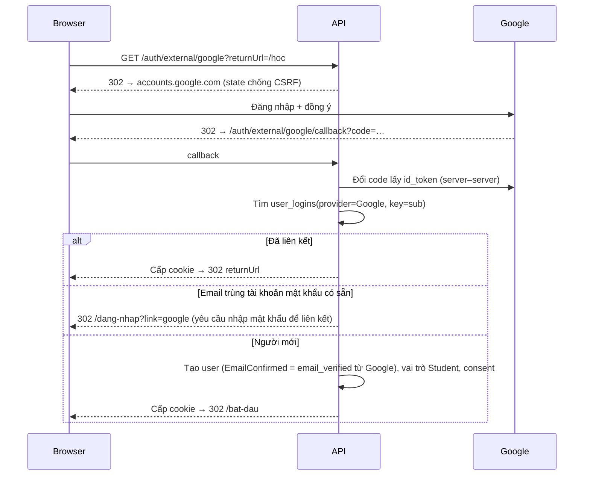
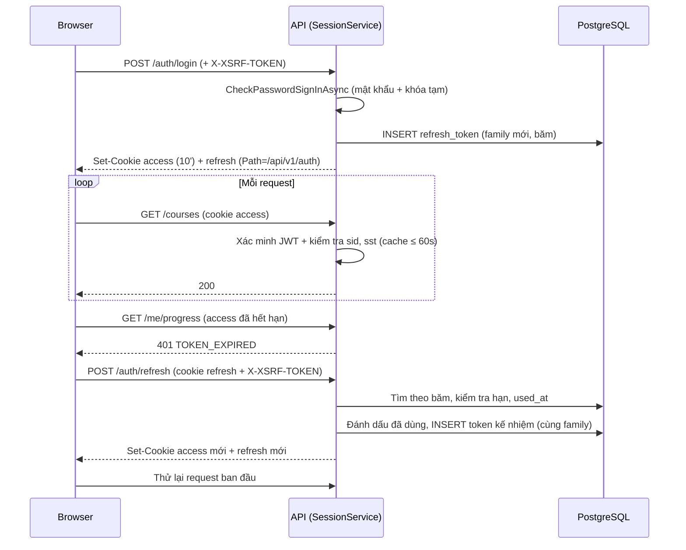

# Module 1 – Identity (tài khoản, xác thực, hồ sơ)

> **[CẬP NHẬT – AD-09, 2026-11-22]** Phần xác thực của module này dùng **JWT access token + refresh token xoay vòng** (không dùng cookie đăng nhập của Identity). Các câu nhắc tới "cookie phiên" ở §2–§8 đã được vá. **Thiết kế đầy đủ nằm ở §14**, phần nào mâu thuẫn thì §14 thắng. Ước tính module tăng từ 6–8 lên **11–15 ngày công**.

> **[TRẠNG THÁI TRIỂN KHAI – 2026-11-23]** Backend + frontend cốt lõi đã chạy và kiểm chứng (ID-T01..11, 15..20, 24..39, 41..44 pass trên PostgreSQL thật). **Chưa làm:** Google login (ID-T12..14, T45, cần OAuth Client ID/Secret của chủ dự án), ID-T21..23 (khách chơi thử, onboarding phút học), ID-T40 (xoay khóa ký). ID-T17 hiện kiểm tra qua danh sách quyền ở `/me` vì endpoint `assessment.take` chưa có. Điều chỉnh so với thiết kế (CSRF double-submit, token email tự viết…): [decision log §7](../../phase-1/08-decision-log.md).

## 1. Mục tiêu & phạm vi
**Mục tiêu:** người dùng tạo được tài khoản và đăng nhập **an toàn**, khai báo mục đích học. Admin có quyền quản trị. Mọi module khác dựa vào Identity để biết "ai đang gọi" và "người đó được làm gì".

| Trong phạm vi (MVP) | Ngoài phạm vi |
|---|---|
| Đăng ký email + mật khẩu, xác minh email, đăng nhập/đăng xuất, "Ghi nhớ" | Đăng nhập bằng Facebook hoặc số điện thoại |
| Đăng nhập Google (Q-P2-01) | Xác thực 2 lớp (2FA): để V2 |
| Quên và đặt lại mật khẩu, đổi mật khẩu | Vai trò Teacher, Content Manager riêng |
| Onboarding: mục đích học + cấp độ mục tiêu | Tải xuống dữ liệu cá nhân (V2) |
| Hồ sơ, ảnh đại diện | |
| Xóa tài khoản (ẩn danh trong ≤ 30 ngày) | |
| Admin: danh sách, khóa và mở khóa người dùng. CLI `create-admin` | |

Nguồn yêu cầu: UC-01..06, UC-32 · FR-ID-01..08 · BR-AUTH-01..09, BR-PRIV-01..04 · US-01..06.

## 2. Kiến thức bạn sẽ học
| Khái niệm | Giải thích | Trong module |
|---|---|---|
| **Authentication vs Authorization** | *Xác thực* trả lời câu "bạn là ai". *Phân quyền* trả lời câu "bạn được làm gì". Hai bước tách biệt, làm theo thứ tự đó | JWT bearer + permission policy |
| **Hash mật khẩu** | Không bao giờ lưu mật khẩu gốc. Hệ thống lưu kết quả hàm băm chậm có **salt** (PBKDF2 trong Identity). Khi đăng nhập, băm lại mật khẩu người dùng nhập rồi so sánh với giá trị đã lưu | `PasswordHasher` |
| **Access token và refresh token** | **Access token** (JWT, sống 10 phút) chứng minh "tôi là ai" ở mỗi request. **Refresh token** (chuỗi ngẫu nhiên, sống lâu, lưu băm ở server) dùng để xin access token mới và **xoay vòng mỗi lần dùng**. Mất một token ngắn hạn thì thiệt hại nhỏ, còn token dài hạn thì thu hồi được | `SessionService`, xem §14 |
| **HttpOnly** | JavaScript không đọc được cookie, nên kẻ tấn công XSS không đánh cắp được phiên | |
| **CSRF** | Trang độc hại có thể khiến trình duyệt tự gửi cookie của bạn kèm một request giả. Cách chống: `SameSite` + **antiforgery token**, là thứ trang độc hại không đọc được | Header `X-XSRF-TOKEN` |
| **Token một lần có hạn** | Link xác minh email và link đặt lại mật khẩu chứa token đã ký, có thời hạn. Token đặt lại mật khẩu bị vô hiệu sau khi dùng, vì `SecurityStamp` thay đổi | `UserManager.Generate…TokenAsync` |
| **SecurityStamp** | Một chuỗi ngẫu nhiên của mỗi user. Khi đổi mật khẩu, chuỗi này đổi theo, nên mọi cookie và token cũ mất hiệu lực | BR-AUTH-08 |
| **OAuth 2.0 / OpenID Connect** | Ủy quyền đăng nhập cho Google. Google xác minh người dùng rồi trả về danh tính đã ký. Ứng dụng **không bao giờ** thấy mật khẩu Google | `AddGoogle()` |
| **Account enumeration** | Thông báo lỗi khác nhau cho "email không tồn tại" và "sai mật khẩu" sẽ giúp kẻ xấu dò ra email nào có tài khoản. Vì vậy dùng một thông báo chung | US-03, US-04 |
| **Lockout & rate limit** | Chống dò mật khẩu: khóa tạm tài khoản và giới hạn số request theo IP | BR-AUTH-06 |
| **Permission-based authorization** | Endpoint yêu cầu một *quyền* cụ thể, không yêu cầu *tên vai trò*. Sau này tách vai trò chỉ cần sửa bảng ánh xạ vai trò sang quyền | `RolePermissionMap` |
| **Soft delete + ẩn danh** | Xóa tài khoản không xóa ngay mọi bảng liên quan, mà thay dữ liệu cá nhân bằng giá trị ẩn danh. Thống kê vẫn còn, quyền riêng tư vẫn được đảm bảo | BR-PRIV-02 |

## 3. Mô hình miền

### 3.1 `AppUser` (mở rộng `IdentityUser<Guid>`)
| Thuộc tính | Kiểu | Ràng buộc | Ghi chú |
|---|---|---|---|
| `Id` | Guid (v7) | PK | |
| `Email`, `NormalizedEmail` | string | UQ, ≤ 254 ký tự | Email là định danh đăng nhập (BR-AUTH-01) |
| `EmailConfirmed` | bool | | Mở khóa quyền làm bài kiểm tra và báo lỗi (BR-AUTH-07) |
| `PasswordHash` | string? | | Null nếu tài khoản chỉ dùng Google |
| `DisplayName` | string | 2–50 ký tự, lọc từ thô tục | |
| `AvatarMediaId` | Guid? | | Tham chiếu tới ContentOps Media |
| `LearningPurpose` | enum? | `Ausbildung`, `Nursing`, `Recognition`, `Study`, `Other` | PD-09 |
| `TargetLevel` | enum? | `A1`, `A2`, `B1` | |
| `CreatedAt` | DateTimeOffset | | |
| `DeletedAt`, `AnonymizedAt` | DateTimeOffset? | | Vòng đời xóa tài khoản |
| `LockoutEnd`, `AccessFailedCount` | (sẵn có của Identity) | | BR-AUTH-06 |

**Bất biến (invariant) cần giữ:**
- Tài khoản đã có `DeletedAt` thì không đăng nhập được.
- Sau khi ẩn danh, `Email` thành `deleted-{id}@invalid`, `DisplayName` thành "Người dùng đã xóa", `PasswordHash` thành null, các bản ghi `user_logins` bị xóa.

### 3.2 `UserConsent`
`Id`, `UserId`, `TermsVersion`, `PrivacyVersion`, `MinorGuardianConfirmed` (bool), `ConsentedAt`.
- Lần đăng ký đầu tiên tạo 1 bản ghi.
- Khi điều khoản có phiên bản mới, người dùng phải đồng ý lại (V2). Mỗi lần đồng ý thêm 1 bản ghi, **không ghi đè** bản cũ. Đây là bằng chứng đồng ý theo NĐ 13/2023.

### 3.3 Vai trò → quyền
| Vai trò | Quyền |
|---|---|
| `Student` | `learning.access`, `assessment.take`*, `reports.create`* |
| `Admin` | Toàn bộ quyền của Student + `content.manage`, `content.publish`, `infohub.manage`, `reports.manage`, `users.manage` |

\* `assessment.take` và `reports.create` còn đòi thêm điều kiện **email đã xác minh**. Điều kiện này được kiểm tra bằng một authorization requirement riêng: `VerifiedEmailRequirement`.

## 4. Chức năng chi tiết

### 4.1 Đăng ký (UC-01, US-01)
**Luồng:**
1. Frontend gọi `GET /auth/csrf` để nhận cookie XSRF.
2. Người dùng điền form. Zod kiểm tra ngay trên client (chỉ để trải nghiệm tốt hơn, **không thay được** kiểm tra ở server).
3. `POST /auth/register`. FluentValidation kiểm tra lại toàn bộ dữ liệu.
4. Tạo user: `UserManager.CreateAsync(user, password)`. Identity băm mật khẩu và kiểm tra chính sách mật khẩu.
5. Thêm vai trò `Student`. Ghi `UserConsent`.
6. Sinh token xác minh, gửi email (qua `IEmailSender`). Email lỗi **không** làm hỏng việc đăng ký: hệ thống log lại, người dùng bấm "Gửi lại" sau.
7. `SessionService.StartSessionAsync(user, rememberMe)` tạo phiên (chuỗi refresh token) và cấp cặp token qua cookie `HttpOnly` (§14). Trả 201 kèm `MeResponse`.
8. Frontend chuyển sang `/bat-dau` (onboarding).

**Validation (BR-AUTH-02, 03):**
- `email` hợp lệ.
- `password` ≥ 8 ký tự, có cả chữ và số, không trùng email, không nằm trong danh sách mật khẩu phổ biến (file `common-passwords.txt`, khoảng 10.000 dòng).
- `displayName` dài 2–50 ký tự.
- `acceptTerms = true`.

**Tình huống biên:**
- Email đã tồn tại thì trả 409 `EMAIL_TAKEN`. Ở form đăng ký thì nói thẳng là chấp nhận được, vì người dùng cần biết để chuyển sang đăng nhập. Rate limit 5 lần/giờ/IP hạn chế việc lợi dụng điều này để dò email.
- Email viết hoa thường khác nhau được coi là một (so sánh qua `NormalizedEmail`).
- Gửi 2 request đăng ký cùng lúc: unique index ở DB chặn bản thứ hai, trả 409.

### 4.2 Xác minh email (US-02)
- Link có dạng `https://<domain>/xac-minh-email?userId=…&token=…`. Trang này gọi `POST /auth/confirm-email`.
- Token có hạn **24 giờ**. Cấu hình bằng `DataProtectionTokenProviderOptions` cho một provider riêng dành cho email.
- `POST /auth/resend-confirmation` bị giới hạn 3 lần/giờ/người dùng.

### 4.3 Đăng nhập & khóa tạm (US-03)
- `SignInManager.PasswordSignInAsync(email, password, isPersistent: rememberMe, lockoutOnFailure: true)`.
- Sai 5 lần thì `LockoutEnd = now + 15 phút`. Response trả 400 kèm `code: ACCOUNT_LOCKED` và `retryAfter` (số giây còn lại).
- Mọi lỗi khác (email không tồn tại, sai mật khẩu) **cùng một thông báo**: `INVALID_CREDENTIALS`.
- Thời hạn phiên theo loại (Ghi nhớ, Admin…): xem bảng ở §14.4. Access token luôn 10 phút, refresh token xoay vòng.

### 4.4 Đăng nhập Google (UC-01b, BR-AUTH-09)

- `returnUrl` phải là **đường dẫn nội bộ** (bắt đầu bằng `/`, không có `//`). Đây là cách chống **open redirect**.
- Người mới đăng ký qua Google vẫn phải tick ô đồng ý điều khoản ở màn hình onboarding đầu tiên. Hệ thống ghi `UserConsent` tại bước đó.
- Client ID và Secret của Google nằm trong biến môi trường.

### 4.5 Quên & đặt lại mật khẩu (US-04)
- `POST /auth/forgot-password {email}` **luôn** trả 202. Nếu email tồn tại thì gửi link (có hạn 1 giờ).
- `POST /auth/reset-password {email, token, newPassword}`:
  1. Gọi `ResetPasswordAsync`.
  2. Gọi `UpdateSecurityStampAsync`, khiến mọi phiên khác bị đăng xuất.
  3. Mở khóa tài khoản nếu đang bị khóa tạm.

### 4.6 Hồ sơ & onboarding (US-05)
- `GET /me` trả `{id, email, emailConfirmed, displayName, avatarUrl, learningPurpose, targetLevel, permissions[], needsOnboarding}`.
- `needsOnboarding = (LearningPurpose == null && chưa bỏ qua)`. Lựa chọn bỏ qua được lưu bằng cách đặt `Other` và `A1`.
- `PATCH /me` chỉ cho sửa các trường được phép (whitelist). Không bao giờ cho sửa `email` hay vai trò qua endpoint này.
- **Gợi ý ở onboarding:** chọn `Ausbildung` hoặc `Nursing` thì bước 2 chọn sẵn `B1`, kèm link "Vì sao là B1?" dẫn tới bài Info Hub.

### 4.7 Xóa tài khoản (US-06, BR-PRIV-02)
1. `POST /me/delete {password, confirmText: "XÓA"}`. Tài khoản chỉ dùng Google thì không có mật khẩu, nên chỉ cần `confirmText`.
2. Đặt `DeletedAt = now`, đổi `SecurityStamp` (đăng xuất mọi nơi), rồi đăng xuất phiên hiện tại.
3. Job `PurgeDeletedAccounts` chạy hằng ngày, xử lý các tài khoản có `DeletedAt` cách đây ≥ 7 ngày (khoảng ân hạn, cấu hình được, tối đa 30). Với mỗi tài khoản:
   - Ẩn danh `users`.
   - Xóa `user_logins` và `user_tokens`.
   - Gọi interface `IUserDataEraser` mà **mỗi module tự cài đặt**. Ví dụ Progress thay `user_id` bằng UUID ẩn danh, ContentOps xóa nội dung tin nhắn trong báo lỗi.
   - Ghi `AnonymizedAt`.

   Vì sao làm qua interface? Identity không được động trực tiếp vào bảng của module khác (AR-03). Mỗi module tự biết dữ liệu cá nhân của mình nằm ở đâu.

### 4.8 Admin – người dùng (UC-32)
- `GET /admin/users?q=&page=` tìm theo email hoặc tên. Kết quả **không** trả về `PasswordHash`.
- `POST /admin/users/{id}/lock`: đặt `LockoutEnd = MaxValue` và đổi `SecurityStamp`.
- `POST /admin/users/{id}/unlock`: mở khóa.
- Admin không tự khóa được chính mình. Hệ thống luôn còn ít nhất 1 Admin.

### 4.9 CLI `create-admin`
`aduo-cli create-admin --email you@x.com`. Lệnh hỏi mật khẩu ngay trong terminal, không nhận mật khẩu qua tham số dòng lệnh, vì tham số sẽ bị lưu vào lịch sử shell.

## 5. Dữ liệu
Bảng `identity.users`, `user_consents`, cùng các bảng chuẩn của Identity. Chi tiết ở [Phase 3 – 02 §3.1](../../phase-3/02-database-design.md).

**Data Protection keys** (khóa mã hóa token xác minh email, đặt lại mật khẩu và antiforgery) phải được **lưu bền vững**. Nếu không, mỗi lần deploy các link đã gửi và antiforgery token sẽ hết hiệu lực. Giải pháp: `PersistKeysToDbContext`, lưu vào bảng `identity.data_protection_keys`. (Khóa ký JWT là một thứ khác, xem §14.8.)

## 6. API (tóm tắt)
Xem [Phase 3 – 03 §2](../../phase-3/03-api-design.md). Rate limit riêng:
| Endpoint | Giới hạn |
|---|---|
| login | 10 lần/phút/IP |
| register | 5 lần/giờ/IP |
| forgot-password | 3 lần/giờ/email + 10 lần/giờ/IP |
| resend-confirmation | 3 lần/giờ/người dùng |

## 7. Giao diện
| Màn hình | Trạng thái cần có |
|---|---|
| Đăng ký | Lỗi ngay tại trường nhập. Nút bị vô hiệu cho tới khi tick đồng ý. Spinner trên nút khi đang gửi. Lỗi `EMAIL_TAKEN` hiện kèm link |
| Đăng nhập | Nút "Tiếp tục với Google". Thông báo khóa tạm kèm thời gian đếm ngược. Link "Quên mật khẩu" |
| Quên mật khẩu | Sau khi gửi luôn hiện "Nếu email tồn tại…" |
| Đặt lại mật khẩu | Link hết hạn thì có nút "Gửi lại link" |
| Xác minh email | Ba trạng thái: thành công / hết hạn / đã xác minh trước đó |
| Onboarding 2 bước | Có nút "Bỏ qua". Ô đồng ý điều khoản (chỉ cho người đăng ký qua Google) |
| Hồ sơ | Đổi tên, ảnh, mục đích, cấp độ, mật khẩu. Vùng "Nguy hiểm": Xóa tài khoản |
| Banner xác minh | Trên dashboard nếu `emailConfirmed = false`: "Xác minh email để làm bài kiểm tra · Gửi lại" |

Guard ở frontend (`(learn)/layout.tsx`):
- Gọi `useMe()`. Nếu 401 thì chuyển tới `/dang-nhap?returnUrl=…`.
- Nếu `needsOnboarding` thì chuyển tới `/bat-dau`.
- Guard ở frontend chỉ phục vụ trải nghiệm người dùng. **Bảo mật thật nằm ở API.**

## 8. Bảo mật – checklist riêng
- [ ] Cookie token (§14.7): `HttpOnly`, `Secure` (prod), `SameSite=Lax`, tiền tố `__Host-` (access) và `__Secure-` (refresh) **chỉ ở staging/production**, không dùng ở dev http.
- [ ] Antiforgery bật cho mọi request POST, PUT, PATCH, DELETE.
- [ ] Không log email trong log tổng quát (chỉ log `userId`).
- [ ] Kiểm tra `returnUrl` để chống open redirect.
- [ ] Data Protection keys được lưu bền vững và không lọt vào repo.
- [ ] Email gửi đi không chứa mật khẩu. Token chỉ xuất hiện trong link.

## 9. Test cases
| ID | Kịch bản | Kết quả mong đợi |
|---|---|---|
| ID-T01 | Đăng ký hợp lệ | 201. Có cặp cookie token (access và refresh) đúng thuộc tính. `emailConfirmed=false`. Có 1 bản ghi consent. Email được gửi (fake sender ghi nhận) |
| ID-T02 | Đăng ký trùng email (khác hoa thường) | 409 `EMAIL_TAKEN` |
| ID-T03 | Mật khẩu "12345678" | 400, lỗi ở trường `password` |
| ID-T04 | `acceptTerms=false` | 400 |
| ID-T05 | POST register không có header XSRF | 400 (antiforgery) |
| ID-T06 | Xác minh với token đúng | Chuyển sang `emailConfirmed=true` |
| ID-T07 | Xác minh với token đã hết hạn (dùng `FakeTimeProvider` +25 giờ) | 400 `TOKEN_EXPIRED` |
| ID-T08 | Đăng nhập sai mật khẩu và đăng nhập email không tồn tại | Cùng response `INVALID_CREDENTIALS` |
| ID-T09 | Sai 5 lần rồi thử lần 6 với mật khẩu đúng | `ACCOUNT_LOCKED`. Sau 15 phút thì đăng nhập được |
| ID-T10 | Quên mật khẩu với email không tồn tại | 202, không gửi email |
| ID-T11 | Đặt lại mật khẩu, rồi dùng lại token đó | Lần 2 thất bại. Mọi refresh token cũ bị thu hồi, access token cũ bị từ chối (xem ID-T34) |
| ID-T12 | Google: người mới | Tạo user, `emailConfirmed` theo Google, chuyển tới onboarding |
| ID-T13 | Google: email trùng tài khoản mật khẩu | Không tự liên kết. Yêu cầu nhập mật khẩu |
| ID-T14 | `returnUrl=https://evil.com` | Bị bỏ qua, chuyển về `/hoc` |
| ID-T15 | `PATCH /me` gửi kèm `email` | Trường bị bỏ qua hoặc trả 400. Email không đổi |
| ID-T16 | Student gọi `/admin/users` | 403 |
| ID-T17 | Chưa xác minh email mà gọi endpoint cần `assessment.take` | 403 `EMAIL_NOT_VERIFIED` |
| ID-T18 | Xóa tài khoản rồi đăng nhập | Thất bại. Sau khi job chạy, email đã bị ẩn danh |
| ID-T19 | Admin khóa user đang đăng nhập | Request tiếp theo của user đó trả 401 |
| ID-T20 | Khóa Admin cuối cùng | 422 `LAST_ADMIN` |

## 10. Các bước triển khai
1. Cấu hình Identity (`AddIdentityCore<AppUser>` + roles + EF stores), chính sách mật khẩu, lockout, token providers, lưu Data Protection keys.
2. Migration `Identity_Init`. Seed các vai trò (lệnh `seed`). Lệnh `create-admin`.
3. `IEmailSender` (MailKit SMTP) + `FakeEmailSender` cho test. Template email HTML đơn giản bằng tiếng Việt.
4. Các slice: Register, ConfirmEmail, Resend, Login, Logout, Forgot, Reset, Me (Get/Patch), ChangePassword, Delete.
5. Google external login + flow liên kết tài khoản.
6. Permission policies + `VerifiedEmailRequirement`. Interface `IUserDataEraser` + job `PurgeDeletedAccounts`.
7. Admin users: list, lock, unlock.
8. Integration test ID-T01..20.
9. Frontend: các trang auth, onboarding, hồ sơ, guard, banner xác minh, admin users.
10. Thử thủ công trên điện thoại thật.

## 11. Definition of Done
- [ ] Mọi AC của US-01..06 đạt. ID-T01..20 pass.
- [ ] Google login chạy được ở dev (`http://localhost`, redirect URI đã đăng ký trong Google Cloud Console).
- [ ] Không có mật khẩu, token hay email trong log (đã kiểm tra bằng cách grep log).
- [ ] Decision log cập nhật nếu có thay đổi.

## 12. [ĐÃ CHỐT – CR-002, phương án 2] Thay đổi liên quan
> Chỉ áp dụng nếu CR-002 được chốt (phương án 2 hoặc 1).

- **Gộp dữ liệu khách (A4):** sau khi đăng ký hoặc đăng nhập lần đầu, frontend gọi `POST /me/engagement/merge-guest` (module Engagement) để gộp tiến độ tạm trên `localStorage`. Identity không xử lý gộp, chỉ bảo đảm người dùng vừa đăng nhập xong có phiên hợp lệ.
- **Onboarding** thêm một bước ngắn (tùy chọn): "Mỗi ngày bạn muốn học bao lâu? 5 / 10 / 15 phút", để chọn số thẻ mới mỗi ngày và độ khó nhiệm vụ.
- `IUserDataEraser` của Engagement phải được gọi khi xóa tài khoản (BR-ENG-09).
- Test bổ sung: **ID-T21** khách chơi, đăng ký, dữ liệu được gộp đúng, **ID-T22** `returnUrl` sau đăng ký từ trang chơi thử quay về đúng trang.

## 13. [ĐÃ CHỐT – CR-003, phương án 2] Onboarding cá nhân hóa

- Onboarding (US-05) thêm **bước 3 tùy chọn**: "Mỗi ngày bạn muốn học bao lâu?" 5 / 10 / 15 / 20 phút. Giá trị lưu vào `engagement.user_preferences.daily_minutes` (module Engagement, không phải Identity) và quyết định số thẻ mới mỗi ngày gợi ý (5 phút = 5 thẻ, 10 = 10, 15 = 15, 20 = 20).
- Trang **Cài đặt** nằm trong Hồ sơ, gọi `/me/preferences` (xem [08-engagement §12.5](08-engagement.md)).
- Test bổ sung: **ID-T23** bỏ qua bước 3 thì dùng mặc định 10 phút.

## 14. [ĐÃ CHỐT – AD-09] Thiết kế xác thực JWT hybrid

> **Quyết định (2026-11-22):** chủ dự án chọn thiết kế an toàn và dùng được lâu dài. Phương án: **JWT access token ngắn hạn + refresh token xoay vòng có phát hiện đánh cắp**, truyền bằng **cookie `HttpOnly`** cho web, sẵn sàng **bearer** cho app native. Thay thế cookie session thuần của AR-05 cũ.

### 14.1 Vì sao chọn thiết kế này
| Yêu cầu dài hạn | Thiết kế đáp ứng thế nào |
|---|---|
| **An toàn trước XSS** | Token nằm trong cookie `HttpOnly`, JavaScript không đọc được |
| **Thu hồi được** (khóa tài khoản, đổi mật khẩu, mất thiết bị) | Refresh token lưu băm ở server, mỗi phiên có `family_id`. Access token mang `sid` (phiên) và `sst` (SecurityStamp) để kiểm tra |
| **Phát hiện token bị đánh cắp** | Xoay vòng refresh token mỗi lần dùng. Dùng lại token cũ ngoài khoảng ân hạn thì **thu hồi cả chuỗi** |
| **Mở rộng sang mobile, API bên thứ ba** | Cùng mô hình token, chỉ khác cách truyền (cookie hay header). Không phải đổi gốc rễ |
| **Đa instance về sau** | Access token tự chứa. Chỉ trạng thái thu hồi cần chia sẻ (hiện cache trong bộ nhớ, đổi sang Redis khi cần) |

**Đánh đổi chấp nhận:** phức tạp hơn cookie session thuần túy, nhiều chỗ có thể sai. Giảm thiểu bằng: tách `SessionService` thành một lớp duy nhất giữ toàn bộ logic token, bộ test dày (ID-T24..45), và nhật ký sự kiện bảo mật.

### 14.2 Mô hình token
| | **Access token** | **Refresh token** |
|---|---|---|
| Dạng | JWT ký **HS256** (khóa ≥ 256 bit từ biến môi trường). RS256 chỉ khi có dịch vụ khác cần xác minh token | Chuỗi ngẫu nhiên 256 bit (CSPRNG), base64url. **Không phải JWT** |
| Thời hạn | **10 phút** | Theo bảng 14.4 |
| Lưu ở server | Không | **Chỉ lưu băm SHA-256** trong `identity.refresh_tokens`. DB bị lộ cũng không dùng được token |
| Claims | `sub` (userId), `jti`, `sid` (family_id của phiên), `sst` (8 byte đầu của hash SecurityStamp), `iss`, `aud`, `iat`, `exp`, `auth_time` | Không có |
| **Không** chứa | Email, tên, vai trò, permission | |
| Mục đích | Xác thực request API | Chỉ để xin cặp token mới tại `POST /auth/refresh` |

**Vì sao không đưa vai trò/permission vào token?** Vai trò lấy từ bảng ánh xạ trong code ở mỗi request (rất rẻ, trong bộ nhớ), nên đổi quyền có hiệu lực ngay, không phải chờ token cũ hết hạn.

**Cấu hình xác minh JWT (bắt buộc):** chỉ chấp nhận thuật toán đã ghim (HS256), từ chối `alg=none`, bắt buộc `exp`, kiểm tra `iss` và `aud`, `ClockSkew` tối đa 30 giây, khóa ký phải đủ dài.

### 14.3 Vòng đời phiên


### 14.4 Thời hạn theo loại phiên (cấu hình được, BR-AUTH-12)
| Loại phiên | Refresh cookie | Hạn nghỉ (idle) | Hạn tuyệt đối |
|---|---|---|---|
| Học viên, **không** chọn "Ghi nhớ" | Cookie phiên (mất khi đóng trình duyệt) | 24 giờ | 7 ngày |
| Học viên, chọn "Ghi nhớ" | Cookie bền | 30 ngày | **90 ngày** |
| **Admin** (bắt buộc, không có "Ghi nhớ") | Cookie phiên | 2 giờ | **12 giờ** |
| Client native (về sau) | Lưu trong kho an toàn của hệ điều hành | 30 ngày | 90 ngày |

- **Hạn nghỉ** tính lại sau mỗi lần xoay vòng. **Hạn tuyệt đối** không bao giờ kéo dài: hết hạn là phải đăng nhập lại, kể cả khi dùng đều đặn.
- Endpoint Admin còn yêu cầu `auth_time` (lần nhập mật khẩu gần nhất) không quá **12 giờ**, ngược lại trả 401 `REAUTH_REQUIRED`.

### 14.5 Xoay vòng và phát hiện dùng lại
Thuật toán `POST /auth/refresh` (BR-AUTH-10, 11):
```
1. Băm token nhận được, tìm theo băm. Không thấy: 401.
2. Token đã bị thu hồi, hoặc quá hạn nghỉ, hoặc quá hạn tuyệt đối: 401.
3. Token chưa dùng (used_at = null):
     đánh dấu used_at = now; tạo token kế nhiệm (cùng family, replaced_by);
     cấp access token mới + refresh token mới.
4. Token ĐÃ dùng:
     a. Nếu dùng cách đây <= 10 giây VÀ đã có token kế nhiệm còn hiệu lực
        (hai tab làm mới cùng lúc): CHỈ cấp access token mới, không xoay tiếp.
     b. Ngược lại: coi là BỊ ĐÁNH CẮP hoặc dùng lại.
        Thu hồi CẢ CHUỖI (family), ghi auth_event "RefreshReuseDetected", trả 401.
```
- **Ân hạn 10 giây** tránh báo động giả khi hai tab trình duyệt cùng làm mới. Frontend còn dùng khóa liên tab (14.10) nên thực tế gần như không xảy ra.
- Toàn bộ bước 3 chạy trong **một transaction** có khóa dòng (`SELECT ... FOR UPDATE`), để hai request đồng thời không cùng "thắng".

### 14.6 Thu hồi (BR-AUTH-14, 15)
| Sự kiện | Hành động | Hiệu lực |
|---|---|---|
| Đăng xuất | Thu hồi chuỗi hiện tại, xóa cookie | Ngay với refresh. Access tối đa 60 giây (cache `sid`) |
| **Đăng xuất mọi thiết bị** | Thu hồi **mọi** chuỗi của user + đổi `SecurityStamp` | Ngay với refresh. Access tối đa 60 giây |
| Đổi mật khẩu, đặt lại mật khẩu | Như trên | Như trên |
| Admin khóa người dùng, xóa tài khoản | Như trên, kèm đặt `LockoutEnd` | Request **Admin và nhạy cảm kiểm tra không qua cache**, nên có hiệu lực **tức thì** |
| Phát hiện dùng lại refresh token | Thu hồi chuỗi bị dùng lại | Ngay |
| Người dùng thu hồi một thiết bị trong "Thiết bị đăng nhập" | Thu hồi đúng chuỗi đó | Như đăng xuất |

**Kiểm tra `sid`, `sst` mỗi request:** xác minh chữ ký JWT không cần DB, nhưng việc "phiên còn sống và SecurityStamp còn khớp" được tra qua **bộ đệm bộ nhớ 60 giây** theo `sid`. Hết hạn đệm hoặc bị xóa chủ động thì tra DB. Với một VPS duy nhất, thu hồi xóa đệm **ngay** trên chính instance đó. Khi chạy nhiều instance, đổi bộ đệm sang Redis hoặc kênh thông báo (ghi vào sổ quyết định lúc đó).

### 14.7 Truyền tải
**Web (trình duyệt):**
| Cookie | Nội dung | Thuộc tính |
|---|---|---|
| `__Host-aduo_at` | Access token | `HttpOnly`, `Secure`, `SameSite=Lax`, `Path=/`, Max-Age 10 phút. Tiền tố `__Host-` bắt buộc `Path=/` và không có `Domain` |
| `__Secure-aduo_rt` | Refresh token | `HttpOnly`, `Secure`, `SameSite=Lax`, **`Path=/api/v1/auth`** (chỉ gửi tới các endpoint xác thực, không gửi kèm mọi request) |
| `XSRF-TOKEN` | Antiforgery token | **Không** `HttpOnly` (JS cần đọc để gửi lại qua header), `Secure`, `SameSite=Lax` |

- **Dev (http://localhost):** bỏ tiền tố `__Host-`/`__Secure-` và cờ `Secure` (một số trình duyệt, nhất là Safari, từ chối cookie có tiền tố trên http). Dùng biến cấu hình `Auth:CookiePrefixes` (bật ở staging và production).
- **CSRF:** mọi request đổi dữ liệu, **kể cả `/auth/refresh`**, cần header `X-XSRF-TOKEN`. Request chỉ xác thực bằng header `Authorization: Bearer` (không có cookie xác thực) được miễn.
- `JwtBearer` đọc token từ cookie trong `OnMessageReceived` nếu không có header `Authorization`.

**Native (về sau, ngoài MVP):** `POST /auth/token` trả cặp token trong JSON, gửi bằng `Authorization: Bearer`, refresh token cất trong Keychain hoặc Keystore. Không cần thay đổi `SessionService`.

### 14.8 Khóa ký và xoay khóa
- Cấu hình `Jwt:Keys` là **danh sách** `{kid, secret}`. Ký bằng khóa **mới nhất**, xác minh bằng **mọi khóa còn trong danh sách** (header `kid`).
- **Quy trình xoay khóa:** (1) thêm khóa mới, (2) triển khai, ký bằng khóa mới, (3) chờ hơn 10 phút (hết hạn access token cũ), (4) gỡ khóa cũ. Không làm gián đoạn người dùng.
- Khóa nằm trong **biến môi trường**, không commit, không log. Mỗi môi trường (dev, staging, prod) có khóa riêng.

### 14.9 Đăng nhập Google và các luồng khác
- Google dùng luồng OAuth code do Identity xử lý, tạo một **cookie ngoài tạm thời** (sống vài phút) chỉ để trao đổi. Callback xong thì gọi `SessionService.StartSessionAsync` **giống hệt** đăng nhập thường, rồi xóa cookie tạm. **Không lưu token của Google.**
- Xác minh email và đặt lại mật khẩu vẫn dùng token của Identity (Data Protection), không liên quan JWT.

### 14.10 Frontend
- `api` client (đã có middleware XSRF ở Foundation) thêm **middleware làm mới token**: nhận 401 với `code=TOKEN_EXPIRED` thì gọi `POST /auth/refresh` **một lần duy nhất** rồi thử lại request gốc **đúng một lần**. Refresh thất bại thì chuyển tới trang đăng nhập kèm `returnUrl`. Tuyệt đối không lặp vô hạn.
- **Khóa liên tab:** dùng `navigator.locks` (Web Locks API) với khóa `aduo-refresh` để chỉ một tab làm mới tại một thời điểm. Tab khác chờ rồi dùng kết quả (cookie mới đã được trình duyệt chia sẻ).
- Next.js phía server **không** xử lý token. Trang công khai gọi API không kèm cookie.
- Trang "Thiết bị đăng nhập" trong Hồ sơ: danh sách phiên (thiết bị, lần dùng gần nhất, IP rút gọn, đánh dấu phiên hiện tại), nút "Đăng xuất thiết bị này", "Đăng xuất mọi thiết bị".

### 14.11 Dữ liệu và nhật ký
Bảng `identity.refresh_tokens` và `identity.auth_events`: xem [Phase 3 – 02 §10](../../phase-3/02-database-design.md). Nhật ký **không** chứa mật khẩu, token hay email. IP được **rút gọn** (IPv4 /24, IPv6 /48). Giữ 180 ngày rồi job dọn.

### 14.12 API
Xem [Phase 3 – 03 §12](../../phase-3/03-api-design.md): `/auth/refresh`, `/auth/logout`, `/auth/logout-all`, `/me/sessions`.

### 14.13 Business rules mới (BR-AUTH-10..17)
| ID | Quy tắc |
|---|---|
| BR-AUTH-10 | Access token sống **10 phút**. Refresh token **xoay vòng** mỗi lần dùng |
| BR-AUTH-11 | Dùng lại refresh token ngoài ân hạn 10 giây thì **thu hồi cả chuỗi** và ghi sự kiện bảo mật |
| BR-AUTH-12 | Hạn nghỉ và hạn tuyệt đối theo loại phiên (bảng 14.4). Hạn tuyệt đối không bao giờ kéo dài |
| BR-AUTH-13 | **Admin:** phiên tối đa 12 giờ, không có "Ghi nhớ", endpoint Admin yêu cầu đăng nhập trong 12 giờ gần đây |
| BR-AUTH-14 | Đổi hoặc đặt lại mật khẩu, khóa, xóa tài khoản, "Đăng xuất mọi thiết bị" **thu hồi mọi phiên** |
| BR-AUTH-15 | Hiệu lực thu hồi: **tối đa 60 giây** với học viên, **tức thì** với endpoint Admin và hành động nhạy cảm (đổi mật khẩu, xóa tài khoản) |
| BR-AUTH-16 | Người dùng xem và thu hồi từng thiết bị đăng nhập |
| BR-AUTH-17 | Ghi nhật ký sự kiện bảo mật, không chứa dữ liệu bí mật, IP rút gọn |

### 14.14 Test cases bổ sung
| ID | Kịch bản | Kết quả mong đợi |
|---|---|---|
| ID-T24 | Đăng nhập thành công | Có cookie access (`HttpOnly`, `SameSite=Lax`) và refresh (`Path=/api/v1/auth`). Không có token trong body |
| ID-T25 | Access token quá 10 phút (`FakeTimeProvider`) | 401 `TOKEN_EXPIRED` |
| ID-T26 | `POST /auth/refresh` hợp lệ | Có access và refresh mới, refresh cũ bị đánh dấu đã dùng |
| ID-T27 | Dùng lại refresh cũ sau hơn 10 giây | 401 `REFRESH_REUSED`, **cả chuỗi bị thu hồi**, access đang dùng cũng bị từ chối |
| ID-T28 | Hai request refresh đồng thời cùng một token | Cả hai thành công, chỉ **một** token kế nhiệm được tạo |
| ID-T29 | Refresh sau hạn nghỉ | 401 |
| ID-T30 | Hoạt động đều nhưng quá hạn tuyệt đối | 401, phải đăng nhập lại |
| ID-T31 | JWT ký bằng khóa lạ | 401 |
| ID-T32 | JWT `alg=none` | 401 |
| ID-T33 | JWT sai `iss` hoặc `aud` | 401 |
| ID-T34 | Đổi mật khẩu rồi dùng access cũ | Từ chối trong ≤ 60 giây. Refresh cũ bị 401 |
| ID-T35 | Đăng xuất | Chuỗi bị thu hồi, cookie bị xóa |
| ID-T36 | Đăng xuất mọi thiết bị | Mọi chuỗi bị thu hồi |
| ID-T37 | Admin khóa user rồi user gọi endpoint Admin hoặc nhạy cảm | **Tức thì** 401 |
| ID-T38 | Admin gọi endpoint Admin khi `auth_time` quá 12 giờ | 401 `REAUTH_REQUIRED` |
| ID-T39 | Danh sách thiết bị | Có phiên hiện tại được đánh dấu. Thu hồi phiên khác có hiệu lực |
| ID-T40 | Xoay khóa ký | Token ký khóa cũ còn trong danh sách vẫn hợp lệ. Gỡ khóa cũ thì 401 |
| ID-T41 | `POST /auth/refresh` thiếu `X-XSRF-TOKEN` | 400 (antiforgery) |
| ID-T42 | Gọi API chỉ bằng `Authorization: Bearer` hợp lệ, không cookie | 200, không cần XSRF |
| ID-T43 | `auth_events` | Ghi đăng nhập thành công, sai, khóa, dùng lại token. **Không** chứa mật khẩu hay token |
| ID-T44 | Kiểm tra DB | `refresh_tokens` **không** chứa giá trị gốc của token, chỉ băm |
| ID-T45 | Đăng nhập Google | Tạo phiên giống đăng nhập thường, không lưu token Google |

### 14.15 Checklist bảo mật bổ sung (thêm vào §8)
- [ ] Khóa ký JWT: ≥ 256 bit, trong biến môi trường, có `kid`, có quy trình xoay.
- [ ] Ghim thuật toán, từ chối `none`, bắt buộc `exp`, kiểm tra `iss` và `aud`.
- [ ] Refresh token chỉ lưu băm, xoay vòng, phát hiện dùng lại.
- [ ] Thu hồi: ≤ 60 giây (học viên), tức thì (Admin, nhạy cảm). Có test.
- [ ] Hạn tuyệt đối và phiên Admin ngắn.
- [ ] Antiforgery cho `/auth/refresh`.
- [ ] CSP của Next.js được cấu hình (cookie `HttpOnly` không chặn được XSS làm thao tác thay người dùng).
- [ ] Nhật ký sự kiện bảo mật hoạt động, IP rút gọn, giữ 180 ngày.

### 14.16 Bước triển khai bổ sung và ước tính
Thay các bước 1, 4, 6 của §10 bằng:
- **Bước 1:** cấu hình Identity (user store, mật khẩu, khóa tạm, token email) **không** bật cookie đăng nhập, cùng cấu hình JwtBearer.
- **Bước 4:** các slice đăng ký, đăng nhập, refresh, đăng xuất, đăng xuất mọi thiết bị, danh sách thiết bị.
- **Bước 6:** `SessionService` (phát hành, xoay vòng, thu hồi, đệm `sid`), permission policies, `VerifiedEmailRequirement`, yêu cầu `auth_time` cho Admin.
- Thêm: bảng `refresh_tokens` và `auth_events`, job dọn hết hạn, middleware làm mới token ở frontend, trang "Thiết bị đăng nhập".

**Ước tính module Identity: 11–15 ngày công** (từ 6–8), tăng khoảng 5–7 ngày. Tổng MVP khoảng **93–126 ngày công**.

### 14.17 Definition of Done bổ sung
- [ ] ID-T24..45 pass, **đặc biệt** ID-T27, T28, T34, T37 (các test khó nhất).
- [ ] Đã tự thử: lấy cookie refresh từ DevTools rồi dùng lại sau khi bản gốc đã xoay, chuỗi bị thu hồi.
- [ ] Không có token hay khóa ký trong log (grep log).
