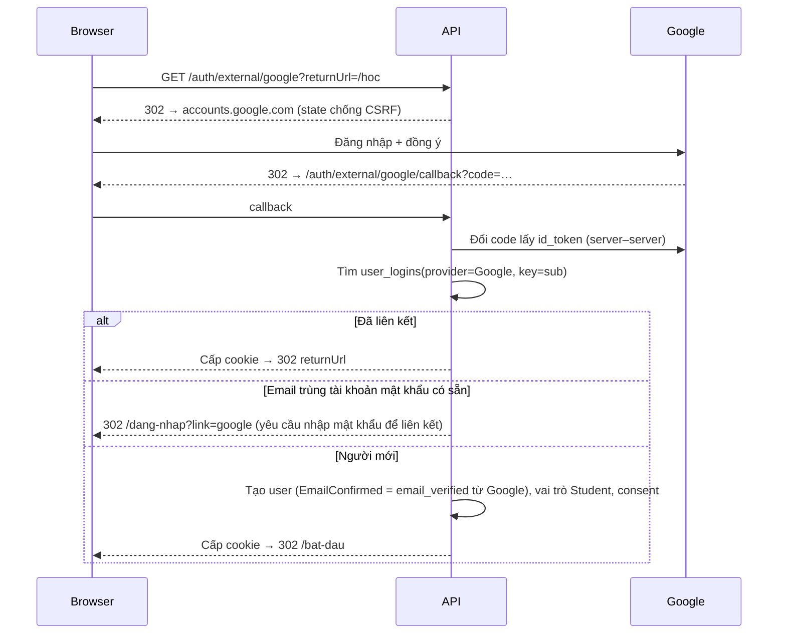

# Module 1 – Identity (tài khoản, xác thực, hồ sơ)

## 1. Mục tiêu & phạm vi
**Mục tiêu:** người dùng tạo được tài khoản và đăng nhập **an toàn**, khai báo mục đích học. Admin có quyền quản trị. Mọi module khác dựa vào Identity để biết "ai đang gọi" và "người đó được làm gì".

| Trong phạm vi (MVP) | Ngoài phạm vi |
|---|---|
| Đăng ký email + mật khẩu, xác minh email, đăng nhập/đăng xuất, "Ghi nhớ" | Đăng nhập bằng Facebook hoặc số điện thoại |
| Đăng nhập Google (Q-P2-01) | Xác thực 2 lớp (2FA): để V2 |
| Quên và đặt lại mật khẩu, đổi mật khẩu | Vai trò Teacher, Content Manager riêng |
| Onboarding: mục đích học + cấp độ mục tiêu | Tải xuống dữ liệu cá nhân (V2) |
| Hồ sơ, ảnh đại diện | |
| Xóa tài khoản (ẩn danh trong ≤ 30 ngày) | |
| Admin: danh sách, khóa và mở khóa người dùng. CLI `create-admin` | |

Nguồn yêu cầu: UC-01..06, UC-32 · FR-ID-01..08 · BR-AUTH-01..09, BR-PRIV-01..04 · US-01..06.

## 2. Kiến thức bạn sẽ học
| Khái niệm | Giải thích | Trong module |
|---|---|---|
| **Authentication vs Authorization** | *Xác thực* trả lời câu "bạn là ai". *Phân quyền* trả lời câu "bạn được làm gì". Hai bước tách biệt, làm theo thứ tự đó | Cookie auth + permission policy |
| **Hash mật khẩu** | Không bao giờ lưu mật khẩu gốc. Hệ thống lưu kết quả hàm băm chậm có **salt** (PBKDF2 trong Identity). Khi đăng nhập, băm lại mật khẩu người dùng nhập rồi so sánh với giá trị đã lưu | `PasswordHasher` |
| **Session cookie** | Sau khi đăng nhập, server cấp một cookie đã **mã hóa và ký** (Data Protection). Trình duyệt tự gửi cookie này ở mỗi request | `HttpOnly`, `Secure`, `SameSite=Lax` |
| **HttpOnly** | JavaScript không đọc được cookie, nên kẻ tấn công XSS không đánh cắp được phiên | |
| **CSRF** | Trang độc hại có thể khiến trình duyệt tự gửi cookie của bạn kèm một request giả. Cách chống: `SameSite` + **antiforgery token**, là thứ trang độc hại không đọc được | Header `X-XSRF-TOKEN` |
| **Token một lần có hạn** | Link xác minh email và link đặt lại mật khẩu chứa token đã ký, có thời hạn. Token đặt lại mật khẩu bị vô hiệu sau khi dùng, vì `SecurityStamp` thay đổi | `UserManager.Generate…TokenAsync` |
| **SecurityStamp** | Một chuỗi ngẫu nhiên của mỗi user. Khi đổi mật khẩu, chuỗi này đổi theo, nên mọi cookie và token cũ mất hiệu lực | BR-AUTH-08 |
| **OAuth 2.0 / OpenID Connect** | Ủy quyền đăng nhập cho Google. Google xác minh người dùng rồi trả về danh tính đã ký. Ứng dụng **không bao giờ** thấy mật khẩu Google | `AddGoogle()` |
| **Account enumeration** | Thông báo lỗi khác nhau cho "email không tồn tại" và "sai mật khẩu" sẽ giúp kẻ xấu dò ra email nào có tài khoản. Vì vậy dùng một thông báo chung | US-03, US-04 |
| **Lockout & rate limit** | Chống dò mật khẩu: khóa tạm tài khoản và giới hạn số request theo IP | BR-AUTH-06 |
| **Permission-based authorization** | Endpoint yêu cầu một *quyền* cụ thể, không yêu cầu *tên vai trò*. Sau này tách vai trò chỉ cần sửa bảng ánh xạ vai trò sang quyền | `RolePermissionMap` |
| **Soft delete + ẩn danh** | Xóa tài khoản không xóa ngay mọi bảng liên quan, mà thay dữ liệu cá nhân bằng giá trị ẩn danh. Thống kê vẫn còn, quyền riêng tư vẫn được đảm bảo | BR-PRIV-02 |

## 3. Mô hình miền

### 3.1 `AppUser` (mở rộng `IdentityUser<Guid>`)
| Thuộc tính | Kiểu | Ràng buộc | Ghi chú |
|---|---|---|---|
| `Id` | Guid (v7) | PK | |
| `Email`, `NormalizedEmail` | string | UQ, ≤ 254 ký tự | Email là định danh đăng nhập (BR-AUTH-01) |
| `EmailConfirmed` | bool | | Mở khóa quyền làm bài kiểm tra và báo lỗi (BR-AUTH-07) |
| `PasswordHash` | string? | | Null nếu tài khoản chỉ dùng Google |
| `DisplayName` | string | 2–50 ký tự, lọc từ thô tục | |
| `AvatarMediaId` | Guid? | | Tham chiếu tới ContentOps Media |
| `LearningPurpose` | enum? | `Ausbildung`, `Nursing`, `Recognition`, `Study`, `Other` | PD-09 |
| `TargetLevel` | enum? | `A1`, `A2`, `B1` | |
| `CreatedAt` | DateTimeOffset | | |
| `DeletedAt`, `AnonymizedAt` | DateTimeOffset? | | Vòng đời xóa tài khoản |
| `LockoutEnd`, `AccessFailedCount` | (sẵn có của Identity) | | BR-AUTH-06 |

**Bất biến (invariant) cần giữ:**
- Tài khoản đã có `DeletedAt` thì không đăng nhập được.
- Sau khi ẩn danh, `Email` thành `deleted-{id}@invalid`, `DisplayName` thành "Người dùng đã xóa", `PasswordHash` thành null, các bản ghi `user_logins` bị xóa.

### 3.2 `UserConsent`
`Id`, `UserId`, `TermsVersion`, `PrivacyVersion`, `MinorGuardianConfirmed` (bool), `ConsentedAt`.
- Lần đăng ký đầu tiên tạo 1 bản ghi.
- Khi điều khoản có phiên bản mới, người dùng phải đồng ý lại (V2). Mỗi lần đồng ý thêm 1 bản ghi, **không ghi đè** bản cũ. Đây là bằng chứng đồng ý theo NĐ 13/2023.

### 3.3 Vai trò → quyền
| Vai trò | Quyền |
|---|---|
| `Student` | `learning.access`, `assessment.take`*, `reports.create`* |
| `Admin` | Toàn bộ quyền của Student + `content.manage`, `content.publish`, `infohub.manage`, `reports.manage`, `users.manage` |

\* `assessment.take` và `reports.create` còn đòi thêm điều kiện **email đã xác minh**. Điều kiện này được kiểm tra bằng một authorization requirement riêng: `VerifiedEmailRequirement`.

## 4. Chức năng chi tiết

### 4.1 Đăng ký (UC-01, US-01)
**Luồng:**
1. Frontend gọi `GET /auth/csrf` để nhận cookie XSRF.
2. Người dùng điền form. Zod kiểm tra ngay trên client (chỉ để trải nghiệm tốt hơn, **không thay được** kiểm tra ở server).
3. `POST /auth/register`. FluentValidation kiểm tra lại toàn bộ dữ liệu.
4. Tạo user: `UserManager.CreateAsync(user, password)`. Identity băm mật khẩu và kiểm tra chính sách mật khẩu.
5. Thêm vai trò `Student`. Ghi `UserConsent`.
6. Sinh token xác minh, gửi email (qua `IEmailSender`). Email lỗi **không** làm hỏng việc đăng ký: hệ thống log lại, người dùng bấm "Gửi lại" sau.
7. `SignInManager.SignInAsync(user)` cấp cookie. Trả 201 kèm `MeResponse`.
8. Frontend chuyển sang `/bat-dau` (onboarding).

**Validation (BR-AUTH-02, 03):**
- `email` hợp lệ.
- `password` ≥ 8 ký tự, có cả chữ và số, không trùng email, không nằm trong danh sách mật khẩu phổ biến (file `common-passwords.txt`, khoảng 10.000 dòng).
- `displayName` dài 2–50 ký tự.
- `acceptTerms = true`.

**Tình huống biên:**
- Email đã tồn tại thì trả 409 `EMAIL_TAKEN`. Ở form đăng ký thì nói thẳng là chấp nhận được, vì người dùng cần biết để chuyển sang đăng nhập. Rate limit 5 lần/giờ/IP hạn chế việc lợi dụng điều này để dò email.
- Email viết hoa thường khác nhau được coi là một (so sánh qua `NormalizedEmail`).
- Gửi 2 request đăng ký cùng lúc: unique index ở DB chặn bản thứ hai, trả 409.

### 4.2 Xác minh email (US-02)
- Link có dạng `https://<domain>/xac-minh-email?userId=…&token=…`. Trang này gọi `POST /auth/confirm-email`.
- Token có hạn **24 giờ**. Cấu hình bằng `DataProtectionTokenProviderOptions` cho một provider riêng dành cho email.
- `POST /auth/resend-confirmation` bị giới hạn 3 lần/giờ/người dùng.

### 4.3 Đăng nhập & khóa tạm (US-03)
- `SignInManager.PasswordSignInAsync(email, password, isPersistent: rememberMe, lockoutOnFailure: true)`.
- Sai 5 lần thì `LockoutEnd = now + 15 phút`. Response trả 400 kèm `code: ACCOUNT_LOCKED` và `retryAfter` (số giây còn lại).
- Mọi lỗi khác (email không tồn tại, sai mật khẩu) **cùng một thông báo**: `INVALID_CREDENTIALS`.
- Cookie hết hạn sau 14 ngày (có gia hạn trượt), hoặc 30 ngày nếu chọn "Ghi nhớ".

### 4.4 Đăng nhập Google (UC-01b, BR-AUTH-09)

- `returnUrl` phải là **đường dẫn nội bộ** (bắt đầu bằng `/`, không có `//`). Đây là cách chống **open redirect**.
- Người mới đăng ký qua Google vẫn phải tick ô đồng ý điều khoản ở màn hình onboarding đầu tiên. Hệ thống ghi `UserConsent` tại bước đó.
- Client ID và Secret của Google nằm trong biến môi trường.

### 4.5 Quên & đặt lại mật khẩu (US-04)
- `POST /auth/forgot-password {email}` **luôn** trả 202. Nếu email tồn tại thì gửi link (có hạn 1 giờ).
- `POST /auth/reset-password {email, token, newPassword}`:
  1. Gọi `ResetPasswordAsync`.
  2. Gọi `UpdateSecurityStampAsync`, khiến mọi phiên khác bị đăng xuất.
  3. Mở khóa tài khoản nếu đang bị khóa tạm.

### 4.6 Hồ sơ & onboarding (US-05)
- `GET /me` trả `{id, email, emailConfirmed, displayName, avatarUrl, learningPurpose, targetLevel, permissions[], needsOnboarding}`.
- `needsOnboarding = (LearningPurpose == null && chưa bỏ qua)`. Lựa chọn bỏ qua được lưu bằng cách đặt `Other` và `A1`.
- `PATCH /me` chỉ cho sửa các trường được phép (whitelist). Không bao giờ cho sửa `email` hay vai trò qua endpoint này.
- **Gợi ý ở onboarding:** chọn `Ausbildung` hoặc `Nursing` thì bước 2 chọn sẵn `B1`, kèm link "Vì sao là B1?" dẫn tới bài Info Hub.

### 4.7 Xóa tài khoản (US-06, BR-PRIV-02)
1. `POST /me/delete {password, confirmText: "XÓA"}`. Tài khoản chỉ dùng Google thì không có mật khẩu, nên chỉ cần `confirmText`.
2. Đặt `DeletedAt = now`, đổi `SecurityStamp` (đăng xuất mọi nơi), rồi đăng xuất phiên hiện tại.
3. Job `PurgeDeletedAccounts` chạy hằng ngày, xử lý các tài khoản có `DeletedAt` cách đây ≥ 7 ngày (khoảng ân hạn, cấu hình được, tối đa 30). Với mỗi tài khoản:
   - Ẩn danh `users`.
   - Xóa `user_logins` và `user_tokens`.
   - Gọi interface `IUserDataEraser` mà **mỗi module tự cài đặt**. Ví dụ Progress thay `user_id` bằng UUID ẩn danh, ContentOps xóa nội dung tin nhắn trong báo lỗi.
   - Ghi `AnonymizedAt`.

   Vì sao làm qua interface? Identity không được động trực tiếp vào bảng của module khác (AR-03). Mỗi module tự biết dữ liệu cá nhân của mình nằm ở đâu.

### 4.8 Admin – người dùng (UC-32)
- `GET /admin/users?q=&page=` tìm theo email hoặc tên. Kết quả **không** trả về `PasswordHash`.
- `POST /admin/users/{id}/lock`: đặt `LockoutEnd = MaxValue` và đổi `SecurityStamp`.
- `POST /admin/users/{id}/unlock`: mở khóa.
- Admin không tự khóa được chính mình. Hệ thống luôn còn ít nhất 1 Admin.

### 4.9 CLI `create-admin`
`aduo-cli create-admin --email you@x.com`. Lệnh hỏi mật khẩu ngay trong terminal, không nhận mật khẩu qua tham số dòng lệnh, vì tham số sẽ bị lưu vào lịch sử shell.

## 5. Dữ liệu
Bảng `identity.users`, `user_consents`, cùng các bảng chuẩn của Identity. Chi tiết ở [Phase 3 – 02 §3.1](../../phase-3/02-database-design.md).

**Data Protection keys** (khóa dùng để mã hóa cookie) phải được **lưu bền vững**. Nếu không, mỗi lần deploy, mọi người dùng sẽ bị đăng xuất. Giải pháp: `PersistKeysToDbContext`, lưu vào bảng `identity.data_protection_keys`.

## 6. API (tóm tắt)
Xem [Phase 3 – 03 §2](../../phase-3/03-api-design.md). Rate limit riêng:
| Endpoint | Giới hạn |
|---|---|
| login | 10 lần/phút/IP |
| register | 5 lần/giờ/IP |
| forgot-password | 3 lần/giờ/email + 10 lần/giờ/IP |
| resend-confirmation | 3 lần/giờ/người dùng |

## 7. Giao diện
| Màn hình | Trạng thái cần có |
|---|---|
| Đăng ký | Lỗi ngay tại trường nhập. Nút bị vô hiệu cho tới khi tick đồng ý. Spinner trên nút khi đang gửi. Lỗi `EMAIL_TAKEN` hiện kèm link |
| Đăng nhập | Nút "Tiếp tục với Google". Thông báo khóa tạm kèm thời gian đếm ngược. Link "Quên mật khẩu" |
| Quên mật khẩu | Sau khi gửi luôn hiện "Nếu email tồn tại…" |
| Đặt lại mật khẩu | Link hết hạn thì có nút "Gửi lại link" |
| Xác minh email | Ba trạng thái: thành công / hết hạn / đã xác minh trước đó |
| Onboarding 2 bước | Có nút "Bỏ qua". Ô đồng ý điều khoản (chỉ cho người đăng ký qua Google) |
| Hồ sơ | Đổi tên, ảnh, mục đích, cấp độ, mật khẩu. Vùng "Nguy hiểm": Xóa tài khoản |
| Banner xác minh | Trên dashboard nếu `emailConfirmed = false`: "Xác minh email để làm bài kiểm tra · Gửi lại" |

Guard ở frontend (`(learn)/layout.tsx`):
- Gọi `useMe()`. Nếu 401 thì chuyển tới `/dang-nhap?returnUrl=…`.
- Nếu `needsOnboarding` thì chuyển tới `/bat-dau`.
- Guard ở frontend chỉ phục vụ trải nghiệm người dùng. **Bảo mật thật nằm ở API.**

## 8. Bảo mật – checklist riêng
- [ ] Cookie: `HttpOnly`, `Secure` (prod), `SameSite=Lax`, tên `__Host-aduo` (bắt buộc Secure, path `/`, không có Domain).
- [ ] Antiforgery bật cho mọi request POST, PUT, PATCH, DELETE.
- [ ] Không log email trong log tổng quát (chỉ log `userId`).
- [ ] Kiểm tra `returnUrl` để chống open redirect.
- [ ] Data Protection keys được lưu bền vững và không lọt vào repo.
- [ ] Email gửi đi không chứa mật khẩu. Token chỉ xuất hiện trong link.

## 9. Test cases
| ID | Kịch bản | Kết quả mong đợi |
|---|---|---|
| ID-T01 | Đăng ký hợp lệ | 201. Có cookie. `emailConfirmed=false`. Có 1 bản ghi consent. Email được gửi (fake sender ghi nhận) |
| ID-T02 | Đăng ký trùng email (khác hoa thường) | 409 `EMAIL_TAKEN` |
| ID-T03 | Mật khẩu "12345678" | 400, lỗi ở trường `password` |
| ID-T04 | `acceptTerms=false` | 400 |
| ID-T05 | POST register không có header XSRF | 400 (antiforgery) |
| ID-T06 | Xác minh với token đúng | Chuyển sang `emailConfirmed=true` |
| ID-T07 | Xác minh với token đã hết hạn (dùng `FakeTimeProvider` +25 giờ) | 400 `TOKEN_EXPIRED` |
| ID-T08 | Đăng nhập sai mật khẩu và đăng nhập email không tồn tại | Cùng response `INVALID_CREDENTIALS` |
| ID-T09 | Sai 5 lần rồi thử lần 6 với mật khẩu đúng | `ACCOUNT_LOCKED`. Sau 15 phút thì đăng nhập được |
| ID-T10 | Quên mật khẩu với email không tồn tại | 202, không gửi email |
| ID-T11 | Đặt lại mật khẩu, rồi dùng lại token đó | Lần 2 thất bại. Cookie cũ thành 401 |
| ID-T12 | Google: người mới | Tạo user, `emailConfirmed` theo Google, chuyển tới onboarding |
| ID-T13 | Google: email trùng tài khoản mật khẩu | Không tự liên kết. Yêu cầu nhập mật khẩu |
| ID-T14 | `returnUrl=https://evil.com` | Bị bỏ qua, chuyển về `/hoc` |
| ID-T15 | `PATCH /me` gửi kèm `email` | Trường bị bỏ qua hoặc trả 400. Email không đổi |
| ID-T16 | Student gọi `/admin/users` | 403 |
| ID-T17 | Chưa xác minh email mà gọi endpoint cần `assessment.take` | 403 `EMAIL_NOT_VERIFIED` |
| ID-T18 | Xóa tài khoản rồi đăng nhập | Thất bại. Sau khi job chạy, email đã bị ẩn danh |
| ID-T19 | Admin khóa user đang đăng nhập | Request tiếp theo của user đó trả 401 |
| ID-T20 | Khóa Admin cuối cùng | 422 `LAST_ADMIN` |

## 10. Các bước triển khai
1. Cấu hình Identity (`AddIdentityCore<AppUser>` + roles + EF stores), chính sách mật khẩu, lockout, token providers, lưu Data Protection keys.
2. Migration `Identity_Init`. Seed các vai trò (lệnh `seed`). Lệnh `create-admin`.
3. `IEmailSender` (MailKit SMTP) + `FakeEmailSender` cho test. Template email HTML đơn giản bằng tiếng Việt.
4. Các slice: Register, ConfirmEmail, Resend, Login, Logout, Forgot, Reset, Me (Get/Patch), ChangePassword, Delete.
5. Google external login + flow liên kết tài khoản.
6. Permission policies + `VerifiedEmailRequirement`. Interface `IUserDataEraser` + job `PurgeDeletedAccounts`.
7. Admin users: list, lock, unlock.
8. Integration test ID-T01..20.
9. Frontend: các trang auth, onboarding, hồ sơ, guard, banner xác minh, admin users.
10. Thử thủ công trên điện thoại thật.

## 11. Definition of Done
- [ ] Mọi AC của US-01..06 đạt. ID-T01..20 pass.
- [ ] Google login chạy được ở dev (`http://localhost`, redirect URI đã đăng ký trong Google Cloud Console).
- [ ] Không có mật khẩu, token hay email trong log (đã kiểm tra bằng cách grep log).
- [ ] Decision log cập nhật nếu có thay đổi.
