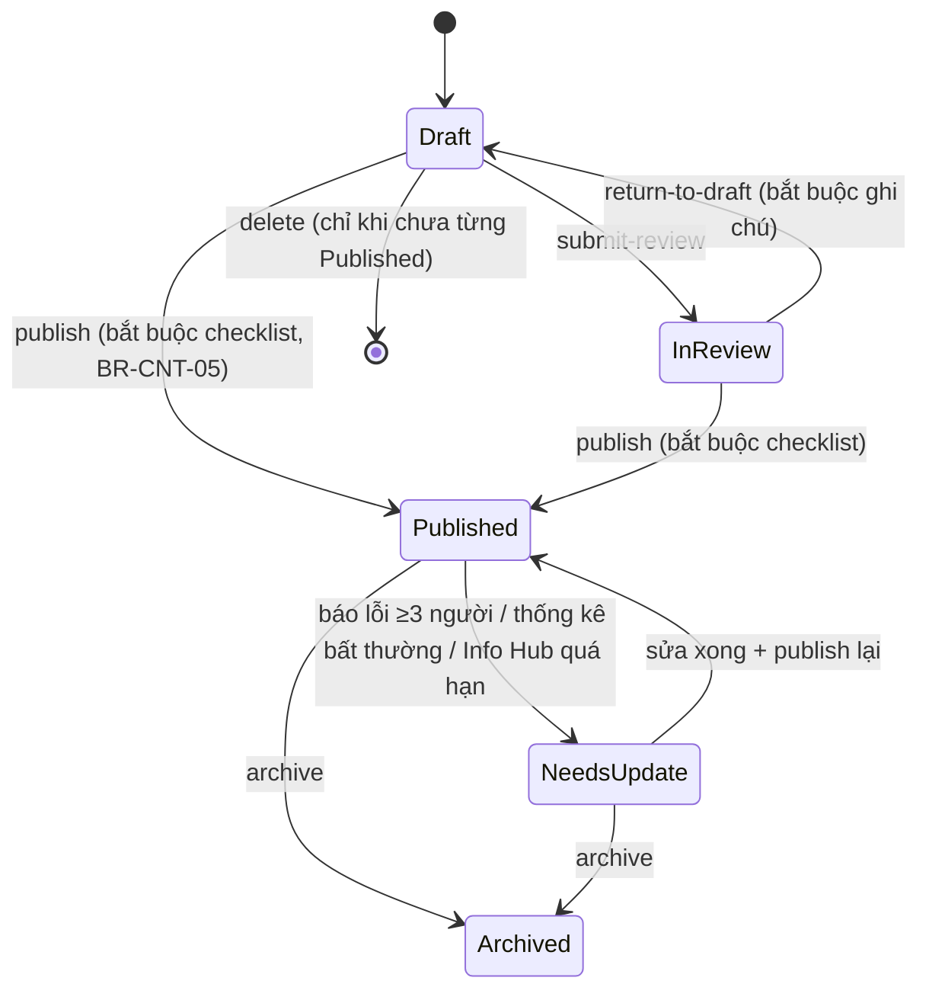
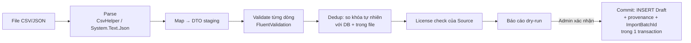

# Module 2 – ContentOps (vận hành nội dung)

> ContentOps là "nhà máy nội dung" của nền tảng. Nó trả lời ba câu hỏi cho **mọi** mẩu nội dung: *từ đâu ra?*, *có được phép dùng không?*, *đã được kiểm tra chưa?*. Vì bạn làm một mình và không có người duyệt (Q4), module này chính là **lưới an toàn chất lượng** của dự án.

Module được triển khai làm hai đợt:
- **2a – Lõi** (bước 3 trong thứ tự triển khai): License, Source, Media, Vòng đời nội dung, Duyệt, Lịch sử, Import, Settings, Attribution.
- **2b – Mở rộng** (bước 10): AI viết nháp và AI kiểm định, TTS, theo dõi chi phí, Báo lỗi, Dashboard.

## 1. Mục tiêu & phạm vi
| Trong phạm vi | Ngoài phạm vi |
|---|---|
| Danh mục License và Source, kiểm tra quyền dùng cho mục đích thương mại | Hệ thống quản lý bản quyền phức tạp (DRM) |
| Upload media (audio, hình) lên R2 | Xử lý video (chưa cần cho A1) |
| Vòng đời nội dung dùng chung + checklist + lịch sử phiên bản | Nhiều tầng duyệt, nhiều người duyệt (V2+) |
| Import CSV/JSON qua CMS + khung ETL dùng chung cho CLI | Crawl hoặc scrape website (bị cấm, xem Phase 1 file 04) |
| AI viết nháp, AI kiểm định, TTS hàng loạt, trần chi phí | AI trả lời trực tiếp cho người học (V3) |
| Báo lỗi nội dung, Dashboard admin | |

Nguồn yêu cầu: UC-25..31, UC-33 · FR-CMS-01..10, FR-RPT, FR-ADM · BR-CNT-01..12, BR-RPT-01..03 · US-50..58.

## 2. Kiến thức bạn sẽ học
| Khái niệm | Giải thích | Trong module |
|---|---|---|
| **State machine** | Nội dung chỉ được chuyển giữa những trạng thái được phép. Mọi phép chuyển đi qua **một chỗ duy nhất** trong code, nên không có đường tắt | `ContentLifecycle` |
| **Owned type / Value object** | Một nhóm trường luôn đi cùng nhau (`ContentMeta`), được khai báo một lần và tái sử dụng ở mọi bảng nội dung | `ContentMeta` |
| **Interface đa hình** | Nhiều loại nội dung (từ vựng, câu hỏi, bài học…) cùng triển khai `IPublishable`, nên chỉ cần **một** hàng đợi duyệt và **một** API publish cho tất cả | `IPublishable`, `IContentRegistry` |
| **Provenance** | Ghi lại nguồn gốc của dữ liệu để truy vết được và chứng minh được tính hợp pháp | `source_id`, `license_id`, `original_ref` |
| **ETL** | Extract (đọc file) → Transform (chuẩn hóa) → Load (ghi vào DB). Tách ba bước rõ ràng để chạy thử được và làm lại được | Import pipeline |
| **Dry-run** | Chạy toàn bộ xử lý nhưng **không ghi**, chỉ trả báo cáo. Nhờ vậy an toàn với dữ liệu lớn | Import |
| **Idempotency** | Chạy cùng một thao tác nhiều lần cho ra cùng một kết quả, ví dụ import lại cùng một file không sinh bản ghi trùng | Checksum file, unique key |
| **Optimistic concurrency** | Hai tab cùng sửa một bản ghi: tab lưu sau sẽ nhận lỗi 409 thay vì âm thầm ghi đè | Cột `version` |
| **Job queue bất đồng bộ** | Việc tốn thời gian (gọi AI, TTS) được đưa vào hàng đợi và xử lý ở nền. Client hỏi lại trạng thái (polling) | Bảng `content.jobs` |
| **Structured output từ LLM** | Yêu cầu AI trả JSON theo schema, sau đó validate bằng code. **Không bao giờ tin** đầu ra của AI khi chưa kiểm tra | `output_schema` |
| **Trần chi phí (budget guard)** | Kiểm tra tổng chi phí trước mỗi lượt gọi dịch vụ trả phí | `external_usage` |
| **Upload an toàn** | Kiểm tra magic bytes, giới hạn kích thước, đổi tên file thành UUID, không bao giờ dùng tên file người dùng gửi lên làm đường dẫn | Media |

## 3. Mô hình miền

### 3.1 License & Source
| Entity | Thuộc tính quan trọng | Bất biến |
|---|---|---|
| `License` | `Code`, `Name`, `Url`, `AllowsCommercial`, `RequiresAttribution`, `ShareAlike`, `AllowsModification` | Seed sẵn, Admin không sửa cờ trong UI ở MVP |
| `Source` | `Name`, `Provider`, `Url`, `DefaultLicenseId`, `LicenseVerifiedAt`, `Notes`, `IsActive` | Source có license `AllowsCommercial=false` thì **không** được dùng để import hay publish (BR-CNT-03, PD-05) |

**Seed ban đầu:**

| Source | License |
|---|---|
| Wiktionary (qua kaikki.org) | CC-BY-SA-4.0 |
| Tatoeba | CC-BY-2.0-FR (một số câu CC0-1.0) |
| ADUO (tự biên soạn) | Proprietary |
| Azure TTS | Proprietary (⚖️ chờ xác minh) |

### 3.2 `ContentMeta` & vòng đời

- **Điều kiện publish chung** (`PublishGuard`):
  1. Có `SourceId` và `LicenseId`.
  2. License cho phép thương mại.
  3. Checklist đã tick đủ.
  4. `Origin=AIDraft` thì phải có kết quả AI kiểm định.
  5. Các **điều kiện riêng** của từng loại nội dung, do module sở hữu cung cấp qua `IPublishable.ValidateForPublish()`. Ví dụ Lexicon kiểm tra danh từ phải có giống (BR-LEX-01), Assessment kiểm tra câu hỏi phải qua auto-check (BR-ASM-05).
- **Khi publish:** ghi `ReviewedBy`, `ReviewedAt`, `PublishedAt`. Tạo `content_revisions` (snapshot JSON) và `review_checklists`.
- **Sửa bản ghi đã Published:** MVP **không** tạo "bản nháp song song". Admin sửa trực tiếp, và bản ghi phải qua lại PublishGuard và checklist khi lưu. Bản cũ được lưu ở `content_revisions`, `version` tăng thêm 1.
  - **Đánh đổi:** người học thấy ngay bản đã sửa, không có "bản nháp song song". Chấp nhận được vì chỉ có một người soạn. Bài kiểm tra đang làm dở không bị ảnh hưởng nhờ snapshot (BR-EXAM-07).

### 3.3 `IContentRegistry`: "danh bạ" các loại nội dung
Mỗi module nội dung khai báo với ContentOps:
```csharp
registry.Register<VocabularyEntry>("vocabulary-entries", ContentKind.Vocabulary);
registry.Register<Question>("questions", ContentKind.Question);
// ...
```
Nhờ danh bạ này, ContentOps có thể:
- Dựng **một API vòng đời chung**: `POST /admin/{resource}/{id}/publish`.
- Dựng **một hàng đợi duyệt** gom từ mọi bảng.
- Dựng **trang Attribution** liệt kê Source đang được dùng ở bất kỳ bảng nào.

Đây là điểm mấu chốt để không phải viết lại logic duyệt 6 lần.

### 3.4 Media
`Id`, `Kind` (Audio / Image / ImportFile), `Bucket`, `StorageKey`, `ContentType`, `SizeBytes`, `DurationMs`, `ChecksumSha256`, `OriginalUrl`, `Attribution`, kèm `ContentMeta`.
- Audio từ nguồn ngoài **phải có license riêng cho từng file** (BR-CNT-11).
- Upload trùng checksum thì trả về media đã có, không lưu file mới.

### 3.5 ImportBatch
`Id`, `ContentType`, `SourceId`, `FileMediaId`, `Status` (DryRun / Committed / Cancelled), `Report` (jsonb), `CreatedBy`, `CommittedAt`.

### 3.6 Job, PromptTemplate, ExternalUsage (2b)
- `PromptTemplate`: `Code`, `Version`, `Purpose`, `SystemPrompt`, `UserPromptTemplate` (có biến `{{topic}}`…), `OutputSchema`, `IsActive`. **Không sửa** một phiên bản đã dùng, chỉ tạo phiên bản mới, để truy vết được bản nháp nào sinh từ prompt nào.
- `Job`: `Kind` (AiDraft / AiReview / Tts), `Status`, `Payload`, `Result`, `Error`, `Attempts` (tối đa 3, chờ lâu dần giữa các lần thử).
- `ExternalUsage`: mỗi lượt gọi API trả phí ghi một dòng (`provider`, `units`, `cost_usd`).

### 3.7 ErrorReport (2b)
`UserId`, `TargetType`, `TargetId`, `Category`, `Message` (≤ 500), `Status`, `ResolutionNote`, `ResolvedBy/At`.

## 4. Chức năng chi tiết

### 4.1 Quản lý Source & License (US-50)
- Màn hình Nguồn: danh sách, tạo, sửa (`Name`, `Provider`, `Url`, `DefaultLicense`, `LicenseVerifiedAt`, `Notes`).
- Chọn license không cho phép thương mại thì hiện cảnh báo đỏ: "Nguồn này sẽ không import hay publish được".
- Trang công khai **`/nguon-du-lieu`**: liệt kê các Source đang có nội dung Published, kèm license và link. Đây là nghĩa vụ ghi công của CC BY và CC BY-SA.

### 4.2 Upload media
1. `POST /admin/media` (multipart).
2. Đọc tối đa N byte đầu để kiểm tra **magic bytes**: MP3 (`ID3` hoặc frame sync), OGG (`OggS`), PNG, JPEG, WebP (`RIFF…WEBP`), CSV/JSON (text UTF-8).
3. Kiểm tra kích thước:

   | Loại | Tối đa |
   |---|---|
   | Audio | 5 MB |
   | Hình | 2 MB |
   | File import | 50 MB |

4. Ảnh được chuyển sang WebP. Audio đọc được độ dài (`DurationMs`) nếu là MP3.
5. Tính SHA-256. Nếu đã có media cùng checksum thì trả về media đó.
6. Ghi lên R2 với key `audio/2026/{uuid}.mp3`. Sau đó mới ghi DB. Nếu ghi DB lỗi thì xóa object vừa ghi (bù trừ thủ công, vì R2 và Postgres không chung được một transaction).

### 4.3 Hàng đợi duyệt & publish (US-54)
- `GET /admin/review-queue?type=&origin=&flagged=&sourceId=&page=`: gom bản ghi ở trạng thái Draft, InReview, NeedsUpdate từ mọi loại nội dung qua `IContentRegistry`. Sắp xếp theo `flagged desc, updated_at asc`.
- Panel xem trước hiển thị nội dung như người học sẽ thấy, kèm các cờ cảnh báo (auto-check, AI kiểm định, số báo lỗi đang mở).
- **Checklist** (BR-CNT-06), 6 mục:

  | # | Mục kiểm tra |
  |---|---|
  | 1 | Nguồn và giấy phép đúng |
  | 2 | Nội dung chính xác (với câu hỏi: đáp án đúng, không mơ hồ) |
  | 3 | Phù hợp cấp độ |
  | 4 | Tiếng Việt tự nhiên |
  | 5 | Media phát được |
  | 6 | Đã xem các cờ cảnh báo |

- **Publish hàng loạt:** chỉ áp dụng cho các mục **không có cờ**. Tick checklist một lần cho cả lô, nhưng hệ thống vẫn ghi `review_checklists` cho **từng** mục.
- Publish thất bại thì trả 422 `PUBLISH_CHECK_FAILED` kèm `reasons[]`, ví dụ `["MISSING_GENDER","NO_EXPLANATION"]`.

### 4.4 Lịch sử phiên bản
- Mỗi lần publish hoặc sửa bản đã Published, ghi `content_revisions(entity_type, entity_id, version, snapshot, changed_by, change_note)`.
- UI: tab "Lịch sử" trong trang sửa, cho xem bản cũ. **Khôi phục** một bản cũ được làm bằng cách tạo một phiên bản mới có nội dung giống bản cũ (đây là Should).

### 4.5 Import pipeline (UC-25, US-51)

- **Một pipeline dùng chung, nhiều importer.** Mỗi loại nội dung cài đặt `IImporter<TRow>`: `Parse`, `Validate`, `NaturalKey`, `ToEntity`. CMS và CLI dùng **cùng** importer. CLI chỉ khác ở chỗ đọc file lớn theo kiểu streaming và ghi theo lô 500 dòng.
- **Báo cáo dry-run:**
  ```json
  {"total":500,"valid":480,"errors":[{"row":17,"field":"gender","message":"Danh từ thiếu giống"}],"duplicates":[{"row":42,"key":"de|Haus|Noun|1","existingId":"…"}]}
  ```
- **Xử lý trùng (BR-CNT-10):** mặc định là bỏ qua. Admin có thể chọn từng dòng: Bỏ qua / Gộp (điền vào các trường đang trống) / Tạo mới (tăng `homograph_no`).
- **Hủy batch (BR-CNT-12):** xóa các bản ghi của batch **chưa từng Published**. Bản ghi đã Published được giữ lại và hệ thống báo số lượng.
- **Template:** `GET /admin/imports/templates/{contentType}` trả file CSV có header và 2 dòng mẫu.

### 4.6 Settings
`app_settings` lưu các giá trị *(cấu hình)* của business rules, đọc qua `ISettings` có cache 1 phút:
- `lesson.passThresholdPct = 60`
- `exam.graceSeconds = 30`
- `reports.maxPerDay = 10`
- `budget.monthlyUsd = 10`
- `infohub.reviewMonths.default = 6`
- `infohub.reviewMonths.Ausbildung = 3`
- …

### 4.7 AI viết nháp (2b, UC-26, US-53)
**Luồng:**
1. Admin chọn template (ví dụ `A1_ARTICLE_CHOICE`), chủ đề, số lượng (≤ 20).
2. Hệ thống kiểm tra trần chi phí: `sum(cost_usd) tháng này + ước tính ≤ budget`.
3. Tạo `Job(AiDraft)` và trả 202 `{jobId}`.
4. Worker xử lý job:
   - Dựng prompt từ template.
   - Gọi `ILlmClient`, yêu cầu JSON theo `OutputSchema`.
   - Validate kết quả.
   - Chạy **auto-check** của Assessment (BR-ASM-05).
   - Tạo `Job(AiReview)` cho từng câu.
5. Job AiReview gọi LLM với prompt "giáo viên kiểm định", nhận về `{ok, issues[]}` và lưu vào `ai_review` (BR-CNT-07).
6. Ghi bản ghi `Origin=AIDraft`, `Status=Draft`, `ai_model`, `prompt_template_id`.

**Dữ liệu đầu vào cho prompt** chỉ gồm nội dung học (danh sách từ, chủ đề, cấp độ). **Không bao giờ** gửi dữ liệu người dùng lên API AI (BR-PRIV-03).

**Chọn model:**
- Mặc định Haiku 5.5 (rẻ) để sinh nháp.
- Có thể cấu hình model mạnh hơn cho bước kiểm định.
- Giá đã ghi ở Phase 1 file 02 §3 (theo trang pricing ngày 2026-11-22).

### 4.8 TTS hàng loạt (2b, UC-33)
- `POST /admin/tts-jobs {targetType:"VocabularyEntry", ids:[…]}`, hoặc chọn "mọi mục A1 chưa có audio".
- Worker gọi `ITtsClient` (Azure, giọng de-DE, có thể dùng SSML để chỉnh tốc độ), xuất MP3 mono khoảng 48 kbps, lưu thành Media (Source = Azure TTS), rồi gắn `audio_media_id`. Mỗi lượt gọi ghi `ExternalUsage` (số ký tự).
- **Văn bản đưa vào TTS:**
  - Danh từ đọc **kèm mạo từ** ("die Mutter"), giúp người học nhớ giống.
  - Động từ đọc dạng nguyên mẫu.
  - Câu ví dụ đọc nguyên câu.

### 4.9 Báo lỗi (2b, UC-17, UC-30, US-42, US-57)
- Người học: bottom sheet gồm loại lỗi + mô tả. Gửi `POST /me/error-reports`. Yêu cầu email đã xác minh (BR-AUTH-07).
- Giới hạn:
  - 10 báo lỗi/ngày/người (đếm trong DB, BR-RPT-01).
  - Mỗi người chỉ có 1 báo lỗi đang mở cho mỗi nội dung (unique partial index).
- **Tự chuyển NeedsUpdate:** ngay sau khi tạo báo lỗi, đếm số người khác nhau có báo lỗi Open trên cùng nội dung. Từ 3 người trở lên thì gọi `lifecycle.MarkNeedsUpdate()` (BR-RPT-02).
- Admin: hàng đợi báo lỗi, mở nội dung để sửa. **Resolve** sẽ đóng mọi báo lỗi Open của cùng nội dung, và đưa nội dung về Published nếu đang NeedsUpdate.

### 4.10 Dashboard Admin (2b, US-58)
| Chỉ số | Cách tính |
|---|---|
| Tổng người dùng | `count(users where deleted_at is null)` |
| Hoạt động 7 ngày | `count(distinct user_id)` từ `answer_events` hoặc `lesson_progress.updated_at` trong 7 ngày |
| Lượt kiểm tra | `count(exam_attempts)` trong 7 và 30 ngày |
| Báo lỗi đang mở | `count(error_reports where Open)` |
| Nội dung theo trạng thái | Gom qua `IContentRegistry` |
| Bài Info Hub quá hạn | `count(articles where NeedsUpdate & quá hạn)` |
| Chi phí tháng | `sum(external_usage.cost_usd)` / trần |

Có cache 5 phút. Mỗi module cung cấp số liệu của mình qua interface (`IDashboardContributor`), để ContentOps không phải truy vấn thẳng vào bảng của module khác.

## 5. API
Xem [Phase 3 – 03 §8](../../phase-3/03-api-design.md) và §7 (báo lỗi, attributions).

## 6. Giao diện (Admin)
| Màn hình | Thành phần chính |
|---|---|
| Nguồn | DataTable + form. Badge license (xanh: cho phép thương mại, đỏ: không cho phép) |
| Media | Lưới media, lọc theo loại, nghe thử, upload (kéo-thả hoặc chọn file) |
| Import | Bước 1: chọn loại, nguồn, file (kèm link tải template). Bước 2: báo cáo dry-run (tab Hợp lệ / Lỗi / Trùng). Bước 3: xác nhận. Danh sách batch kèm nút Hủy |
| Hàng đợi duyệt | Wireframe ở [Phase 3 – 05 §3.9](../../phase-3/05-ux-design.md) |
| AI | Chọn template + tham số, theo dõi job (polling 2 giây), kết quả đưa thẳng vào hàng đợi duyệt, thanh chi phí tháng |
| Báo lỗi | Danh sách gom theo nội dung, số người báo, nút Mở nội dung / Resolve / Reject |
| Dashboard | 7 thẻ chỉ số |
| Cài đặt | Form các giá trị cấu hình kèm mô tả rule liên quan |

## 7. Test cases
| ID | Kịch bản | Kết quả mong đợi |
|---|---|---|
| CO-T01 | Import với Source có license NC | 422 `LICENSE_NOT_COMMERCIAL`, không tạo batch |
| CO-T02 | Dry-run 500 dòng (480 OK, 15 lỗi, 5 trùng) | Báo cáo đúng số liệu, DB không có bản ghi mới |
| CO-T03 | Commit batch | 480 bản ghi Draft có `import_batch_id`, `source_id`, `license_id` |
| CO-T04 | Commit cùng file lần 2 | 0 bản ghi mới, 480 dòng nằm trong mục trùng |
| CO-T05 | Hủy batch có 10 bản ghi đã Published | Xóa 470, giữ 10, báo "10 mục đã publish không bị xóa" |
| CO-T06 | Publish không tick đủ checklist | 422 |
| CO-T07 | Publish bản ghi `AIDraft` chưa có `ai_review` | 422 `PUBLISH_CHECK_FAILED` (`AI_REVIEW_MISSING`) |
| CO-T08 | Return-to-draft không có ghi chú | 400 |
| CO-T09 | Hai tab sửa cùng bản ghi, cùng `version` | Tab sau nhận 409 `CONCURRENCY_CONFLICT` |
| CO-T10 | Sửa bản đã Published | `version` tăng, có 1 dòng `content_revisions` |
| CO-T11 | Upload file `.mp3` thực chất là `.exe` | 400 `INVALID_FILE_TYPE` |
| CO-T12 | Upload audio 6 MB | 400 `FILE_TOO_LARGE` |
| CO-T13 | Upload trùng checksum | Trả về media cũ, không tạo object mới |
| CO-T14 | AI job khi chi phí tháng đã chạm trần | 422 `AI_BUDGET_EXCEEDED` |
| CO-T15 | LLM trả JSON sai schema | Job Failed, có thông báo lỗi, không tạo bản ghi |
| CO-T16 | Báo lỗi lần 11 trong ngày | 429 |
| CO-T17 | Ba người khác nhau báo lỗi cùng một câu | Câu chuyển NeedsUpdate |
| CO-T18 | Resolve một báo lỗi | Mọi báo lỗi Open của cùng nội dung được đóng, nội dung về Published |
| CO-T19 | Trang `/nguon-du-lieu` | Chỉ liệt kê Source có nội dung Published |
| CO-T20 | Student gọi `/admin/*` | 403 |

## 8. Các bước triển khai
**2a:**
1. Entity License, Source, Media, ImportBatch, ContentRevision, ReviewChecklist, AppSetting + migration + seed.
2. `ContentMeta`, `ContentLifecycle` (state machine), `PublishGuard`, `IPublishable`, `IContentRegistry`. Unit test toàn bộ các phép chuyển trạng thái.
3. `IObjectStorage` (R2 + bản local filesystem cho dev), upload media.
4. Khung import (`IImporter<T>`, dry-run, commit, cancel). Ở bước này chưa có importer cụ thể: importer đầu tiên viết ở Lexicon.
5. Review queue API + UI. Checklist. Lịch sử phiên bản.
6. Sources UI, Media UI, Import UI, Settings, trang Attribution.

**2b:**
7. `ILlmClient` (Anthropic) + `FakeLlmClient` cho test. Job runner. PromptTemplate (seed 3–5 mẫu A1). Theo dõi chi phí.
8. `ITtsClient` (Azure) + TTS job.
9. ErrorReport (người học + admin).
10. Dashboard.

## 9. Definition of Done
- [ ] CO-T01..20 pass.
- [ ] Không có đường nào publish nội dung mà không đi qua `PublishGuard` (kiểm bằng architecture test: chỉ `ContentLifecycle` được set `Status`).
- [ ] Trang Attribution hiển thị đúng nguồn cho nội dung thật đầu tiên.
- [ ] Trần chi phí đã được thử với số liệu giả.
