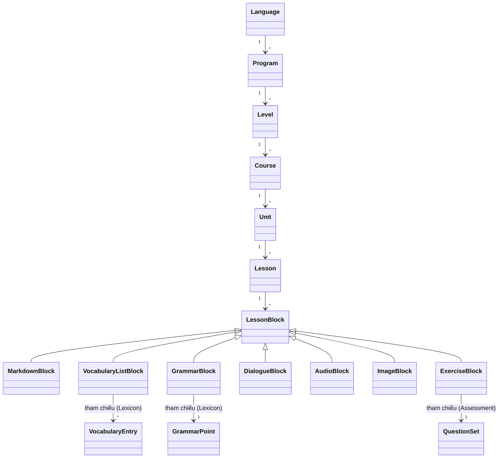

# Module 4 – Catalog (lộ trình, khóa học, bài học)

> Catalog quyết định người học **thấy gì và học theo thứ tự nào**. Phần lớn nội dung thật không nằm ở đây. Catalog *sắp xếp và lắp ghép* nội dung từ Lexicon (từ, ngữ pháp) và Assessment (bài tập) thành những bài học ngắn 10–15 phút.

## 1. Mục tiêu & phạm vi
| Trong phạm vi | Ngoài phạm vi |
|---|---|
| Cây Language → Program → Level → Course → Unit → Lesson | Khóa học trả phí (cờ `AccessTier` có sẵn nhưng MVP luôn là `Free`) |
| Bài học gồm các khối có thứ tự (7 loại khối) | Video bài giảng (V2+) |
| Bài học thử cho Guest | Bình luận, thảo luận |
| Trang catalog và chi tiết khóa (SSR, SEO) | Bắt buộc học tuần tự hay khóa bài (BR-CAT-06: chỉ gợi ý) |
| Admin: CRUD, kéo-thả khối, xem trước như người học | |

Nguồn yêu cầu: UC-07, 08, 09, 20, 21 · FR-CAT-01..07 · BR-CAT-01..07 · US-10..12, US-52.

## 2. Kiến thức bạn sẽ học
| Khái niệm | Giải thích | Trong module |
|---|---|---|
| **Dữ liệu dạng cây (hierarchy)** | Mô hình cha → con nhiều tầng. Cần quy tắc "hiển thị khi cả nhánh đã Published" và truy vấn hiệu quả, không N+1 | BR-CAT-02 |
| **Thứ tự do người dùng sắp xếp** | Cột `sort_order` cộng thao tác "sắp xếp lại" phải chạy trong một transaction. Dùng unique **DEFERRABLE** để tráo vị trí không vi phạm ràng buộc giữa chừng | `lesson_blocks` |
| **Polymorphic content block** | Mỗi khối có `block_type` và `payload` riêng. Dùng **discriminated union** ở cả C# lẫn TypeScript để code an toàn kiểu | `LessonBlock` |
| **Tham chiếu vs sao chép** | Khối từ vựng lưu ID của mục từ, không lưu bản sao. Ưu điểm: sửa một chỗ đúng mọi nơi. Đánh đổi: phải "resolve" (lấy chi tiết) khi trả bài học về | `lesson_block_vocabulary` |
| **N+1 query** | Lỗi kinh điển: lấy 1 bài, rồi mỗi khối lại gọi 1 query lấy từ. Cách tránh: gom ID, query một lần | `LessonAssembler` |
| **SSR/ISR & cache invalidation** | Trang công khai được cache lại. Khi Admin publish thì phải làm mới cache | `revalidateTag` / Output cache |
| **Slug & SEO** | URL thân thiện `/khoa-hoc/tieng-duc-a1`, duy nhất, không đổi khi sửa tiêu đề | `slug` |
| **Render Markdown an toàn** | Markdown từ CMS có thể chứa HTML độc hại nếu bị lỗi. Phải sanitize trước khi render | `rehype-sanitize` |

## 3. Mô hình miền

| Entity | Thuộc tính chính | Quy tắc |
|---|---|---|
| `Language` | `de` | Seed. Không có UI quản lý ở MVP |
| `Program` | "Tiếng Đức theo CEFR" (`CEFR`) | Seed. `Metadata` (jsonb) để dành cho sau |
| `Level` | A1, A2, B1 | Seed. MVP chỉ publish A1 |
| `Course` 🧾 | `Slug`, `Title`, `DescriptionMd`, `CoverMediaId`, `EstimatedMinutes` (tự tính bằng tổng các bài), `AccessTier` | Mỗi khóa có ≥ 1 bài preview (BR-CAT-05, kiểm tra khi publish khóa) |
| `Unit` | `Title`, `SortOrder` | Trạng thái theo khóa (không cần ContentMeta riêng, chỉ có `status`) |
| `Lesson` 🧾 | `Slug`, `Title`, `Summary`, `IsPreview`, `EstimatedMinutes`, `PassThresholdPct?` | Phải có ≥ 1 khối. Nên ≤ 15 phút (chỉ cảnh báo) |
| `LessonBlock` | `SortOrder`, `BlockType`, `Payload` hoặc FK | Xem bảng loại khối bên dưới |

**7 loại khối:**
| Loại | Dữ liệu | Hiển thị | Kiểm tra khi publish bài |
|---|---|---|---|
| `Markdown` | `{markdown}` | Văn bản, bảng, danh sách | Không rỗng |
| `VocabularyList` | Bảng nối tới các entry | Thẻ từ (GenderBadge, audio) | Mọi entry đều đã **Published** |
| `Grammar` | `grammar_point_id` | Thẻ ngữ pháp rút gọn + link "Xem đầy đủ" | Grammar point đã Published |
| `Dialogue` | `{lines:[{speaker,de,vi,audioMediaId}]}` | Bong bóng hội thoại, có nút ẩn/hiện bản dịch | ≥ 2 dòng |
| `Audio` | `{mediaId, transcriptDe, transcriptVi}` | AudioPlayer + transcript ẩn/hiện | Media tồn tại |
| `Image` | `{mediaId, altVi}` | Hình | `altVi` bắt buộc (accessibility) |
| `Exercise` | `question_set_id` | Nút "Làm bài tập (N câu)" | Set có ≥ 1 câu Published |

**Quy tắc phụ thuộc khi publish:** bài học **không** publish được nếu một khối tham chiếu tới nội dung chưa Published. Hệ thống trả lý do cụ thể, ví dụ "Từ *Mutter* đang Draft". Nhờ vậy người học không bao giờ thấy một khối trống.

## 4. Chức năng chi tiết

### 4.1 Catalog công khai (US-10)
- `GET /programs` và `GET /courses?levelCode=A1` chỉ trả nút khi **cả nhánh** đã Published (BR-CAT-02).
  - Cách làm: truy vấn có JOIN lên các tầng cha với điều kiện `status='Published'` ở mỗi tầng.
  - **Phương án thay thế:** lưu cờ "hiệu lực" xuống từng nút con. Bị loại vì phải cập nhật lan truyền mỗi khi trạng thái thay đổi, dễ sai.
- Người dùng đã đăng nhập thì kèm `progressPct` (lấy từ Progress qua `IProgressReader`).
- Trang render SSR/ISR, revalidate 10 phút. Khi Admin publish thì gọi `revalidateTag('catalog')` qua webhook nội bộ. Nếu chưa làm webhook thì chấp nhận độ trễ 10 phút.

### 4.2 Chi tiết khóa
Gồm mô tả, tổng thời lượng, danh sách unit và bài. Mỗi bài có trạng thái của người học (✓ đã xong / ● đang học / ○ chưa học) và nhãn "Học thử" nếu là bài preview.

### 4.3 Học một bài (US-11, US-12)
**`GET /lessons/{id}`:**
1. Kiểm tra bài và nhánh cha đều Published, nếu không thì trả 404.
2. Bài không phải preview mà người dùng chưa đăng nhập thì trả 401. Frontend hiện hộp thoại "Đăng ký miễn phí để học tiếp" và giữ `returnUrl`.
3. **Ghép bài (`LessonAssembler`):**
   - Đọc các khối.
   - Gom mọi `entry_id`, `grammar_point_id`, `question_set_id`.
   - Gọi `ILexiconReader.GetEntriesAsync(ids)` và `IAssessmentReader.GetSetSummariesAsync(ids)`, **mỗi loại chỉ 1 query**.
   - Map sang DTO, kèm URL audio công khai và thông tin ghi công.
4. Kèm theo `progress` (vị trí khối cuối, trạng thái), `previous` và `next` (bài trước, bài sau trong cùng khóa).

**Lưu vị trí:** khi người học cuộn tới một khối mới (dùng IntersectionObserver, debounce 2 giây), frontend gọi `PUT /me/lessons/{id}/progress {lastBlockId}`. Lần gọi đầu tự **enroll** người học vào khóa (BR-CAT-07, thuộc Progress).

**Hoàn thành bài:** do Progress quyết định theo BR-PROG-01. Catalog chỉ hiển thị trạng thái.

### 4.4 Admin – soạn khóa và bài (US-52)
- **Cây khóa học:** panel trái là cây Khóa → Unit → Bài, kéo-thả để đổi thứ tự unit và bài.
- **Block editor:**
  - Thêm khối bằng menu chọn loại.
  - Sửa khối: form theo loại. Khối từ vựng có ô **tìm và chọn** mục từ (dùng API tìm kiếm của Lexicon phía admin, thấy cả Draft). Khối bài tập chọn hoặc tạo một QuestionSet.
  - Kéo-thả thứ tự khối (`dnd-kit`).
  - **Lưu:** `PUT /admin/lessons/{id}/blocks` gửi **toàn bộ** danh sách khối theo thứ tự, kèm `version` của bài. Server so sánh, xóa, thêm, sửa trong 1 transaction. Unique `(lesson_id, sort_order)` được `DEFERRABLE INITIALLY DEFERRED` để không lỗi khi tráo vị trí.
- **Xem trước (FR-CMS-08):** `GET /admin/lessons/{id}/preview` dùng cùng `LessonAssembler`, nhưng **cho phép** nội dung Draft và đánh dấu khối nào chưa publish. Hiển thị trong khung mô phỏng mobile 375px.
- Publish bài đi qua ContentOps lifecycle. `IPublishable.ValidateForPublish()` của Lesson kiểm tra 7 quy tắc khối ở trên.
- **Slug:** tự sinh từ tiêu đề (bỏ dấu tiếng Việt, kebab-case). **Không** tự đổi slug khi tiêu đề thay đổi, để giữ link cũ và SEO.

## 5. Dữ liệu & API
- Bảng: [Phase 3 – 02 §3.2](../../phase-3/02-database-design.md).
- API: [Phase 3 – 03 §3, §8](../../phase-3/03-api-design.md).
- Interface công khai: `ICatalogReader.GetLessonInfoAsync(ids)` (Progress dùng để tính %), `GetPublishedLessonCountAsync(courseId)`.

## 6. Giao diện
| Màn hình | Trạng thái và chi tiết |
|---|---|
| Catalog | Thẻ khóa: ảnh bìa, tiêu đề, số bài, thời lượng, thanh tiến độ (nếu đã đăng nhập). Trạng thái rỗng: "Khóa học đang được chuẩn bị" |
| Chi tiết khóa | Accordion theo unit. Nút chính: "Bắt đầu" / "Học tiếp bài X" |
| Bài học | Header có nút quay lại, ⚑ báo lỗi, chỉ báo "khối 3/7". Thanh tiến độ trong bài. Các khối nối tiếp nhau. Cuối bài có nút bài tập hoặc "Hoàn thành". Skeleton khi tải. Lỗi audio: hiện "Không phát được audio" kèm ⚑ |
| Hộp thoại đăng ký (Guest) | Nút Google + email, giữ lại `returnUrl` |
| Admin cây khóa | Kéo-thả, badge trạng thái từng nút |
| Admin Block editor | Danh sách khối có tay nắm kéo, form bên phải, nút Xem trước, Lưu (có xử lý 409 xung đột), Publish |

## 7. Test cases
| ID | Kịch bản | Kết quả mong đợi |
|---|---|---|
| CA-T01 | Khóa Published nhưng Level còn Draft | Không xuất hiện ở catalog |
| CA-T02 | Guest mở bài preview | 200 |
| CA-T03 | Guest mở bài thường | 401 |
| CA-T04 | Mở bài đang Draft (người học) | 404 |
| CA-T05 | Bài có 3 khối từ vựng, mỗi khối 10 từ | Đúng 1 query lấy entries (đo bằng EF logging hoặc interceptor đếm query) |
| CA-T06 | Publish bài có khối từ vựng chứa từ Draft | 422, kèm lý do nêu tên từ |
| CA-T07 | Publish bài có Image thiếu `altVi` | 422 |
| CA-T08 | Publish khóa không có bài preview | 422 `NO_PREVIEW_LESSON` |
| CA-T09 | Tráo thứ tự khối 1 ↔ 3 rồi lưu | Thành công, thứ tự đúng |
| CA-T10 | Hai tab cùng lưu danh sách khối | Tab sau nhận 409 |
| CA-T11 | Đổi tiêu đề bài | Slug không đổi |
| CA-T12 | Markdown chứa `<script>` | Bị loại khi render |
| CA-T13 | `next` của bài cuối unit | Trỏ tới bài đầu của unit kế tiếp |
| CA-T14 | Admin preview bài có từ Draft | Hiển thị được, khối được đánh dấu "chưa publish" |

## 8. Các bước triển khai
1. Entity + seed (Language `de`, Program CEFR, Level A1–B1) + migration.
2. Domain: `LessonBlock` (discriminated union), `ValidateForPublish` của Lesson và Course + unit test.
3. `LessonAssembler` + reader interfaces (Lexicon, Assessment; dùng stub cho Assessment tới bước 6).
4. API công khai và API người học + integration test CA-T01..05, T12, T13.
5. API admin (cây, blocks, preview) + test CA-T06..11, T14.
6. UI người học: catalog, chi tiết khóa, trang bài học, `LessonBlockRenderer`, `Markdown`, `AudioPlayer`, `DialogueBlock`.
7. UI admin: cây khóa, Block editor, khung preview mobile.
8. **Nội dung thật:** soạn khóa "Tiếng Đức A1 từ con số 0", Unit 1 (phát âm và bảng chữ cái), 2–3 bài đầu. Học thử chính bài mình vừa soạn trên điện thoại.

## 9. Definition of Done
- [ ] CA-T01..14 pass.
- [ ] Có 1 khóa A1 với ≥ 1 unit Published, học được trên điện thoại thật, LCP < 2,5 giây (NFR-01).
- [ ] Không có N+1 khi tải bài học.
