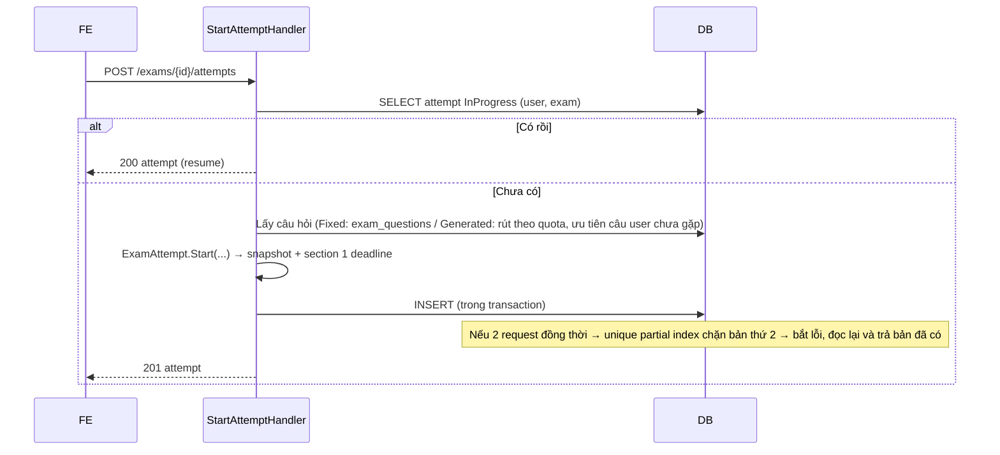

# Module 5 – Assessment (câu hỏi, luyện tập, bài kiểm tra cuối cấp)

> Đây là module **khó nhất về kỹ thuật** và cũng là nơi bạn học được nhiều nhất: chấm điểm theo nhiều loại câu hỏi, quản lý thời gian phía server, xử lý mất mạng, chống gian lận, snapshot dữ liệu.

Module triển khai thành hai đợt:
- **5a** (bước 6): câu hỏi + luyện tập.
- **5b** (bước 8): bài kiểm tra cuối cấp.

## 1. Mục tiêu & phạm vi
| Trong phạm vi | Ngoài phạm vi |
|---|---|
| 4 loại câu hỏi: SingleChoice, FillBlank, Matching, Ordering | Tự luận Schreiben, ghi âm Sprechen (V2/V3) |
| Dạng bài (category) theo kỹ năng, auto-check trước khi publish | Chấm bằng AI cho người học (V2) |
| Bộ bài tập gắn vào bài học. Chế độ luyện tập chấm ngay | Thi đấu, xếp hạng |
| Blueprint cấu hình bằng dữ liệu. Đề Fixed và Generated | Thuật toán thích ứng theo năng lực (IRT, CAT) |
| Bài kiểm tra có giờ do server tính, tự lưu, offline-tolerant, khóa phần, giới hạn lượt nghe, tự nộp | Giám sát chống gian lận bằng camera |
| Kết quả: điểm, mức đánh giá, gợi ý ôn tập, lịch sử | Cấp chứng chỉ |

Nguồn yêu cầu: UC-12..14, 23, 24 · FR-ASM-01..10 · BR-ASM-01..08, BR-EXAM-01..12 · US-20, US-30..34, US-55.

## 2. Kiến thức bạn sẽ học
| Khái niệm | Giải thích | Trong module |
|---|---|---|
| **Strategy pattern** | Mỗi loại câu hỏi có một bộ chấm (`IAnswerGrader`) riêng, cùng chung một interface. Thêm loại câu hỏi mới chỉ cần thêm một class, không sửa `switch` ở khắp nơi | Grading |
| **Discriminated union / polymorphic JSON** | `body` và `response` có cấu trúc khác nhau theo `type`. Dùng `System.Text.Json` polymorphism (`[JsonDerivedType]`) ở C# và union type ở TypeScript | QuestionBodies |
| **Server-authoritative time** | Không bao giờ tin đồng hồ của máy người dùng. Server lưu `deadline_at`. Client chỉ hiển thị, có bù chênh lệch bằng `serverNow` | Attempt |
| **Idempotent API** | Lưu đáp án bằng PUT (gọi 10 lần cũng như 1 lần). Nộp bài lần 2 trả lại kết quả cũ. Cần thiết vì mạng di động hay gửi lại request | SaveAnswer, Submit |
| **Optimistic UI + hàng đợi offline** | Giao diện hiển thị ngay lựa chọn của người dùng. Request được xếp vào hàng đợi, gửi lại khi có mạng | `offlineQueue.ts` |
| **Snapshot / immutability** | Kết quả bài làm phải giữ nguyên dù câu hỏi bị sửa sau đó. Vì vậy chụp lại toàn bộ câu hỏi khi bắt đầu làm | `attempt_questions.snapshot` |
| **Ràng buộc ở database** | Unique partial index đảm bảo "mỗi người 1 lượt đang làm" kể cả khi 2 request đến cùng lúc. Đây là thứ code ứng dụng khó tự đảm bảo | `exam_attempts` |
| **Race condition & row lock** | Nộp tay và job tự nộp có thể chạy cùng lúc. Dùng `SELECT … FOR UPDATE` hoặc concurrency token để chỉ một bên thắng | Submit |
| **DTO tách biệt để chống lộ dữ liệu** | API cho người học dùng DTO **không có** đáp án đúng. Đáp án chỉ trả về sau khi nộp | `QuestionForLearnerDto` |
| **Testing với thời gian giả** | `FakeTimeProvider` cho phép "tua nhanh" 20 phút trong test để kiểm tra logic hết giờ | Unit test |
| **Thống kê đơn giản** | Tỷ lệ đúng từng câu, gắn cờ câu bất thường. Đây là bước đầu của phân tích chất lượng đề | BR-ASM-08 |

---

## 3. Đợt 5a – Câu hỏi & luyện tập

### 3.1 Mô hình miền
**`QuestionCategory`** (dạng bài, seed cho A1):
| Code | Kỹ năng | Ví dụ |
|---|---|---|
| `ARTICLE_CHOICE` | Grammar | ___ Tisch → der |
| `VERB_CONJUGATION` | Grammar | Ich ___ (kommen) aus Vietnam → komme |
| `WORD_ORDER` | Grammar | Sắp xếp: heute / ich / arbeite → Heute arbeite ich |
| `VOCAB_MEANING` | Vocabulary | "die Mutter" nghĩa là? |
| `VOCAB_MATCHING` | Vocabulary | Ghép từ với nghĩa |
| `READ_SHORT_TEXT` | Reading | Đọc tin nhắn hoặc quảng cáo ngắn, chọn đáp án |
| `READ_SIGN` | Reading | Đọc biển báo, thông báo |
| `LISTEN_SHORT` | Listening | Nghe câu ngắn, chọn đáp án hoặc hình |
| `LISTEN_DIALOGUE` | Listening | Nghe hội thoại, chọn đáp án |

**`Question`** (🧾): `Type`, `CategoryId`, `Skill`, `CefrLevel`, `StemMd`, `StemAudioMediaId?`, `StemImageMediaId?`, `Body` (theo type), `ExplanationMd`, `Settings`, `AutoCheckPassed`, `AutoCheckIssues`, `AiReview?`, `StatsAttempts`, `StatsCorrect`, `FlaggedForReview`, `Topics`.

**`QuestionSet`** (🧾): `Title`, `Purpose` (`LessonExercise` / `Practice`), các item có thứ tự.

### 3.2 Bộ chấm điểm (BR-ASM-01..04)
```csharp
public interface IAnswerGrader
{
    QuestionType Type { get; }
    GradeResult Grade(QuestionBody body, AnswerResponse response, QuestionSettings s, GradingMode mode);
}
public sealed record GradeResult(bool IsCorrect, decimal Fraction, object CorrectAnswerForDisplay);
```
| Loại | Quy tắc chấm |
|---|---|
| SingleChoice | Đúng khi `optionId` là phương án `isCorrect`. `Fraction` = 1 hoặc 0 |
| FillBlank | Mỗi chỗ trống: chuẩn hóa đáp án (trim, gộp khoảng trắng). Nếu `allowUmlautSubstitution` thì so cả dạng `ae/oe/ue/ss`. Nếu `caseSensitive` (mặc định với tiếng Đức) thì giữ nguyên hoa thường. So với danh sách `accepted`. `Fraction` = số chỗ đúng / tổng số chỗ. `IsCorrect` khi đúng tất cả |
| Matching | Luyện tập: `Fraction` = số cặp đúng / tổng. Kiểm tra: `IsCorrect` chỉ khi đúng toàn bộ, `Fraction` = 1 hoặc 0 (BR-ASM-03) |
| Ordering | Đúng khi dãy token khớp một trong các thứ tự `accepted` (BR-ASM-04) |

`GradingMode` gồm `Practice` và `Exam`. Bộ chấm là **hàm thuần** (không đụng DB), nên rất dễ unit test.

### 3.3 Auto-check trước publish (BR-ASM-05)
| Kiểm tra | Chặn hay cảnh báo |
|---|---|
| Đủ trường bắt buộc (stem, body, explanation, category, level) | Chặn |
| SingleChoice: 2–4 phương án, **đúng 1** phương án đúng, không có phương án trùng nhau | Chặn |
| FillBlank: mỗi chỗ trống có ≥ 1 đáp án được chấp nhận, số chỗ `___` trong template khớp với số blanks | Chặn |
| Matching: 3–6 cặp, mỗi bên đúng 1 ghép | Chặn |
| Ordering: ≥ 2 token, có ≥ 1 thứ tự được chấp nhận | Chặn |
| Media được tham chiếu có tồn tại | Chặn |
| Kỹ năng Listening thì phải có `StemAudioMediaId` | Chặn |
| Từ vựng trong câu vượt cấp độ (so với Lexicon) | Chỉ cảnh báo |

### 3.4 Luyện tập (UC-12, US-20)
1. `POST /me/practice-sessions {questionSetId}`: tạo session, trả câu hỏi qua `QuestionForLearnerDto` (**không có** `isCorrect` hay `accepted`). Phương án được xáo trộn nếu không bật `keepOptionOrder`.
2. Mỗi câu: `POST /me/practice-sessions/{id}/answers {questionId, response}`. Server chấm (`Practice` mode) và trả ngay `{isCorrect, fraction, correctAnswer, explanationMd}`. Đồng thời ghi `answer_events` (qua `IProgressWriter`).
3. `POST …/complete`: tính `correct/total`, `scorePct`. Báo cho Progress để xét hoàn thành bài (BR-PROG-01).
4. Nút "Làm lại các câu sai": frontend tạo session mới chỉ gồm các câu đã sai.

**Vì sao được trả đáp án ngay ở luyện tập?** Mục tiêu của luyện tập là *học*, không phải *đánh giá*. Phản hồi tức thì giúp nhớ lâu hơn.

### 3.5 Admin – câu hỏi
- Form theo từng loại câu hỏi:
  - SingleChoice: danh sách phương án, chọn 1 phương án đúng.
  - FillBlank: template có `___`, danh sách đáp án cho từng chỗ trống.
  - Matching: hai cột.
  - Ordering: danh sách token, một hoặc nhiều thứ tự được chấp nhận.
- Nút "Kiểm tra" chạy auto-check và hiện kết quả ngay.
- Xem trước câu hỏi như người học (cả chế độ luyện tập lẫn kiểm tra).
- Lọc theo category, level, skill, status, origin, `flagged`.
- Thống kê từng câu: số lượt trả lời, tỷ lệ đúng, cờ bất thường (BR-ASM-08).

---

## 4. Đợt 5b – Bài kiểm tra cuối cấp

### 4.1 Mô hình miền
| Entity | Vai trò |
|---|---|
| `ExamBlueprint` | "Khuôn" đề: các phần, thời lượng, số câu, điểm, lượt nghe, phân bố dạng bài, các mức đánh giá. Seed sẵn `A1_FINAL` |
| `BlueprintSection` | Hören (15 câu, 1200 giây, 2 lượt nghe), Lesen (15 câu, 1500 giây) |
| `SectionCategoryQuota` | Ví dụ Hören gồm `LISTEN_SHORT` 8 câu + `LISTEN_DIALOGUE` 7 câu. Lesen gồm `READ_SIGN` 5 + `READ_SHORT_TEXT` 10 (đây là con số **đề xuất**, bạn điều chỉnh khi soạn). Quota của một phần chỉ dùng category **cùng kỹ năng** với phần đó, để điểm theo kỹ năng có ý nghĩa |
| `Exam` (🧾) | Một đề cụ thể theo blueprint. `Fixed` (chọn sẵn câu hỏi) hoặc `Generated` (rút câu khi bắt đầu làm) |
| `ExamAttempt` | **Aggregate root** của một lượt làm bài: trạng thái, các phần, câu hỏi đã snapshot, câu trả lời |

### 4.2 `ExamAttempt`: các hàm domain (trái tim của module)
```csharp
static Result<ExamAttempt> Start(Exam exam, Guid userId, IReadOnlyList<Question> picked, DateTimeOffset now)
Result SaveAnswer(Guid attemptQuestionId, AnswerResponse r, DateTimeOffset now, int graceSeconds)
Result<int> RecordAudioPlay(Guid attemptQuestionId, DateTimeOffset now)   // trả lượt còn lại
Result CloseSection(int sectionNo, DateTimeOffset now)                  // chủ động hoặc do hết giờ
Result<AttemptResult> Submit(DateTimeOffset now, IGraderRegistry graders, bool auto)
void AdvanceIfExpired(DateTimeOffset now)                               // gọi đầu mỗi thao tác
```

**Bất biến:**
1. Chỉ có **một** phần đang mở tại một thời điểm. Phần sau chỉ bắt đầu khi phần trước đóng, và `deadline_at` của phần sau = thời điểm phần trước đóng + `duration` (BR-EXAM-03).
2. `SaveAnswer` chỉ thành công khi câu thuộc phần đang mở **và** `now ≤ deadline + grace` (BR-EXAM-04). Nếu không thì trả `SECTION_CLOSED`.
3. `RecordAudioPlay` chỉ thành công khi `audio_plays < max_audio_plays` (BR-EXAM-08). Số lượt tính ở **server**, nên tải lại trang không có thêm lượt.
4. Sau khi `Submitted` hoặc `AutoSubmitted`, mọi thao tác ghi đều trả `ATTEMPT_ALREADY_SUBMITTED`.
5. Điểm chỉ tính trên snapshot (BR-EXAM-07). Câu bỏ trống được 0 điểm, không trừ điểm (BR-EXAM-05).

**`AdvanceIfExpired`:** mỗi khi người học gọi API, hàm này kiểm tra trước. Nếu phần hiện tại đã quá hạn thì tự đóng phần đó và mở phần sau. Nếu là phần cuối thì tự nộp bài. Vì vậy, ngay cả khi job nền chưa chạy, trạng thái vẫn luôn đúng.

### 4.3 Bắt đầu làm bài (US-30)

- **Đề Generated** (BR-EXAM-09):
  - Với mỗi quota `(category, count)`, chọn ngẫu nhiên các câu **Published** cùng category và level, ưu tiên những câu người học chưa từng trả lời (lấy từ `answer_events`).
  - Không đủ câu thì trả 422 `QUESTION_BANK_INSUFFICIENT`. Admin cũng thấy cảnh báo này khi bấm "validate" đề.
- **Snapshot:** mỗi `attempt_question` lưu `{stemMd, stemAudioUrl, body (KỂ CẢ đáp án), explanationMd, settings, points}` và `question_version`.
- Phương án được xáo trộn **một lần** lúc snapshot (lưu thứ tự đã xáo), nên tải lại trang không bị đổi thứ tự.

### 4.4 Làm bài: lưu đáp án & offline (US-31)
**Phía client:**
1. Người học chọn đáp án. Store Zustand cập nhật ngay (optimistic UI).
2. Đẩy `{aqId, response, clientTs}` vào `offlineQueue`, lưu ở `localStorage` theo key `attempt:{id}`.
3. Hàng đợi gửi `PUT /me/attempts/{id}/answers/{aqId}`. Thành công thì xóa khỏi hàng đợi và hiện "✓ Đã lưu".
4. Mất mạng thì banner "⏳ Đang chờ mạng". Sự kiện `online` kích hoạt gửi lại. Mỗi câu chỉ giữ **bản mới nhất** trong hàng đợi.
5. Nhận `409 SECTION_CLOSED` thì xóa các mục của phần đó khỏi hàng đợi, rồi tải lại trạng thái lượt làm bài.

**Đồng hồ:** `remaining = deadlineAt − (Date.now() + offset)`, với `offset = serverNow − clientNowAtResponse`. Mỗi lần gọi API, offset được cập nhật lại. Đồng hồ hiển thị **không bao giờ** là căn cứ để chấm: server mới quyết định.

**Mở lại sau khi đóng trình duyệt:** `GET /me/attempts/{id}` trả đáp án đã lưu và deadline. Client gộp với hàng đợi local, ưu tiên bản local nếu `clientTs` mới hơn và phần đó vẫn còn mở.

### 4.5 Chuyển phần, lượt nghe, nộp bài (US-32)
- **"Sang phần Lesen":** hiện hộp thoại xác nhận, rồi gọi `POST …/sections/1/close`. Server đóng phần 1 và đặt deadline phần 2. Client tải câu hỏi phần 2 (trước đó phần 2 bị `locked`, không trả câu hỏi).
- **Nghe:** bấm ▶ thì gọi **trước** `POST …/audio-plays/{aqId}`. Được phép thì mới phát audio. Hết lượt thì nút bị khóa.
  - Đánh đổi: người rành kỹ thuật có thể tải file audio trực tiếp từ URL. Chấp nhận được, vì đây là bài **tự đánh giá**, không phải kỳ thi có giá trị pháp lý.
- **Nộp bài:** gọi `POST …/submit`. Server:
  1. Khóa dòng (`SELECT … FOR UPDATE`).
  2. Nếu đã nộp rồi thì trả kết quả cũ (idempotent).
  3. Chấm từng câu bằng grader ở chế độ `Exam`, tính điểm từng phần, `score_pct`, `band`.
  4. Ghi `answer_events` cho từng câu.
  5. Cập nhật `questions.stats_*` ở lần chạy job kế tiếp.
- **Job `AutoSubmitExpiredAttempts`** (mỗi phút): tìm các lượt `InProgress` có deadline của phần cuối + grace < now, rồi gọi **cùng** service nộp bài với `auto=true`, trạng thái thành `AutoSubmitted`.

### 4.6 Kết quả (US-33, BR-EXAM-10, 11)
- **Mức đánh giá** theo `pass_bands` của blueprint:

  | Điểm | Mức | Nhãn |
  |---|---|---|
  | ≥ 60% | `ReadyForNext` | "Sẵn sàng sang A2" |
  | 40–59% | `NeedsReview` | "Cần ôn thêm" |
  | < 40% | `Relearn` | "Nên học lại các unit" |

- **Theo dạng bài:** gom kết quả theo `category`, ví dụ "Chọn mạo từ 3/5".
- **Gợi ý ôn tập:** lấy 2–3 category có tỷ lệ đúng thấp nhất, tìm các bài học có `ExerciseBlock` chứa câu hỏi cùng category. Mỗi gợi ý tối đa 3 bài. Dữ liệu lấy qua `ICatalogReader`.
- **Xem lại câu sai:** chỉ có **sau khi nộp**. Gồm đáp án của bạn, đáp án đúng, giải thích, audio.
- Luôn kèm câu miễn trừ (BR-EXAM-10).

### 4.7 Admin – blueprint & đề (US-55)
- Blueprint `A1_FINAL` được seed sẵn. Admin xem được, và có thể tạo **phiên bản mới**. Không sửa phiên bản đã có đề sử dụng.
- **Đề Fixed:** chọn câu hỏi cho từng phần (lọc theo category của quota). Nút **Validate** kiểm tra đủ số câu, đúng phân bố, mọi câu Published, câu Listening có audio.
- **Đề Generated:** chỉ cần chọn blueprint. Validate kiểm tra ngân hàng có đủ câu cho mỗi quota, **nhân hệ số an toàn ×2** để đề rút ra đủ đa dạng.
- Publish đề đi qua ContentOps lifecycle.

---

## 5. Dữ liệu & API
- Bảng: [Phase 3 – 02 §3.4](../../phase-3/02-database-design.md).
- API: [Phase 3 – 03 §5, §6, §8](../../phase-3/03-api-design.md).
- Interface công khai:
  - `IAssessmentReader.GetSetSummariesAsync(ids)` cho Catalog.
  - `IAssessmentReader.GetLessonIdsForCategoriesAsync(...)` cho phần gợi ý ôn tập (thực ra đi qua Catalog).
  - Ghi `answer_events` thông qua `IProgressWriter`.

## 6. Giao diện
| Màn hình | Chi tiết |
|---|---|
| Luyện tập | 1 câu / màn hình, thanh tiến độ, phản hồi ngay (✅/❌ kèm chữ + giải thích), tổng kết, "Làm lại câu sai" |
| Component câu hỏi | `SingleChoice` (phím 1–4 trên desktop), `FillBlank` (thanh phím ä ö ü ß), `Matching` (chạm trái rồi chạm phải), `Ordering` (chạm token để đưa lên dòng đáp án, chạm lại để gỡ) |
| Danh sách bài kiểm tra | Thẻ đề: cấu trúc, số lần đã làm, điểm cao nhất |
| Giới thiệu đề | Cấu trúc, lượt nghe, quy tắc không quay lại phần trước, câu miễn trừ, nút "Bắt đầu" (khóa nếu chưa xác minh email) |
| Làm bài | Wireframe [Phase 3 – 05 §3.6](../../phase-3/05-ux-design.md): đồng hồ, "Đã lưu" / "Đang chờ mạng", lưới câu, đánh dấu xem lại, chuyển phần có xác nhận, cảnh báo còn 5 phút |
| Kết quả | Wireframe §3.7 + xem lại câu sai |
| Lịch sử | Danh sách lượt làm + biểu đồ đường khi có ≥ 2 lượt |
| Admin | Câu hỏi (form theo loại + auto-check + preview + thống kê), Bộ bài tập, Blueprint (xem), Đề (chọn câu + validate) |

## 7. Test cases
**5a – chấm điểm & luyện tập:**
| ID | Kịch bản | Kết quả mong đợi |
|---|---|---|
| AS-T01 | SingleChoice chọn đúng / sai | 1 / 0 |
| AS-T02 | FillBlank "Strasse", bật umlaut substitution | Đúng |
| AS-T03 | FillBlank "straße", bật case sensitive | Sai |
| AS-T04 | FillBlank 2 chỗ, đúng 1 | Fraction 0,5, IsCorrect=false |
| AS-T05 | Matching đúng 3/4 (Practice) | Fraction 0,75 |
| AS-T06 | Matching đúng 3/4 (Exam) | Fraction 0 |
| AS-T07 | Ordering theo một trong các thứ tự được chấp nhận | Đúng |
| AS-T08 | Auto-check: SingleChoice có 2 phương án đúng | Chặn publish |
| AS-T09 | Auto-check: câu Listening không có audio | Chặn publish |
| AS-T10 | API luyện tập trả câu hỏi | JSON **không** chứa `isCorrect` hay `accepted` |
| AS-T11 | Hoàn thành session đạt 70% | Progress nhận event, bài chuyển Completed (nếu đã tới khối cuối) |

**5b – bài kiểm tra:**
| ID | Kịch bản | Kết quả mong đợi |
|---|---|---|
| AS-T20 | Bắt đầu khi chưa xác minh email | 403 `EMAIL_NOT_VERIFIED` |
| AS-T21 | Bắt đầu 2 lần song song | Chỉ có 1 attempt. Request thứ 2 nhận lại chính attempt đó |
| AS-T22 | Response bắt đầu | Phần 2 `locked`, không có câu hỏi. Không lộ đáp án |
| AS-T23 | Lưu đáp án ở phút 19 | 204 |
| AS-T24 | Lưu đáp án phần 1 ở phút 20 + 31 giây | 409 `SECTION_CLOSED` |
| AS-T25 | Không thao tác gì tới phút 21, rồi gọi GET | Phần 1 đã đóng, phần 2 đang mở với deadline = lúc đóng + 25 phút |
| AS-T26 | Chủ động đóng phần 1 ở phút 5 | Phần 2 mở, deadline = phút 5 + 25 phút |
| AS-T27 | Lưu đáp án phần 1 sau khi đã chuyển phần | 409 |
| AS-T28 | Phát audio lần 3 (giới hạn 2) | 422 `AUDIO_PLAY_LIMIT` |
| AS-T29 | Nộp bài 2 lần | Lần 2 trả cùng kết quả, không chấm lại |
| AS-T30 | Job tự nộp và người học nộp tay cùng lúc | Chỉ 1 bên ghi kết quả. Không lỗi |
| AS-T31 | Sửa câu hỏi sau khi đã bắt đầu làm bài | Kết quả chấm theo snapshot cũ |
| AS-T32 | 21/30 câu đúng | `score_pct` 70, band `ReadyForNext` |
| AS-T33 | 13/30 câu đúng | 43,33%, `NeedsReview`, có ≥ 1 gợi ý bài học |
| AS-T34 | Đề Generated khi ngân hàng thiếu câu | 422 `QUESTION_BANK_INSUFFICIENT` |
| AS-T35 | Phương án xáo trộn rồi tải lại trang | Thứ tự giữ nguyên |
| AS-T36 | E2E (Playwright): tắt mạng giữa chừng, chọn 3 đáp án, bật lại | Cả 3 đều lên server |
| AS-T37 | Xem kết quả khi chưa nộp | 409 hoặc 404, không lộ đáp án |

## 8. Các bước triển khai
**5a:**
1. Entity, `QuestionBody` polymorphic (C# + JSON), seed category.
2. Graders + unit test AS-T01..07.
3. Auto-check + đăng ký `IPublishable` + test AS-T08..09.
4. Admin CRUD câu hỏi và bộ bài tập + UI form theo loại.
5. Practice API + `IProgressWriter` + test AS-T10..11.
6. UI 4 component câu hỏi + màn hình luyện tập. Gắn `ExerciseBlock` ở Catalog vào bộ bài tập thật.
7. **Nội dung:** soạn hoặc import khoảng 50 câu cho các bài đầu (khi ContentOps 2b chưa có thì soạn tay).

**5b:**
8. Entity blueprint, exam, attempt + seed `A1_FINAL`.
9. `ExamAttempt` domain + unit test với `FakeTimeProvider` (AS-T23..33).
10. API Start, Get, Save, AudioPlay, Close, Submit, Result + integration test (AS-T20..22, T29..31, T34, T37).
11. Job tự nộp.
12. Frontend: store, offline queue, timer, màn hình làm bài, kết quả, lịch sử + E2E AS-T36.
13. Admin đề + validate.
14. **Nội dung:** soạn Đề 1 (Fixed), cần khoảng 30 câu, gồm audio hội thoại cho Hören.

## 9. Definition of Done
- [ ] AS-T01..37 pass. Độ phủ test của Grading và `ExamAttempt` ≥ 90%.
- [ ] Làm trọn một đề trên điện thoại thật, có bật và tắt mạng giữa chừng.
- [ ] Không endpoint nào trả đáp án trước khi nộp (có test tự động quét JSON response).

## 10. [ĐÃ CHỐT – CR-002, phương án 2] Thay đổi liên quan
> Đã chốt ngày 2026-11-22 (CR-002, phương án 2). Đây là kế hoạch chính thức.

- **Mini-game dùng lại component câu hỏi:** `MatchingQuestion` (chạm-chạm) và `SingleChoiceQuestion` được tách thành component không phụ thuộc vào chế độ luyện tập hay kiểm tra, để Engagement dùng lại.
- **Luyện tập công khai chấm ở phía khách (A4):** một số bộ câu hỏi đánh dấu `is_public_practice` được trả **kèm đáp án** cho khách, để chơi thử ngay không cần đăng nhập. Bộ này **tách riêng** khỏi ngân hàng đề kiểm tra, để không lộ đáp án bài có giờ. Bài kiểm tra cuối cấp **không bao giờ** chấm ở client.
- `answer_events.source` thêm giá trị `Game` và `Srs`.
- **Sinh nhiều đề từ một ngân hàng:** để có nhiều bài kiểm tra mà không cần soạn tay từng đề, ưu tiên loại đề `Generated` (đã có trong thiết kế). Đây là cách giữ khối lượng nội dung hợp lý so với kho đề lớn của đối thủ (mà họ lấy từ nhà xuất bản, ta không làm).
- Test bổ sung: **AS-T38** endpoint công khai không bao giờ trả câu hỏi thuộc ngân hàng đề kiểm tra.

## 11. [ĐÃ CHỐT – CR-003, phương án 2] Tái dùng cho học từ và độ nghiêm khi chấm

- **Component dùng chung:** `SingleChoiceQuestion` và `FillBlankQuestion` nhận prop `mode` (`practice`, `exam`, `srs`) và **không phụ thuộc** vào API câu hỏi, để Engagement dựng thẻ ôn từ dữ liệu Lexicon mà không cần tạo `Question` thật.
- **Độ nghiêm khi chấm** (`grading_strictness` của người dùng, xem [08-engagement §12.2](08-engagement.md)): `IAnswerGrader` nhận thêm `GradingStrictness` và **chỉ** dùng ở `GradingMode.Practice`. Ở `GradingMode.Exam` luôn dùng cấu hình của câu hỏi (BR-EXAM giữ nguyên).
- **"Gần đúng":** kết quả chấm có thêm cờ `IsNearMiss` (sai 1 ký tự với từ dài từ 6 ký tự), chỉ ở strictness Easy.
- **Test bổ sung:** **AS-T39** strictness Easy chấp nhận `ae/oe/ue/ss`. **AS-T40** ở `GradingMode.Exam` strictness bị bỏ qua. **AS-T41** `IsNearMiss` đúng ngưỡng 6 ký tự.
