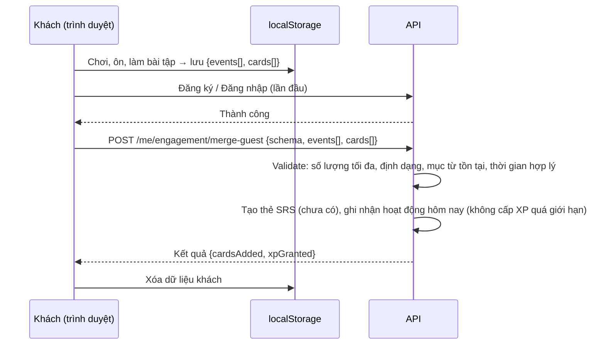

# Module 8 – Engagement (ôn tập thông minh, thói quen học, học thử)

> **Trạng thái: ĐÃ CHỐT ngày 2026-11-22** theo [CR-002](../../change-requests/CR-002-competitive-insights.md), **phương án 2** (toàn bộ tầng A trong MVP). Riêng hướng hình ảnh "Bàn học" (Q-CR2-03) chưa được xác nhận riêng, tạm theo đề xuất (gradient + vector tự thiết kế).

> Engagement là module làm cho người học **quay lại mỗi ngày** và **nhớ được những gì đã học**. Ba trang đối thủ đều có ba thứ này: ôn từ theo lịch, vòng thói quen (streak + nhiệm vụ nhỏ), và cho thử ngay không cần đăng nhập.

## 1. Mục tiêu & phạm vi
| Trong phạm vi | Ngoài phạm vi (để sau) |
|---|---|
| **A3** Flashcard + lặp lại ngắt quãng (SRS) cho từ vựng | FSRS nâng cao, tối ưu tham số theo từng người (V2) |
| **A2** Streak, XP, 3 nhiệm vụ mỗi ngày | Kim cương, cửa hàng, huy hiệu, bảng xếp hạng (V2/V3) |
| **A5** Mini-game "Nối từ nhanh" | "Artikel Blitz", game chạy (1.1) |
| **A4** Phiên khách và **gộp dữ liệu khách vào tài khoản** | Đấu trường realtime (V3) |
| Thẻ "Cụm từ mỗi ngày" (B2, 1.1) | Thông báo nhắc học qua email/push (V2) |

Nguồn: CR-002 mục A2–A5, B2. Quy tắc liên quan: BR-PROG, BR-LEX, BR-PRIV.

## 2. Kiến thức bạn sẽ học
| Khái niệm | Giải thích | Trong module |
|---|---|---|
| **Spaced repetition** | Nhớ lâu hơn khi ôn đúng lúc sắp quên. Thẻ làm đúng thì khoảng cách ôn lần sau tăng dần (1 ngày, 3 ngày, 7 ngày…), làm sai thì quay về ngắn | SM-2 giản lược |
| **Thuật toán là hàm thuần** | Đầu vào (trạng thái thẻ + chất lượng câu trả lời + ngày) → đầu ra (trạng thái mới + ngày ôn kế). Không đụng DB nên test được hoàn toàn bằng unit test | `SrsScheduler` |
| **Truy vấn "đến hạn"** | "Thẻ nào hôm nay cần ôn?" là truy vấn trọng yếu, cần index đúng cột | `(user_id, due_at)` |
| **Ngày theo múi giờ** | "Hôm nay" của người Việt là 00:00–23:59 giờ Việt Nam, không phải UTC. Sai múi giờ là nguồn bug streak kinh điển | `LearningDay` |
| **Idempotency của sự kiện** | Cùng một lần ôn thẻ gửi 2 lần (mạng chập chờn) không được cộng XP hai lần | Khóa duy nhất theo `client_event_id` |
| **Offline-first nhẹ** | Khách chơi và ôn khi chưa đăng nhập: dữ liệu ở `localStorage`, đồng bộ khi có tài khoản | `guestStore.ts` |
| **Gộp dữ liệu (merge)** | Khi khách đăng ký, gộp tiến độ tạm với tài khoản mới mà không mất và không nhân đôi | `MergeGuestData` |
| **Chống tin client** | XP và streak chỉ lấy từ sự kiện server ghi nhận. Dữ liệu từ khách chỉ được **kiểm tra hợp lý** rồi nhận một phần | Validation khi gộp |

## 3. Mô hình miền

### 3.1 Thẻ SRS
`SrsCard`: `(UserId, EntryId)` là khóa chính, thẻ gắn với **mục từ Lexicon**.
| Thuộc tính | Ý nghĩa |
|---|---|
| `State` | `New` · `Learning` · `Review` · `Lapsed` |
| `EaseFactor` | Độ "dễ" của thẻ với người này (mặc định 2,5, tối thiểu 1,3) |
| `IntervalDays` | Khoảng cách ôn hiện tại |
| `Repetitions` | Số lần trả lời đúng liên tiếp |
| `DueAt` | Thời điểm cần ôn |
| `LastReviewedAt`, `Lapses`, `TotalReviews` | Thống kê |
| `IsSuspended` | Người học tạm dừng thẻ (ví dụ đã thuộc chắc) |

**Hướng thẻ:** thẻ có **mặt trước** và **mặt sau** theo loại ôn. MVP có 2 kiểu hỏi, chọn ngẫu nhiên hoặc theo cấu hình:
1. **Nhận biết**: thấy từ Đức (kèm audio) → chọn/nhớ nghĩa tiếng Việt.
2. **Mạo từ**: thấy danh từ không có mạo từ → chọn der/die/das (chỉ với danh từ).

Cả hai kiểu dùng chung **một** thẻ (một lịch ôn cho một mục từ).

### 3.2 Thuật toán SM-2 giản lược (`SrsScheduler`, hàm thuần)
Người học tự đánh giá sau khi lật thẻ, hoặc hệ thống tự chấm với dạng chọn đáp án:

| Mức | Ý nghĩa | Với thẻ chọn đáp án |
|---|---|---|
| Again (0) | Quên | Chọn sai |
| Hard (3) | Nhớ khó khăn | — |
| Good (4) | Nhớ | Chọn đúng |
| Easy (5) | Quá dễ | Chọn đúng nhanh (< 3 giây) và liên tiếp ≥ 3 lần |

```
nếu mức < 3 (Again):
    Repetitions = 0; IntervalDays = 0 (ôn lại sau 10 phút trong cùng phiên, rồi 1 ngày)
    Lapses++; EaseFactor = max(1.3, EaseFactor - 0.2); State = Lapsed
ngược lại:
    Repetitions++
    nếu Repetitions == 1: IntervalDays = 1
    nếu Repetitions == 2: IntervalDays = 3
    ngược lại:            IntervalDays = round(IntervalDays * EaseFactor)
    EaseFactor += (0.1 - (5 - mức) * (0.08 + (5 - mức) * 0.02)), kẹp trong [1.3, 3.0]
    nếu Hard: IntervalDays = max(1, round(IntervalDays * 0.8)) (ôn sớm hơn một chút)
    nếu Easy: IntervalDays = round(IntervalDays * 1.3)
DueAt = 00:00 (giờ VN) của ngày (hôm nay + IntervalDays)
```
- **Vì sao SM-2 mà không phải FSRS?** SM-2 đơn giản, được mô tả công khai, dễ viết test. FSRS cho kết quả tốt hơn nhưng cần tham số huấn luyện và phải xác minh giấy phép (Phase 1: 🟡). Hàm thuần nằm sau interface `ISrsScheduler`, nên thay bằng FSRS ở V2 không ảnh hưởng chỗ khác.
- Các con số trên là **điểm xuất phát**, sẽ chỉnh theo dữ liệu thực.

### 3.3 Ngày học, streak, nhiệm vụ, XP
- **`LearningDay`** = ngày theo múi giờ `Asia/Ho_Chi_Minh` (BR-ENG-01).
- **`DailyActivity`**: `(UserId, Day)` → `XpEarned`, `CardsReviewed`, `ExercisesDone`, `LessonsCompleted`, `ScenesPlayed`, `GoalsCompleted`. Cập nhật khi nhận sự kiện hợp lệ.
- **Streak** = số ngày liên tiếp có **ít nhất 1 hoạt động học có ý nghĩa** (BR-ENG-02: ôn ≥ 5 thẻ, hoặc làm ≥ 1 bộ bài tập, hoặc hoàn thành 1 bài, hoặc 1 nhiệm vụ ngày). Đăng nhập suông không tính.
- **Nhiệm vụ ngày** (3 nhiệm vụ nhỏ, chọn theo trình độ và thói quen, BR-ENG-03):

  | Loại | Ví dụ | Đạt khi |
  |---|---|---|
  | Ôn từ | Ôn 10 thẻ | `CardsReviewed ≥ 10` |
  | Luyện tập | Làm 1 bộ bài tập đạt ≥ 60% | `ExercisesDone ≥ 1` |
  | Nghe | Nghe 1 hội thoại hoặc 5 từ có audio | `ScenesPlayed ≥ 1` hoặc `AudioPlays ≥ 5` |

- **XP** (BR-ENG-04): 1 XP/thẻ đúng, 5 XP/bài tập đạt, 10 XP/bài hoàn thành, 15 XP khi hoàn thành cả 3 nhiệm vụ ngày. XP dùng để hiển thị **cấp độ** (Lv 1…). **Không** đổi XP ra bất kỳ thứ gì ở MVP.
- **Đóng băng streak (streak freeze)**: để V2.

### 3.4 Phiên khách (guest) và gộp dữ liệu

- **Giới hạn** (chống lạm dụng): tối đa 200 thẻ và 500 sự kiện mỗi lần gộp. XP từ dữ liệu khách **tối đa 50** (BR-ENG-06).
- **Idempotent:** mỗi sự kiện có `clientEventId`. Gộp lại cùng gói không nhân đôi.
- Tài khoản đã có sẵn dữ liệu: thẻ đã tồn tại thì **giữ bản của tài khoản**. Chỉ thêm thẻ chưa có.
- Khách chỉ lưu những gì **dễ khôi phục**. Không lưu thông tin cá nhân nào (BR-PRIV-01).

### 3.5 Cụm từ mỗi ngày (B2, Release 1.1)
`DailyPhrase` (🧾 ContentMeta): `TextDe`, `TextVi`, `Kind` (Sprichwort / Redewendung), `AudioMediaId`, `CefrLevel`. Hệ thống chọn một câu cho mỗi ngày bằng `hash(ngày) mod N`, nên mọi người thấy cùng một câu trong ngày. Nút "tờ tiếp theo" cho xem câu khác. Nội dung: khoảng 100 tục ngữ/cụm từ Đức thông dụng, **bản dịch do ta viết**, ⚖️ nguồn cần xác minh (tục ngữ dân gian không có bản quyền, nhưng một bộ sưu tập có thể có).

## 4. Chức năng chi tiết

### 4.1 Ôn thẻ (SRS)
**Thêm thẻ vào lịch ôn:**
- Tự động khi người học **mở một bài có khối từ vựng**: các từ trong bài được thêm thành thẻ `New` (BR-ENG-05).
- Người học có thể bấm ☆ trên một mục từ để thêm thủ công.
- Mỗi ngày chỉ giới thiệu tối đa **20 thẻ mới** (cấu hình) để không bị quá tải.

**Một phiên ôn (`GET /me/srs/session`):**
1. Server chọn thẻ: ưu tiên thẻ `Lapsed` và `Review` đến hạn (`DueAt ≤ now`), sau đó thẻ `New`, tối đa 20 thẻ mỗi phiên.
2. Trả về từng thẻ với dữ liệu đã resolve từ Lexicon (từ, mạo từ, nghĩa, audio, ví dụ).
3. Với mỗi thẻ: `POST /me/srs/answers {entryId, grade, clientEventId, responseMs}`. Server tính `SrsScheduler`, cập nhật thẻ, ghi `DailyActivity` và `answer_events` (nguồn `Srs`), và trả về `DueAt` mới.
4. Hết phiên: tổng kết (số thẻ, tỷ lệ nhớ, XP, tiến độ nhiệm vụ).

**Giao diện thẻ:** mặt trước (từ + nút nghe), bấm lật, 4 nút Again/Hard/Good/Easy kèm gợi ý "ôn lại sau X". Với kiểu **Mạo từ** thì 3 nút der/die/das (đúng thì Good, sai thì Again).

**Trạng thái "đã thuộc chắc":** thẻ có `IntervalDays ≥ 21` và `Repetitions ≥ 4` được tính là **đã thuộc**. Con số này hiển thị trong trang tiến độ.

### 4.2 Streak và nhiệm vụ
- `GET /me/engagement/today` trả về: streak hiện tại, ngày hôm nay đã đạt chưa, 3 nhiệm vụ với tiến độ (`2/10`), XP hôm nay, cấp độ.
- Khi một sự kiện mới được ghi (ôn thẻ, hoàn thành bài tập…), `EngagementService.Apply(event)` chạy trong cùng transaction để số liệu luôn khớp.
- **Streak bị đứt** khi một ngày trôi qua mà không có hoạt động hợp lệ. Hệ thống tính lười: không cần job, chỉ so ngày gần nhất có hoạt động với hôm nay khi người dùng mở app. Nhờ vậy không có thời điểm "job chạy lỡ".
- Người học thấy ngày hôm qua bị mất thì có thông điệp nhẹ nhàng, không trách móc: "Chuỗi ngày đã dừng ở 12 ngày. Bắt đầu lại hôm nay nhé!".

### 4.3 Mini-game "Nối từ nhanh" (A5)
- Hiển thị 4 từ Đức và 4 nghĩa, người học chạm để nối cặp. Có bộ đếm giờ ngắn (60 giây) và điểm.
- **Dùng lại component `MatchingQuestion`** của Assessment (chạm-chạm). Dữ liệu lấy từ bộ từ công khai (khoảng 50 từ A1 đánh dấu `IsPublicPractice`).
- **Khách chơi được ngay trên trang chủ** (Phase 3 file 05 landing sẽ thêm khung "Chơi thử ngay").
- Điểm và lượt chơi của khách chỉ lưu trên máy. Người đã đăng nhập thì ghi `answer_events` (nguồn `Game`), nhưng **không** cấp XP quá 5/ngày cho game (để không dạy người học "cày game" thay cho học thật, BR-ENG-04).

### 4.4 Hiển thị "Bàn học" (A1)
Màn hình chính của người đã đăng nhập, thay dashboard ở Phase 3 file 05 §3.3. Thành phần (wireframe ở §5):
1. Lời chào + cấp độ + XP.
2. **Thẻ Streak và 3 nhiệm vụ.**
3. Nút lớn **"Tiếp tục học"** (từ Progress).
4. Thẻ **"Ôn hôm nay: N thẻ"** (từ Engagement). Bấm là vào phiên ôn.
5. **Lưới lối vào**: Lộ trình · Từ vựng · Ngữ pháp · Hội thoại · Kiểm tra · Thông tin Ausbildung.
6. (1.1) Thẻ "Cụm từ mỗi ngày".

Với **khách** thì cũng là "Bàn học", chỉ khác: streak và XP lấy từ `localStorage`, có lời mời "Đăng nhập để giữ tiến độ trên mọi thiết bị".

## 5. Wireframe "Bàn học" (đề xuất)
```
┌──────────────────────────────┐
│ ADUO                  Lv 3 🔔│
│ Guten Morgen, Lan!           │
│ ┌──────────────────────────┐ │
│ │ 🔥 12 ngày   ⭐ 45 XP     │ │
│ │ Hôm nay:  ✓ ✓ ○          │ │
│ │ ☑ Ôn 10 thẻ       10/10  │ │
│ │ ☑ Làm 1 bài tập    1/1   │ │
│ │ ☐ Nghe 1 hội thoại 0/1   │ │
│ └──────────────────────────┘ │
│ [ ▶ Tiếp tục: Bài 3.2     ]  │
│ [ ⟳ Ôn hôm nay · 14 thẻ   ]  │
│  Lộ trình  Từ vựng  Ngữ pháp │
│  Hội thoại Kiểm tra  Thông tin│
│ ┌──────────────────────────┐ │
│ │ CỤM TỪ MỖI NGÀY (1.1)    │ │
│ └──────────────────────────┘ │
│ [Học][Từ vựng][Ôn tập][Thông tin][Tôi] │
└──────────────────────────────┘
```
Thanh điều hướng dưới (mobile) đề xuất **5 mục**: Học · Từ vựng · Ôn tập · Thông tin · Tôi (Phase 3 là 4 mục). "Kiểm tra" nằm trong "Học" và lưới lối vào.

## 6. Dữ liệu (schema `engagement`), xem thêm §12.5 cho các bảng bổ sung theo CR-003
| Bảng | Cột chính | Ràng buộc / Index |
|---|---|---|
| `srs_cards` | `user_id`, `entry_id` (FK → lexicon), `state`, `ease_factor` numeric(4,2), `interval_days` int, `repetitions` int, `due_at` timestamptz, `last_reviewed_at`, `lapses`, `total_reviews`, `is_suspended`, `created_at` | PK `(user_id, entry_id)`. **IX `(user_id, due_at)` WHERE NOT is_suspended**. CK `ease_factor ≥ 1.3` |
| `srs_review_log` | `id` bigint, `user_id`, `entry_id`, `grade` smallint, `response_ms`, `reviewed_at`, `client_event_id` uuid | **UQ `(user_id, client_event_id)`** (idempotent). IX `(user_id, reviewed_at)`. Append-only, dùng sau này để tối ưu thuật toán |
| `daily_activity` | `user_id`, `day` date, `xp_earned`, `cards_reviewed`, `exercises_done`, `lessons_completed`, `scenes_played`, `goals_completed` | PK `(user_id, day)` |
| `user_stats` | `user_id` PK, `total_xp`, `level`, `current_streak`, `longest_streak`, `last_active_day` date | Bản tổng hợp để đọc nhanh. Tính lại được từ `daily_activity` |
| `daily_quests` | `user_id`, `day`, `kind`, `target`, `progress`, `completed_at` | PK `(user_id, day, kind)` |
| `daily_phrases` 🧾 (1.1) | `id`, `text_de`, `text_vi`, `kind`, `audio_media_id`, `cefr_level` | Qua ContentOps lifecycle |

Ghi chú: cột `is_public_practice` được thêm vào `assessment.questions` và `lexicon.vocabulary_entries` / `grammar_points.is_public` (xem CR-002 §4.2).

## 7. API
| Method | Endpoint | Quyền | Mô tả |
|---|---|---|---|
| GET | `/me/engagement/today` | Auth | Streak, nhiệm vụ, XP, cấp độ |
| GET | `/me/srs/summary` | Auth | Số thẻ đến hạn, thẻ mới còn được học hôm nay, số thẻ đã thuộc |
| GET | `/me/srs/session?limit=20` | Auth | Bộ thẻ cho phiên ôn |
| POST | `/me/srs/answers` | Auth | `{entryId, grade, clientEventId, responseMs}` |
| POST | `/me/srs/cards` | Auth | Thêm thẻ thủ công `{entryId}` |
| PATCH | `/me/srs/cards/{entryId}` | Auth | Tạm dừng hoặc bỏ tạm dừng |
| POST | `/me/engagement/merge-guest` | Auth | Gộp dữ liệu khách |
| GET | `/public/practice/vocabulary-pairs?count=4` | Public | Cặp từ cho mini-game của khách (có đáp án, vì chỉ để thử) |
| GET | `/public/daily-phrase?date=` | Public | Cụm từ của ngày (1.1) |

## 8. Business rules mới (BR-ENG)
| ID | Quy tắc |
|---|---|
| BR-ENG-01 | "Ngày học" tính theo múi giờ `Asia/Ho_Chi_Minh` (00:00–23:59) |
| BR-ENG-02 | Streak chỉ tăng khi có hoạt động **có ý nghĩa**: ôn ≥ 5 thẻ, hoặc ≥ 1 bộ bài tập đạt ≥ 60%, hoặc ≥ 1 bài hoàn thành, hoặc hoàn thành ≥ 1 nhiệm vụ ngày. Chỉ đăng nhập không tính |
| BR-ENG-03 | Mỗi ngày có đúng 3 nhiệm vụ, chọn ra theo trình độ. Nhiệm vụ chỉ đo việc học thật |
| BR-ENG-04 | XP chỉ sinh từ sự kiện server đã xác nhận. XP từ mini-game tối đa 5/ngày. XP không đổi được ra giá trị nào ở MVP |
| BR-ENG-05 | Thẻ SRS được thêm tự động khi mở bài học có từ vựng. Tối đa 20 thẻ **mới** mỗi ngày |
| BR-ENG-06 | Dữ liệu khách khi gộp: tối đa 200 thẻ, 500 sự kiện, XP nhận tối đa 50. Gộp là idempotent |
| BR-ENG-07 | Mỗi lần trả lời thẻ có `clientEventId` duy nhất. Gửi lại cùng id không tính hai lần |
| BR-ENG-08 | Thẻ của từ đã bị Archive trong Lexicon bị loại khỏi phiên ôn (không xóa lịch sử) |
| BR-ENG-09 | Người dùng được xóa toàn bộ dữ liệu Engagement khi xóa tài khoản (`IUserDataEraser`) |

## 9. Test cases
| ID | Kịch bản | Kết quả mong đợi |
|---|---|---|
| EN-T01 | Thẻ mới, chọn Good | `Repetitions=1`, `IntervalDays=1` |
| EN-T02 | Good lần 2, lần 3 | Khoảng cách 3 ngày rồi `round(3 × EaseFactor)` |
| EN-T03 | Again khi đang ở khoảng cách 20 ngày | `Repetitions=0`, `Lapses+1`, `EaseFactor` giảm 0,2, không dưới 1,3 |
| EN-T04 | Easy 3 lần liên tiếp | Khoảng cách tăng nhanh hơn Good |
| EN-T05 | `EaseFactor` đạt đáy 1,3 rồi tiếp tục Again | Giữ 1,3 |
| EN-T06 | Hàm thuần: cùng đầu vào hai lần | Cùng đầu ra |
| EN-T07 | Gửi cùng `clientEventId` hai lần | Chỉ tính một lần, không cộng XP đôi |
| EN-T08 | Phiên ôn khi có 30 thẻ đến hạn | Trả tối đa 20, ưu tiên `Lapsed` |
| EN-T09 | Thẻ của từ đã Archive | Không xuất hiện trong phiên |
| EN-T10 | Hoạt động lúc 23:59 và lúc 00:01 giờ VN | Tính vào hai ngày khác nhau (dùng `FakeTimeProvider`) |
| EN-T11 | Ôn 4 thẻ rồi dừng | Streak **không** tăng (cần ≥ 5) |
| EN-T12 | Ôn 5 thẻ | Streak tăng 1 |
| EN-T13 | Bỏ một ngày rồi mở app | Streak về 0, thông điệp nhẹ nhàng, `longest_streak` được giữ |
| EN-T14 | Làm xong cả 3 nhiệm vụ | +15 XP một lần, không lặp |
| EN-T15 | Mini-game: chơi 10 ván | XP game tối đa 5 trong ngày |
| EN-T16 | Gộp dữ liệu khách hợp lệ | Thẻ được thêm, XP ≤ 50 |
| EN-T17 | Gộp gói chứa 1.000 sự kiện | 400/422 và không ghi gì |
| EN-T18 | Gộp cùng gói hai lần | Lần hai không thêm gì |
| EN-T19 | Gộp khi tài khoản đã có thẻ trùng | Giữ lịch của tài khoản |
| EN-T20 | Gộp với `entryId` không tồn tại | Bỏ qua mục đó, các mục khác vẫn được gộp |
| EN-T21 | `/public/practice/...` | Không chứa dữ liệu từ ngân hàng đề kiểm tra |
| EN-T22 | Xóa tài khoản | Mọi bảng Engagement của người đó bị xóa |

## 10. Các bước triển khai
1. Entity + migration (schema `engagement` mới). **Chỉ làm sau Progress.**
2. `SrsScheduler` (hàm thuần) + unit test EN-T01..06.
3. `LearningDay` + `EngagementService` (streak, nhiệm vụ, XP) + unit test EN-T10..15 với `FakeTimeProvider`.
4. API SRS + today + integration test EN-T07..09.
5. Gắn vào luồng mở bài học (thêm thẻ) và hoàn thành bài tập.
6. Gộp dữ liệu khách + test EN-T16..20.
7. Frontend: phiên ôn, thẻ lật, `StreakCard`, `QuestList`, mini-game, `guestStore.ts`, "Bàn học".
8. PWA (manifest, icon, service worker vỏ ứng dụng).
9. `IUserDataEraser` + EN-T22.
10. **Nội dung:** đánh dấu khoảng 50 từ A1 làm bộ chơi thử công khai.

## 11. Definition of Done
- [ ] EN-T01..22 pass. Độ phủ test của `SrsScheduler` và `EngagementService` ≥ 90%.
- [ ] Ôn một phiên 20 thẻ trên điện thoại thật, thấy lịch kế tiếp hợp lý.
- [ ] Khách chơi mini-game, đăng ký, rồi thấy dữ liệu được gộp đúng.
- [ ] Cài PWA lên điện thoại và mở được từ màn hình chính.

## 12. [ĐÃ CHỐT – CR-003, phương án 2] Cá nhân hóa và chế độ học từ

> Đã chốt ngày 2026-11-22. Nguồn: [CR-003 tầng A](../../change-requests/CR-003-personalization-from-brottin.md). Bổ sung cho các mục 3–9 ở trên.

### 12.1 Chế độ học từ (A1)
Phiên ôn có **7 lựa chọn** (6 chế độ + "Trộn"), cùng dùng **một thẻ SRS và một lịch ôn** cho mỗi từ (không có lịch riêng cho từng chế độ):
| Chế độ | Cách hoạt động | Cách chấm vào SRS |
|---|---|---|
| **Lặp lại** | Thẻ đầy đủ, 4 nút Again/Hard/Good/Easy | Trực tiếp theo nút |
| **Flashcard** | Mặt trước: từ + mạo từ có màu + audio. Bấm lật xem nghĩa, tự đánh giá | 4 nút |
| **Trắc nghiệm** | Hiện nghĩa tiếng Việt, chọn từ Đức (1 trong 4) | Đúng = Good, sai = Again |
| **Trắc nghiệm đảo** | Hiện từ Đức, chọn nghĩa tiếng Việt | Như trên |
| **Đoán** | Hiện nghĩa và ví dụ, người học **gõ từ Đức**. Có gợi ý chữ cái (Tab), "Không biết" (Space) | Đúng không gợi ý = Good (nhanh thì Easy), có gợi ý = Hard, sai hoặc Không biết = Again |
| **Artikel** | Hiện danh từ không mạo từ, chọn der/die/das (chỉ danh từ) | Đúng = Good, sai = Again |
| **Trộn** (mặc định) | Xen kẽ các chế độ theo từng thẻ | Theo chế độ của thẻ đó |

- Đáp án gây nhiễu lấy từ các từ **cùng chủ đề** và **cùng loại từ** (danh từ với danh từ). Đáp án sai không được là đồng nghĩa của đáp án đúng.
- **Dùng lại component** `SingleChoiceQuestion`, `FillBlankQuestion` của Assessment, không viết lại.
- **Phím tắt (A5):** `Tab` gợi ý, `Space` không biết, `Enter` kiểm tra hoặc tiếp, `1–4` chọn đáp án (desktop). Có thể tắt.
- Khi hết thẻ: trạng thái rỗng thân thiện, "Bạn đã ôn hết rồi! Hôm nay không còn thẻ nào đến hạn."

### 12.2 Thiết lập cá nhân hóa (A3, BR-ENG-11)
Bảng `engagement.user_preferences`:
| Thiết lập | Mặc định | Giới hạn |
|---|---|---|
| `daily_xp_goal` | 50 | 20–500 |
| `new_cards_per_day` | 20 | 5–50 |
| `daily_minutes` | 10 | 5, 10, 15, 20 (hỏi ở onboarding) |
| `grading_strictness` | `Normal` | `Easy`, `Normal`, `Hard` |
| `default_study_mode` | `Mixed` | một trong các chế độ ở 12.1 |
| `meaning_language` | `vi` | MVP chỉ `vi` (tiếng Anh để V2) |

**Độ nghiêm khi chấm** áp dụng cho **chế độ Đoán và FillBlank ở luyện tập**. **Không** áp dụng cho bài kiểm tra có giờ (BR-EXAM giữ nguyên):
- **Easy:** chấp nhận `ae/oe/ue/ss` thay ä/ö/ü/ß, bỏ qua hoa/thường ở các câu cho phép, bỏ khoảng trắng thừa, **cho phép sai 1 ký tự** với từ từ 6 ký tự trở lên (hiện "Gần đúng, đáp án là …" và tính là Hard).
- **Normal:** theo cấu hình từng câu.
- **Hard:** đúng từng ký tự, phân biệt hoa/thường.

### 12.3 Lưu từ và Từ của tôi (A4)
- **Lưu từ:** nút trên mọi thẻ từ, thêm vào danh sách riêng (`saved_entries`) và tự tạo thẻ SRS nếu chưa có. Bỏ lưu **không** xóa thẻ SRS.
- **Từ của tôi:** người học **tự nhập** từ riêng (`user_words`): từ Đức, mạo từ (tùy chọn), nghĩa tiếng Việt, ví dụ (tùy chọn). Dữ liệu **chỉ hiển thị cho chính họ**. Tạo thẻ SRS **riêng** (`user_word_id`), không lẫn với Lexicon.
- **MVP không có AI** ở đây (C1, V2). Giới hạn 500 từ mỗi người, mỗi trường tối đa 200 ký tự. Văn bản được làm sạch, không nhận HTML.
- Từ tự nhập **không bao giờ** được đưa vào Lexicon chung hay hiển thị cho người khác (bảo vệ quyền riêng tư và chất lượng).

### 12.4 Thời gian học chủ động (A7)
`daily_activity.active_seconds` cộng dồn thời gian giữa các thao tác trong phiên học, **bỏ qua khoảng nghỉ trên 60 giây** (để màn hình treo không bị tính). Client gửi kèm sự kiện, server **kẹp trần** 15 giây mỗi sự kiện. Chưa có giao diện thống kê ở MVP (B2, Release 1.1).

### 12.5 Dữ liệu và API
| Bảng | Cột chính |
|---|---|
| `engagement.user_preferences` (mới) | `user_id` PK + các thiết lập ở 12.2 |
| `engagement.saved_entries` (mới, **chuyển từ Lexicon**) | PK `(user_id, entry_id)`, `saved_at` |
| `engagement.user_words` (mới) | `id`, `user_id`, `text_de`, `article` null, `meaning_vi`, `example_de` null, `example_vi` null, `created_at`. IX `(user_id)`, CK độ dài |
| `engagement.srs_cards` (sửa) | PK đổi thành `id` uuid. Thêm `user_word_id` null. CK: **đúng một** trong `entry_id` hoặc `user_word_id` khác null. UQ `(user_id, entry_id)` và UQ `(user_id, user_word_id)` (partial) |
| `engagement.daily_activity` (sửa) | thêm `active_seconds` int |

| Method | Endpoint | Mô tả |
|---|---|---|
| GET, PUT | `/me/preferences` | Đọc và lưu thiết lập (kiểm tra giới hạn BR-ENG-11) |
| POST, DELETE | `/me/saved-entries`, `/me/saved-entries/{entryId}` | Lưu và bỏ lưu từ |
| GET, POST, PATCH, DELETE | `/me/user-words`, `/me/user-words/{id}` | Từ của tôi |
| GET | `/me/srs/session?mode=Mixed&limit=20` | Thêm tham số `mode` |

### 12.6 Business rules mới
| ID | Quy tắc |
|---|---|
| BR-ENG-10 *(Release 1.1)* | **Tạm nghỉ chuỗi:** mỗi tuần (T2 đến CN, giờ VN) hệ thống tự bảo vệ tối đa 1 ngày bị lỡ, không cần hành động |
| BR-ENG-11 | Thiết lập cá nhân hóa phải nằm trong giới hạn ở 12.2, ngoài giới hạn thì trả 400 |
| BR-ENG-12 | Các chế độ học cùng cập nhật **một** thẻ SRS. Một lần trả lời chỉ tính **một** sự kiện |
| BR-ENG-13 | "Từ của tôi" thuộc về một người dùng, không bao giờ hiển thị hay thống kê chung, và bị xóa khi xóa tài khoản |

### 12.7 Test bổ sung
| ID | Kịch bản | Kết quả mong đợi |
|---|---|---|
| EN-T23 | Chế độ Trắc nghiệm trả lời đúng | Thẻ SRS cập nhật như Good, một sự kiện |
| EN-T24 | Chế độ Đoán, dùng gợi ý rồi đúng | Tính Hard |
| EN-T25 | Distractor của danh từ | Toàn danh từ cùng chủ đề, không có đồng nghĩa của đáp án |
| EN-T26 | Strictness Easy, gõ "strasse" cho "Straße" | Đúng |
| EN-T27 | Strictness Easy, sai 1 ký tự ở từ 8 ký tự | "Gần đúng", tính Hard |
| EN-T28 | Strictness Easy trong bài kiểm tra có giờ | **Không** áp dụng |
| EN-T29 | `PUT /me/preferences` với `new_cards_per_day=200` | 400 |
| EN-T30 | Lưu từ rồi bỏ lưu | Thẻ SRS vẫn còn |
| EN-T31 | Tạo "Từ của tôi" thứ 501 | 422 `USER_WORD_LIMIT` |
| EN-T32 | "Từ của tôi" chứa `<script>` | Bị làm sạch |
| EN-T33 | Hai người dùng cùng thêm một từ tự nhập | Hai bản ghi tách biệt, không thấy nhau |
| EN-T34 | Nghỉ 90 giây giữa hai thao tác | Chỉ cộng tối đa 15 giây vào `active_seconds` |
| EN-T35 | Xóa tài khoản | `user_words`, `saved_entries`, `user_preferences` bị xóa |

### 12.8 Cập nhật các bước triển khai và Definition of Done
- Thêm vào §10: **bước 4b** triển khai `user_preferences` và chế độ học; **bước 4c** `saved_entries` và `user_words`; **bước 7b** phím tắt và trạng thái rỗng.
- Thêm vào §11: [ ] 6 chế độ học đều hoạt động và cùng cập nhật một thẻ SRS. [ ] Đổi độ nghiêm khi chấm thấy khác biệt ở chế độ Đoán, không ảnh hưởng bài kiểm tra. [ ] EN-T01..35 pass.
